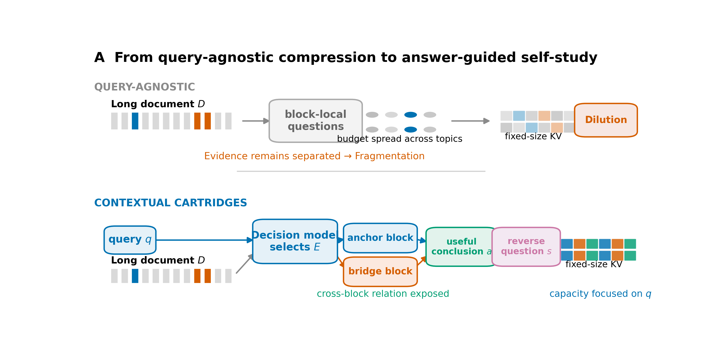
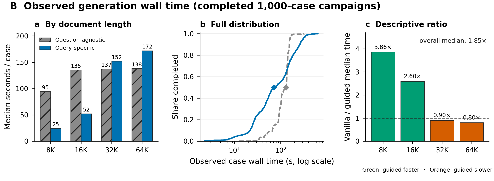
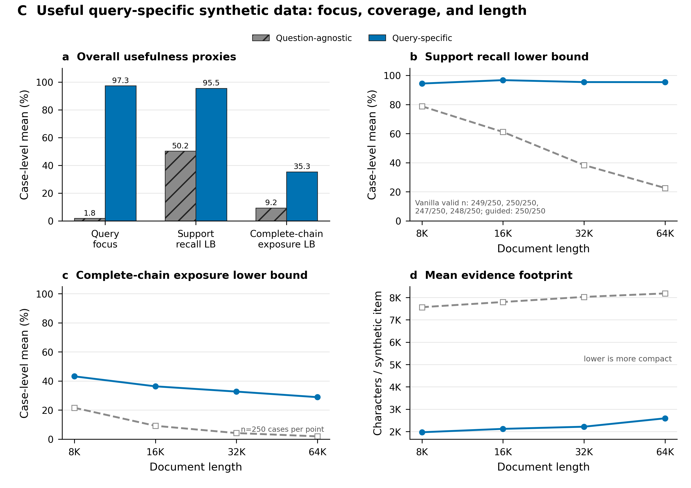

# Contextual Cartridges: Query-Guided Test-Time Learning with Selective Self-Distillation

> **当前冻结版本。** 本文档描述正在执行的原生 KV 方法：**Answer-Guided Query-Specific Dataset Crafting** 与 **TracIn-Selective Self-Distillation**。基础模型、Attention 公式与原版 Cartridges 的 `TrainableCache` 均不修改；只优化请求内 Cartridge 的原生 Keys 和 Values。此前的矩阵偏置、分母偏置、bilevel evidence selection、counterfactual resampling、REINFORCE、grounded-veto-only 与 held-out checkpoint envelope 均不属于本版本。

## 摘要

给定长文档 $D$ 和已经到来的真实问题 $q$，Contextual Cartridges 在回答前先为这道题进行一次请求内自学。第一项技术先用轻量 Decision Model 从文档中选择与 $q$ 有关的单块或互补块组 $E_i$，再从 $(q,E_i)$ 提炼一个有用结论 $a_i$，最后由答案反推练习题 $s_i$，从而构造查询特定的训练集 $\mathcal S_q=\{(s_i,a_i,E_i)\}$。第二项技术保留原版 Cartridges 的 Teacher–Student 软分布蒸馏，但不再让每条 Teacher 轨迹获得相同训练权重：它通过两处学习检查点上的原生 KV 梯度计算 signed TracIn influence，只在第二阶段巩固正影响轨迹，并在没有正影响信号时精确回退到已经训练好的 Vanilla-SD Cartridge。最终推理丢弃原文、合成数据与临时梯度，只保留 $Z_q^*=(K_q^*,V_q^*)$ 回答真实问题。

## 1. 是什么：从通用文档记忆到查询特定记忆

### 1.1 原版 Cartridges

设冻结语言模型为 $p_\theta$，长文档为 $D=(C_1,\ldots,C_N)$，Cartridge 为固定长度的原生 KV 记忆

$$
Z=(K_{\mathrm{cart}},V_{\mathrm{cart}}).
$$

原版 Cartridges 先从文档生成合成对话，再让同一个冻结模型分饰 Teacher 与 Student。对于合成问题 $s_i$ 和 Teacher 回答轨迹 $y_i$，Teacher 读取相应原文材料 $X_i$，Student 不读取原文、只挂载 Cartridge。两者在相同回答前缀 $y_{i,<t}$ 上产生分布

$$
p_T^{i,t}=p_\theta(\cdot\mid X_i,s_i,y_{i,<t}),\qquad
p_S^{i,t}=p_{\theta,Z}(\cdot\mid s_i,y_{i,<t}),
$$

并以稀疏 Teacher 分布的上下文蒸馏损失更新 $Z$：

$$
\mathcal L_i(Z)=\frac{1}{|y_i|}\sum_t
D_{\mathrm{KL}}\!\left(\operatorname{sg}[p_T^{i,t}]\,\Vert\,p_S^{i,t}\right).
$$

模型参数 $\theta$ 始终冻结，只有 $K_{\mathrm{cart}},V_{\mathrm{cart}}$ 接收梯度。训练后释放文档，用 $(Z,q)$ 独立回答问题。

### 1.2 Contextual Cartridges

原版设置通常假设未来问题未知，因此学习的是通用文档记忆。Contextual Cartridges 研究另一种明确场景：真实问题 $q$ 已经到来，我们可以把本次有限的合成预算和 KV 容量专门用于 $q$。方法仅改变两件事：

1. **学什么：**用 Answer-Guided Query-Specific Dataset Crafting 构造 $P(s\mid D,q)$，而不是通用的 $P(s\mid D)$。
2. **巩固什么：**用 TracIn-Selective SD 保留对当前 KV 学习动态具有正向局部影响的 Teacher 轨迹，而不是在全部更新阶段无条件等权模仿。

整体映射为

$$
\boxed{
(D,q)
\xrightarrow{\text{Answer-Guided Crafting}}
\mathcal S_q
\xrightarrow{\text{TracIn-Selective SD}}
Z_q^*=(K_q^*,V_q^*)
\xrightarrow{q}
\hat a.}
$$

## 2. 为什么：三个问题与两个技术

| 原版风险 | 含义 | 对应技术 | 可检验结果 |
| --- | --- | --- | --- |
| **Dilution** | 通用问题把有限训练步数和 KV 容量分散到与当前 $q$ 无关的主题 | Answer-Guided Query-Specific Dataset | 查询聚焦度、相关证据曝光率、最终答题增益 |
| **Fragmentation** | 独立块问题可以覆盖局部事实，却未必训练 $q$ 所需的跨块联系 | Answer-Guided 的互补块组与“答案 $\rightarrow$ 问题”生成 | 多块证据比例、完整支持链曝光率、跨事实题结果 |
| **Oracle Trap** | Vanilla SD 对所有 Teacher 轨迹等权学习，可能把有害更新与有用更新一同写入 KV | TracIn-Selective SD | Selective 相对 Vanilla 的 paired fixes/regressions，以及严格 Teacher-wrong cohort |

这三个问题不是同一件事。前两个决定训练数据是否围绕当前问题组织；Oracle Trap 决定固定数据上的监督轨迹是否都值得继续巩固。因此两项技术必须在 $2\times2$ 因子实验中分别验证，不能用一项技术的结果替代另一项。



**图 1｜从通用压缩到“有用问题”驱动的自学。** 上方表示通用、逐块出题的风险：有限预算被分散到很多主题，互补事实仍彼此割裂；下方表示本方法的核心路径：真实问题 $q$ 先决定材料 $E$，材料先产生对 $q$ 有用的答案或中间结论 $a$，再由 $a$ 反推出必须使用这些材料才能回答的练习题 $s$。因此本方法的目标不是机械增加题量，而是提高每条 synthetic data 对当前请求的用途。[SVG](datasets/babilong_synthetic_qwen3_4b/answer_guided_v3_figures/figure1_fragmentation_dilution_mechanism.svg) · [PDF](datasets/babilong_synthetic_qwen3_4b/answer_guided_v3_figures/figure1_fragmentation_dilution_mechanism.pdf)

## 3. Technique 1：Answer-Guided Query-Specific Dataset Crafting

### 3.1 What：先定材料与结论，再反推问题

该模块为每个真实请求生成带来源的三元组

$$
\mathcal S_q=\{(s_i,a_i,E_i)\}_{i=1}^{M},\qquad E_i\subseteq D.
$$

$E_i$ 是一组保持原文位置的证据块，$a_i$ 是该组材料对解决真实问题有用的具体答案或中间结论，$s_i$ 是围绕 $a_i$ 反推的闭卷练习题。$a_i$ 只负责约束“应该出什么题”，不是 benchmark 答案，也不作为 Student 的 hard-label NLL 目标。

### 3.2 Why：直接针对 Dilution 与 Fragmentation

如果先对每个块盲目出题，生成器不知道当前请求真正需要什么，容易产生大量主题正确但与 $q$ 无关的问题；这会稀释训练预算。如果每道题只由一个块独立产生，即便所有块都被访问，也不等于必要的跨块关系进入了训练目标。Answer-Guided Crafting 先要求材料提供一个对 $q$ 有用的结论，再围绕该结论出题：无用材料自然无法产生合格结论，互补材料共同产生的结论则自然对应跨块问题。

### 3.3 How：两次生成调用的三步过程

#### Step 1：选择材料 $E_i$

轻量 Decision Model 读取真实问题与候选块，缓存每块的保留概率和决策。当前 1,000-case v3 数据使用已有 Decision-API 分数，并保留查询词命中与桥接召回作为 recall safeguard；它不是用 benchmark 答案检索。系统首先保留查询锚点，再组合单块与互补块，得到有限集合 $\mathcal E_q$：

$$
\mathcal E_q=\operatorname{Select}(D,q),\qquad |\mathcal E_q|\ll N.
$$

这一步的设计原则是高召回：好的候选尽量保留，明显无关材料尽量不送入昂贵的大模型生成。Decision Model 的判断仍然可能出错，因此完整来源、分数与选择原因都写入 JSON。

#### Step 2：答案优先

冻结的 Qwen3-4B 读取 $(q,E_i)$，提炼 $E_i$ 能为解决 $q$ 提供的具体结论：

$$
a_i\sim P_\theta(a\mid q,E_i).
$$

生成器同时返回逐字可定位的来源引用。若材料不能给出与 $q$ 有关的事实、条件或中间结论，该候选不进入数据集。这里的“引用存在”是可追溯性检查，不等价于完整语义正确性证明。

#### Step 3：答案反推问题

给定 $(q,E_i,a_i)$，同一冻结生成器构造一道闭卷问题

$$
s_i\sim P_\theta(s\mid q,E_i,a_i),
$$

使得不读取 $E_i$ 时不能从题面直接抄出 $a_i$，而读取 $E_i$ 后可回答为 $a_i$。实现只执行“提炼答案”和“反推问题”两次主要生成调用，不使用六类目标清单、反复规划或多轮修复。确定性的格式检查会拒绝非问题、字面答案泄漏、来源指代题和明显答案类型错配；它们是接口检查，不是额外的语义 Oracle。

因此联合生成分布可写为

$$
P(E,a,s\mid D,q)
=P(E\mid D,q)P_\theta(a\mid q,E)P_\theta(s\mid q,E,a).
$$

### 3.4 为什么这一构造有机会缓解两个问题

- **对 Dilution：**只有能为真实问题提供具体结论的材料才消费练习题与 SD 预算，因此有限 KV 不必平均记忆全文所有主题。
- **对 Fragmentation：**当 $a_i$ 依赖多个互补块时，$s_i$ 围绕联合结论生成，训练目标显式暴露这些块的联系，而不是事后把若干单块题简单拼接。
- **对成本：**大模型只在小模型筛出的有限材料组上运行。完整 1,000-case 观察中，单题 wall time 中位数由 131.5 秒降至 71.1 秒，即 1.85× 的描述性总体中位数比；但 32K/64K 的 query-specific marker 包含共享 batch 等待，且两次 campaign 的并发和后端调度不同，因此不能把它解释成所有长度都严格受控加速。



**图 2｜两次完整 1,000-case campaign 的观察生成时间。** 8K/16K 的 query-specific 单题中位数分别快 3.86×/2.60×，总体中位数快 1.85×；32K/64K 则受本次共享批处理等待影响更慢。图中保留全部结果和负向长度，不做最大值挑选，也不把不同调度条件下的描述性比值写成严格 causal speedup。[源数据](datasets/babilong_synthetic_qwen3_4b/answer_guided_v3_figures/source_data_speed_per_case.csv) · [SVG](datasets/babilong_synthetic_qwen3_4b/answer_guided_v3_figures/figure2_generation_speed.svg) · [PDF](datasets/babilong_synthetic_qwen3_4b/answer_guided_v3_figures/figure2_generation_speed.pdf)

### 3.5 当前数据事实

发布的 v3 JSON 覆盖 BABILong 的 1,000 个请求、10 个任务类型，以及 8K/16K/32K/64K 四个长度各 250 题，共包含 28,671 个三元组（21,207 train，7,464 validation）。生成过程不读取 benchmark 答案。

在固定前缀的 1,000-case 数据审计中，新的 query-specific 数据相对 vanilla 合成数据表现为：

| 数据代理指标 | Vanilla synthetic | Query-specific v3 | 它测量什么 |
| --- | ---: | ---: | --- |
| 问题包含真实查询词的 case 均值 | 1.80% | 97.33% | 查询聚焦代理；不是语义正确率 |
| 支持事实召回下界 | 50.25% | 95.48% | 至少暴露所需支持事实的下界 |
| 完整支持链同上下文曝光下界 | 9.24% | 35.29% | Fragmentation 的证据曝光代理 |
| 单条 synthetic item 的平均证据字符数 | 7.89K | 2.22K | 更小的材料足迹；不是信息充分性的单独证明 |
| 多块证据比例 | 不适用 | 45.13% | 多块材料曝光；不证明每题必须联合推理 |

这些结果支持“数据更聚焦、支持链曝光更充分”，但不单独证明最终 Cartridge 准确率更高；下游结论必须由相同 SD 配置下的答题结果给出。



**图 3｜“有用 synthetic dataset”的可审计证据。** 左上是整体查询聚焦、支持事实召回下界和完整支持链曝光下界；其余面板把 coverage 与证据材料长度按 8K/16K/32K/64K 分解。Vanilla 的支持召回下界由 8K 的 78.77% 降至 64K 的 22.56%，Query-specific 在四档保持 94.40%–96.73%；同时其平均材料足迹显著更小。六个 Vanilla support-recall 标注缺失，按缺失保留而非计作零。这些量衡量 synthetic data 是否对当前 $q$ 聚焦、是否看见必要材料，仍不是最终答案正确率。[源数据](datasets/babilong_synthetic_qwen3_4b/answer_guided_v3_figures/source_data_quality_per_case.csv) · [SVG](datasets/babilong_synthetic_qwen3_4b/answer_guided_v3_figures/figure3_quality_coverage_length.svg) · [PDF](datasets/babilong_synthetic_qwen3_4b/answer_guided_v3_figures/figure3_quality_coverage_length.pdf)

## 4. Technique 2：TracIn-Selective Self-Distillation

### 4.1 What：根据学习动态选择要继续巩固的 Teacher 轨迹

Vanilla SD 对固定数据中的每条 Teacher 轨迹都最小化 $\mathcal L_i(Z)$。Selective SD 不改写 Teacher 回答、不引入 hard label，也不使用 benchmark gold；它估计每条候选轨迹对普通 SD 学习方向的 signed influence，只把正影响轨迹用于训练后半程的选择性巩固。

当前实现首先采用高召回的来源支持门得到候选集合 $\mathcal A$：来源明确反驳、回答截断或明确没有作答的轨迹不进入候选；不确定样本仍保留。TracIn 再决定这些候选中哪些进入选择性阶段。来源门与 TracIn 都属于同一 Selective-SD 模块，而不是第三个方法贡献。

### 4.2 Why：Oracle Trap 是监督使用问题，不是数学上界

Teacher 的单次答题准确率不是 Student 的理论上限，但 Vanilla SD 对所有轨迹等权学习时，没有显式区分“与整体学习目标一致的更新”和“会把当前 KV 推向相反方向的更新”。Oracle Trap 在这里指这种无条件模仿机制，而不是声称 Student 必然不能超过 Teacher。

我们不再问“Teacher 是否被另一个不可得的 Oracle 判为正确”，而是问一个无需验证标签的问题：**沿着这条轨迹更新原生 KV，是否与同一固定数据上普通 SD 的总体学习方向一致？** 这把选择依据从模型口头自评改成了实际学习动态。

### 4.3 How：两检查点 signed TracIn

令普通 SD 的全部训练轨迹为 $\mathcal R$，参考目标为

$$
\mathcal L_{\mathrm{ref}}(Z)=\frac{1}{|\mathcal R|}\sum_{j\in\mathcal R}\mathcal L_j(Z).
$$

我们在两个冻结检查点上计算梯度：初始 Cartridge $Z_0$ 与完成 Vanilla SD 后的 Cartridge $Z_{\mathrm{van}}$。对候选轨迹 $i$ 和检查点 $c$，定义

$$
g_{i,c}=\nabla_Z\mathcal L_i(Z_c),\qquad
g_{\mathrm{ref}\setminus i,c}=\nabla_Z\mathcal L_{\mathrm{ref}\setminus i}(Z_c).
$$

当候选本身属于参考集合时使用 leave-one-out 参考梯度，避免 $g_i^\top g_i$ 让每条样本天然得到正分。只对 Cartridge 的原生 $K,V$ 求导，Backbone 不参与优化。轨迹的 signed TracIn 分数为

$$
\boxed{
I_i=\sum_{c\in\{Z_0,Z_{\mathrm{van}}\}}
\eta_c\,g_{\mathrm{ref}\setminus i,c}^{\top}g_{i,c}.}
$$

冻结阈值为 $\tau=0$：

$$
m_i=\mathbf 1[I_i>0].
$$

$I_i>0$ 表示在一阶局部近似下，该轨迹的下降方向与参考目标的下降方向一致；$I_i\le0$ 表示它是 opponent 或没有正向证据，因此不进入选择性巩固。余弦相似度只用于解释方向，实际筛选使用包含梯度幅度与学习率的 signed dot product。

### 4.4 两阶段更新与不伤害设计

为了避免一开始就删除困难但必要的知识，Selective SD 不是从零只训练筛选后的子集。总更新预算与 Vanilla SD 对齐，并分成两个阶段：

$$
Z^{(h)}=\operatorname{SD}(Z_0;\mathcal R, h),
$$

$$
Z_q^*=\operatorname{SD}\!\left(Z^{(h)};
\{i\in\mathcal A:I_i>0\},T-h\right).
$$

第一阶段对所有普通 SD 轨迹学习，保留原版 Cartridges 的基础吸收能力；第二阶段只重复正影响轨迹，减少有害轨迹在后期被继续强化。若没有任何正影响候选，系统直接复用已经训练好的 $Z_{\mathrm{van}}$，不会停止更新、返回初始化或再运行一遍不同随机顺序的 Vanilla SD。

这一设计实现的是“**局部参考目标上的正向筛选 + 无信号时精确不退化**”。它不能从无标签梯度中创造事实真值，也不能数学保证最终自由生成答案零退化；曲率、多步优化和生成离散性都可能破坏一阶预测。因此论文必须同时报告 Selective 的 fixes 与 regressions，而不能只报告平均分。

### 4.5 为什么它有机会越过 Oracle Trap

最终 Student 并不是把 Teacher 的最终答案作为文本提示，也没有被约束为复制 Teacher 的离散预测；它学习的是多个问题、多个 token 位置上的软分布，并在共享 KV 中聚合这些更新。Selective SD 进一步删除与总体学习方向冲突的轨迹，因此允许出现

$$
\text{Teacher wrong}\quad\land\quad
\text{initial KV wrong}\quad\land\quad
\text{Selective Cartridge correct}.
$$

严格 Oracle-escape 证据必须在这个 cohort 中统计 Selective 相对 Vanilla 的新增修复和新增退化。只有净修复为正，才能支持“越过无条件 Teacher 模仿”的实证主张；TracIn 分数本身不是该主张的证明。

## 5. 完整训练与推理流程

给定 $(D,q)$，执行顺序如下：

1. **切分与快速决策：**保留每个块的原文位置，用轻量 Decision Model 与 recall safeguard 得到单块和互补块组 $E_i$。
2. **以答定题：**冻结生成器从 $(q,E_i)$ 提炼结论 $a_i$，再从 $(q,E_i,a_i)$ 反推闭卷练习题 $s_i$，保存 $(s_i,a_i,E_i)$ 及逐字来源。
3. **构造固定 Teacher 轨迹：**Teacher 读取题目绑定的真实来源材料，生成回答轨迹与逐 token sparse soft targets；Student 不读原文。
4. **训练 Vanilla Cartridge：**从同一 $Z_0$ 在全部固定轨迹上执行标准原生 KV SD，得到 $Z_{\mathrm{van}}$。
5. **计算 Selective mask：**在 $Z_0$ 与 $Z_{\mathrm{van}}$ 上计算 leave-one-out signed TracIn，保留 $I_i>0$ 的候选。
6. **训练 Selective Cartridge：**匹配 Vanilla 的更新预算，前半使用全部轨迹，后半只巩固正影响轨迹；空集合精确回退到 $Z_{\mathrm{van}}$。
7. **独立读取：**释放文档、Teacher cache、合成数据与梯度状态，只保留 $Z_q^*$，从头回答真实问题：

$$
\hat a\sim p_{\theta,Z_q^*}(a\mid q).
$$

整个流程不添加 $g$、$B$、LoRA 或额外推理参数，不修改 Attention 归一化，也不使用答案 NLL、强化学习、bilevel optimization 或 counterfactual resampling。

## 6. 两项技术如何被分别验证

固定同一初始 Cartridge、Teacher 实现和优化预算，运行四个因子臂：

| Synthetic dataset | SD rule | 实验臂 |
| --- | --- | --- |
| Question-agnostic | Vanilla SD | `vanilla_syns_vanilla_sd` |
| Question-agnostic | TracIn-Selective SD | `vanilla_syns_selective_sd` |
| Query-specific | Vanilla SD | `specific_syns_vanilla_sd` |
| Query-specific | TracIn-Selective SD | `specific_syns_selective_sd` |

由此得到三个无混淆对比：

- **Technique 1 的贡献：**`specific_syns_vanilla_sd − vanilla_syns_vanilla_sd`。
- **Technique 2 的贡献：**在两种固定数据上分别比较 `selective_sd − vanilla_sd`。
- **完整方法：**`specific_syns_selective_sd − vanilla_syns_vanilla_sd`。

开发实验冻结为 160 个 source-aware 配对 case；840 个 source-disjoint holdout 在开发门通过前保持关闭。benchmark 答案只在全部推理结束后的 report 阶段用于评分，不进入生成、选择或 KV 更新。最终报告必须包含总体准确率、按长度结果、paired fixes/regressions、Teacher-wrong/initial-wrong 严格 cohort、TracIn 保留率和运行成本。当前结果仍在计算，因此本文档不预填任何未完成准确率。

## 7. 代码、JSON 与复现入口

### 完整数据

- [发布清单](datasets/babilong_synthetic_qwen3_4b/answer_guided_v3_release.json)
- [1000-case 完成记录](datasets/babilong_synthetic_qwen3_4b/answer_guided_v3_progress.json)
- [生成配置](datasets/babilong_synthetic_qwen3_4b/answer_guided_v3_generation_config.json)
- [完整压缩 JSON release](https://github.com/XiangqiWang77/Masked-TTT/releases/tag/contextual-cartridges-answer-guided-v3-20261109)
- [Vanilla 与早期 matched query-specific 数据 release](https://github.com/XiangqiWang77/Masked-TTT/releases/tag/babilong-syn-qwen3-4b-1000-matched-32605413)
- [数据质量审计与图表](datasets/babilong_synthetic_qwen3_4b/comparison/README.md)
- [Answer-Guided v3 的三张主图、源 CSV 与绘图代码](datasets/babilong_synthetic_qwen3_4b/answer_guided_v3_figures/README.md)

### Technique 1 代码

- [`answer_guided_questions.py`](datasets/babilong_synthetic_qwen3_4b/sd_protocol/code/contextualized/answer_guided_questions.py)：答案提炼、来源引用与问题反推。
- [`decision_answer_evidence.py`](datasets/babilong_synthetic_qwen3_4b/sd_protocol/code/experiments/decision_answer_evidence.py)：缓存 Decision API、查询锚点与桥接 recall safeguard。
- [`run_answer_guided_remaining.py`](datasets/babilong_synthetic_qwen3_4b/sd_protocol/code/experiments/run_answer_guided_remaining.py)：1000-case 可恢复生成。
- [`audit_query_anchored_dataset.py`](datasets/babilong_synthetic_qwen3_4b/sd_protocol/code/experiments/audit_query_anchored_dataset.py)：Dilution/Fragmentation 数据代理审计。

### Technique 2 与四臂实验代码

- [`tracin_sd.py`](datasets/babilong_synthetic_qwen3_4b/sd_protocol/code/contextualized/tracin_sd.py)：原生 KV 梯度、leave-one-out TracIn 与严格正阈值。
- [`run_syn_sd_factorial.py`](datasets/babilong_synthetic_qwen3_4b/sd_protocol/code/experiments/run_syn_sd_factorial.py)：四臂训练、两阶段 consolidation 与精确 Vanilla fallback。
- [`early_study.py`](datasets/babilong_synthetic_qwen3_4b/sd_protocol/code/contextualized/early_study.py)：官方 Cartridges sparse Teacher KL 和数据打包。
- [`report_syn_sd_factorial.py`](datasets/babilong_synthetic_qwen3_4b/sd_protocol/code/experiments/report_syn_sd_factorial.py)：严格配对评分与 Oracle-escape 统计。
- [`plot_tracin_sd_factorial.py`](datasets/babilong_synthetic_qwen3_4b/sd_protocol/code/experiments/plot_tracin_sd_factorial.py)：只在完整结果上生成 PDF/SVG/PNG 与源数据表。
- [精确集群配置](datasets/babilong_synthetic_qwen3_4b/sd_protocol/configuration.cluster.json)与[可读协议配置](datasets/babilong_synthetic_qwen3_4b/sd_protocol/configuration.json)。

### 测试

```bash
CC_CODE=datasets/babilong_synthetic_qwen3_4b/sd_protocol/code
PYTHONPATH="$CC_CODE" pytest -q \
  datasets/babilong_synthetic_qwen3_4b/sd_protocol/code/tests/test_answer_guided_questions.py \
  datasets/babilong_synthetic_qwen3_4b/sd_protocol/code/tests/test_decision_answer_evidence.py \
  datasets/babilong_synthetic_qwen3_4b/sd_protocol/code/tests/test_tracin_selective_sd.py \
  datasets/babilong_synthetic_qwen3_4b/sd_protocol/code/tests/test_syn_sd_training_views.py \
  datasets/babilong_synthetic_qwen3_4b/sd_protocol/code/tests/test_syn_sd_report.py
```

代码快照依赖 Stanford Hazy Research 官方 Cartridges commit `ef34ba97a06049c34820506e2c283746284ae5f0`。发布目录是审查快照，不是包含模型权重和 BABILong 原始语料的独立安装包。

## 8. 主张—证据边界

| 主张 | 当前证据 | 状态 |
| --- | --- | --- |
| Query-specific v3 覆盖完整 1000-case BABILong | 完成清单：1000/1000，28,671 triples | **已支持** |
| Query-specific 数据比 vanilla 更聚焦 | 查询词命中 97.33% vs 1.80% | **支持数据代理，不等于答题增益** |
| Query-specific 数据更充分暴露支持链 | 支持召回下界与完整支持链曝光下界提高 | **支持数据代理，不等于跨块推理已学会** |
| TracIn 实现只保留正 signed influence | 单元测试、逐候选 audit JSON、阈值 $I_i>0$ | **实现已支持** |
| Selective SD 不使用 held-out/gold 做选择 | 冻结配置与代码审计 | **实现已支持** |
| Selective SD 的最终答题准确率高于 Vanilla SD | 完整四臂配对实验 | **等待结果** |
| 完整 Contextual Cartridges 越过 Oracle Trap | 严格 Teacher-wrong/initial-wrong cohort 中净修复为正 | **等待结果** |

## 9. 自审查

- **贡献是否只有两个？** 是：Answer-Guided Query-Specific Dataset Crafting 与 TracIn-Selective SD；原生 KV 蒸馏是沿用的训练基础。
- **术语是否稳定？** 是：`query-specific` 只描述数据分布，`Selective SD` 只描述 Teacher 轨迹的学习动态筛选。
- **是否把数据代理写成最终性能？** 否；查询聚焦、支持曝光和多块比例均明确标为代理。
- **是否声称 TracIn 等价于事实正确性？** 否；它是两检查点的一阶局部 influence proxy。
- **是否保证“不把原来答对的改错”？** 只保证无正信号时精确回退、以及第二阶段不巩固非正影响轨迹；最终 QA 是否零退化必须报告 paired regressions。
- **是否修改推理结构？** 否；最终仍只读取原生 $(K_q^*,V_q^*)$。
