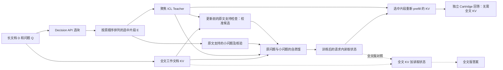

# Query Cartridges: Learning to Read Long Contexts with Masked Test-Time Training

> 本分支以 [OLMo 的原始 ICL 自蒸馏配置](docs/OLMO_ICL_SELF_DISTILLATION.zh-CN.md) 为准。下文还保留了历史对照与后续候选的说明；这些候选不属于本分支的训练路径。

## 一句话：让模型为当前问题学会如何读文档

给定一篇长文档和一个问题，Query Cartridges 先选出少量可能相关的片段，用这些片段构造一个聚焦的 ICL Teacher，并让同一个模型围绕原问题和少量原文支持的小问题进行自我学习。学习过程中，模型的基础权重保持冻结；我们只更新当前请求中、选中片段的 KV 读取状态。**最终答案由独立 Cartridge 生成：它只包含选中片段的 KV 和学到的读取状态，回答时不读取全文 KV。**

我们关心的首要目标是**回答质量**：让模型更有效地利用当前问题所需的证据。独立 Cartridge 同时提供一个可测的空间收益：在回答阶段，只保留一份较小的、针对当前问题构建的缓存状态。当前实现的训练阶段仍会暂时使用全文 KV；回答阶段的压缩与构造阶段的峰值显存分别计算。

## 1. Motivation：长文档有信息，模型还需要会使用信息

想象一份很长的项目档案，其中有三条信息：

> - X 项目原定预算为 300 万元。
> - X 项目最终批准预算为 320 万元。
> - Y 项目最终批准预算为 250 万元。

问题是：**X 项目的最终批准预算比 Y 项目多多少？**

要正确回答，模型必须找到两个项目，区分“原定”和“最终”，读出 320 与 250，再计算出 70 万元。假如这三条信息散落在数百页记录中，即使全文都放进上下文，模型仍然要从大量候选信息里定位、区分并组合它们。

长上下文研究已经观察到，改变相关信息在输入中的位置，会明显影响模型利用这些信息的效果；相关证据出现在上下文中，不等于它一定能被稳定使用。这个现象为我们的研究问题提供了背景，而具体任务中是否存在注意力分散，仍需通过实验判断。参见 [Lost in the Middle](https://aclanthology.org/2024.tacl-1.9/)。

这带来一个直观的张力：

- **阅读全文**保留全局视野，可以看到后来的修订、否定条件和选块时遗漏的证据。
- **聚焦相关片段**减少干扰，让问题和候选证据之间的关系更突出。

Query Cartridges 的思路是让两种视角在构造时互相配合：用聚焦阅读产生学习信号，用全文阅读训练读取状态；最终把该状态放进小型 Cartridge，用选中证据独立回答。选块如果遗漏必要证据，独立版回答时就无法再从全文补回，因此选择质量是方法的关键。

## 2. 目的：把“看过相关内容”变成“更会读取相关内容”

普通 ICL 把相关文本放在提示中，模型随后直接回答。我们进一步问：能否利用同一份相关文本，让模型在回答之前针对这个请求进行一次短暂的学习？

目标不是永久改变模型，也不是把原文复制进一份新的参数文件。我们希望得到的是一份**问题相关的小型内部记忆**：它包含选中证据的 KV，也包含模型为本次问题学到的读取状态，使模型能够调整对哪些片段分配注意力，以及从这些片段中读出什么表示。

这份状态与当前文档和问题绑定。请求结束后，状态及其优化器数据会被丢弃，基础模型保持原样。

## 3. Fundamental challenges：三件事必须同时做好

### 3.1 聚焦信号与证据覆盖如何兼得？

如果只让 Teacher 看完整文档，它也可能被无关内容干扰。如果只把选中的片段交给最终回答模型，漏选的条件就无法再被读取。

我们的分工是：选中的片段负责构造聚焦的学习信号和最终记忆；训练时的 Student 可读取完整工作文档，帮助适配状态学习全文与聚焦阅读之间的差异。独立 Cartridge 回答时只看选中内容，因此要优先提高关键事实、时间条件和跨段依赖的选择召回。全文版保留为对照。

### 3.2 怎样让学习与当前问题真正相关？

一种常见的测试时训练方式是预测原文的下一个词。它能提供密集的无标签信号，但原文续写和问题回答是不同的条件：把档案续写得更好，不一定就能更好地区分“X 的最终预算”和“Y 的最终预算”。

我们希望训练信号直接出现在问答过程中：围绕当前问题及其相关的小问题，比较模型在答案位置上的预测分布。这样，学习关注的是**怎样为了回答而读取**。

### 3.3 Teacher 可能有用，也可能出错，怎样使用它？

选中片段形成的 Teacher 能提供更集中的预测，但它也可能漏看条件或推理出错。因此，我们让 Teacher 提供可学习的分布信号，并从原文构造、核验少量小练习；质量校准候选还会在更新前检查 Teacher 信号。全文版对照可以另外比较适配前后的答案。

这两项检查都由冻结模型执行，不读取评测标准答案。它们提供额外的判断依据；最终效果仍以独立评测为准。

## 4. Source idea：Cartridges、自我学习与测试时适配

我们的灵感来自 [Cartridges: Lightweight and General-Purpose Long Context Representations via Self-Study](https://arxiv.org/abs/2506.06266)。这项工作探索将语料训练成较小的虚拟 KV 缓存，并让模型通过生成合成问答、进行上下文蒸馏来学习使用这份缓存。作者的实验表明，在其设置中，利用上下文蒸馏训练 Cartridge 比只对合成文本做下一词预测更有效。

我们借鉴的关键思想是：**文档不只是被保存；模型还可以通过围绕文档的问答练习，学习怎样调用文档信息。**

两者的使用场景有所不同。原始 Cartridges 侧重为一份语料离线构建可跨多个问题复用的虚拟缓存。Query Cartridges 则在收到具体问题后，依据问题选择片段并构造本次请求的独立记忆；全文 KV 加同一份读取状态作为对照。

| 比较 | 原始 Cartridges | Query Cartridges |
|---|---|---|
| 构造时机 | 针对语料离线训练 | 收到实际问题后进行测试时训练 |
| 面向的问题 | 构造时不知道具体问题，一份记忆服务多种查询 | 当前问题引导选块、小练习和适配 |
| 记忆本体 | 直接学习一组虚拟 Key、Value | 选中原文重新 prefill 的 KV，加问题相关读取修正 |
| Teacher 与 Student | Teacher 看相关子语料，Student 使用待训练的小型缓存 | Teacher 看选中片段，训练时的 Student 看完整工作文档；学到的状态随后映射到选中 KV |
| 生命周期 | 训练成本可由多个问题分摊 | 状态属于当前请求，回答后释放 |

两者共同追求好的回答质量和较小的回答阶段内存。原始工作也研究超过 ICL 的表现；我们的额外目标是让实际问题直接决定“为哪部分内容学习、生成什么练习、怎样读取”，而不是依赖问题尚未出现时构造的通用记忆。

我们还借鉴 [On-Policy Distillation](https://arxiv.org/abs/2306.13649) 的轨迹思想：让学生在**自己当前会生成的前缀**上得到 Teacher 反馈。这里使用的是 Teacher 到 Student 的**前向 KL**；“on-policy”描述前缀来自当前 Student，并不指定必须采用反向 KL。

## 5. 三个核心设计

1. **Chunk-Guided Selection：选什么来学习。** Decision API 根据问题给文档片段打分，选中片段同时决定 Teacher 的材料和 Student 可以更新的读取位置。
2. **Masked KV Adaptation：把学习写在哪里。** 保留模型参数和原始 KV，联合学习选中片段的注意力分配与 Value 读出修正，形成问题相关的读取状态。
3. **Self-Study with On-Policy Self-Distillation：怎样学习。** Teacher 在原问题及原文支持的小问题上，为 Student 自己生成的前缀提供下一词分布；所有练习共同更新同一份状态。

## 6. 从头到尾：这个方法怎样运行？

### 第一步：问题引导的片段选择

把文档 $D$ 划分为有序片段 $C_1,\ldots,C_N$，并令 $Q$ 表示用户问题。Decision API 判断每个片段是否为回答当前问题提供有用证据，包括相关事实、条件、否定、后续修订及跨段推理线索。

当前配置默认选择得分最高的约 10% 的片段，记选中集合为 $\mathcal I$。片段在 Teacher 输入中保持原文顺序。分数预先保存为 JSON 后，不同模型可以复用同一份选块结果；选块过程本身不生成评测答案。

对于前面的例子，理想的选块应当覆盖 X 的最终预算和 Y 的最终预算。如果 X 的原定预算能帮助区分“原定”和“最终”，它也可以被纳入。

### 第二步：建立两种阅读视角

同一个基础模型建立两条路径：

| 路径 | 可以读取的文档 | 作用 |
|---|---|---|
| ICL Teacher | 按原顺序重新组成的选中片段 | 提供聚焦预测和小练习 |
| 训练时 Student | 完整工作文档 | 学习聚焦监督与全文读取之间的差异 |

这里的“完整工作文档”是实际送入模型的文档。如果原始输入超过模型的原生上下文限制，系统会优先保留高分片段，构造可容纳的工作文档并记录映射；所有同模型对照使用相同工作输入。

Teacher 与 Student 使用同一组冻结模型权重。Teacher 额外生成一份聚焦回答，用于 ICL Teacher 对照；训练时，Teacher 也会根据 Student 当前生成的前缀给出概率分布。

### 可选：更新前检查 Teacher 信号

质量校准中，我们也测试在优化之前检查 Teacher 的答案。冻结模型先在选中片段中寻找相关原文，再在完整工作文档中核对该答案是否被具体事实矛盾。第一遍只向第二遍传递经原文逐字核验的引用，不传递第一遍的结论。只因判断不清而无法核实，并不自动认定 Teacher 错误。

这个检查只决定是否使用 Teacher 信号更新当前请求的读取状态，不改写 Teacher 答案，也不把检查过程放进最终回答提示。开发集先记录判断但仍执行更新，以便比较有无该检查；如果开发集选定这一策略，留出集才会在更新前实际应用。检查引用可以核实文字来自原文，不能单独证明模型对引用关系的理解正确。

### 第三步：为模型构造小练习

Teacher 阅读选中片段后，提出最多两个与原问题相关的事实性小问题，并为每题给出短答案和支持答案的原文引用。例如：

- 小问题：“X 项目的最终批准预算是多少？”
- 候选答案：“320 万元。”
- 支持引用：“X 项目最终批准预算为 320 万元。”

小问题的作用是让同一份临时状态接收多个相关查询的训练信号。例如，一个练习强调 X 的最终预算，另一个强调 Y 的最终预算；原问题仍然要求 Student 自己比较并计算。

当前实现会检查：引用必须逐字出现在选中块中；候选答案必须出现在引用中；随后冻结模型只看该引用独立回答小问题。基础版本要求独立回答与候选答案一致，核验通过的答案只用于筛选练习，不作为额外提示交给 Teacher 或 Student。Qwen 质量校准版允许从整句候选答案中提取经独立复答支持的短片段，并将该片段作为**仅提供给 Teacher 的小题提示**。检查不读取评测标准答案。

另一个候选为出题 Teacher 单独构造提示，只提供选中原文和真实问题，不沿用原任务的回答示例。生成后的问答仍须通过原文引用和独立复答检查，才能参与训练。截至 2026 年 11 月 3 日 18:36 UTC，该候选完成固定 200 题开发集中的 126 题；同缓存训练前后准确率均为 62.70%。

核验的目的是提高小练习与原文的一致性。逐字引用与模型复答是实用筛选，并非对逻辑蕴含的形式化证明；若没有练习通过，原问题路径仍然可以训练。

### 第四步：理解原始 KV Cache

Transformer 阅读文档时，每一层会为已读位置保存 Key 和 Value，合称 **KV Cache**：

- **Key** 参与决定当前词应当关注过去哪些位置。
- **Value** 提供这些位置被读取时传递给后续网络的内容。

简化地说，对于一个正在回答的读者位置 $t$，模型用当前 Query 与过去各位置的 Key 计算分数，再对对应的 Value 做加权求和。缓存减少了重复计算，也保存了每个文档位置的内部表示。

Student 首先用冻结模型正常 prefill 工作文档，得到原始缓存 $k_{u,0},v_{u,0}$。这份缓存不被优化器覆盖；我们在读取它时，临时叠加选中位置的修正。

### 第五步：构造 Masked KV 读取状态

令 $m_u=1$ 表示位置 $u$ 属于选中块，其他位置为 0。对某个适配层和注意力头，读取公式写为：

$$
z_{t,u}=\frac{q_t^\top k_{u,0}}{\sqrt{d_h}}+m_u g_{c(u)},\qquad
\alpha_{t,u}=\operatorname{softmax}_{u\le t}(z_{t,u}),
$$

$$
o_t=\sum_{u\le t}\alpha_{t,u}\bigl(v_{u,0}+m_u\Delta v_u\bigr).
$$

这条公式包含两个共同学习的旋钮：

1. **读取分配。** $g_c$ 是按块、层和 KV 头设置的可训练注意力分数修正。它可以提高或降低选中块相对于其他内容的读取份额。
2. **读取内容。** $\Delta v_u$ 是选中位置的 Value 读出修正。当前实现采用按块低秩形式，并限制修正幅度：

$$
\Delta v_u=\operatorname{clip}_{0.15\lVert v_{u,0}\rVert}
\left((v_{u,0}U_{\ell,h})B_{\ell,h,c(u)}\right).
$$

其中，$U_{\ell,h}$ 是由该层、该 KV 头的选中 Value 构造的固定低秩基；$B_{\ell,h,c}$ 是选中块的可训练系数。初始时 $g$ 与 $B$ 均为零，所以刚创建状态时的读出与基础路径一致。原始 Key、Value 和模型权重均不变。

注意，这里的“调整注意力”并不表示更新模型的 $W_Q$；“调整 Value 读出”也不表示更新 $W_V$。被训练的是请求内的读取状态。未选中文档位置和开头的 attention sink 不施加这些修正。

当前 Qwen3 路径适配其全注意力层；OLMo 与 GPT-OSS 的混合注意力路径只适配全注意力层，滑动窗口层继续使用原生行为。

### 第六步：通过 On-Policy Self-Distillation 联合更新

让 $q$ 表示原问题或一个通过核验的小问题。在某一步，Student 先从自己当前的读取状态生成一个短前缀 $\hat y_{<i}$。然后：

- 基础版 Teacher 读取选中片段 $E$、问题 $q$ 和这个前缀，给出下一词分布 $p_T$。
- Student 读取完整工作文档 $D$、相同问题 $q$ 和相同前缀，给出下一词分布 $p_S$。
- 用同一条前缀上 Teacher 到 Student 的前向 KL 更新两类读取状态。

$$
\mathcal L_{\mathrm{SD}}(\phi;q,\hat y)
=\frac{1}{|J|}\sum_{i\in J}
\mathrm{KL}\!\left(
p_T(\cdot\mid E,q,\hat y_{<i})\;\Vert\;
p_{S,\phi}(\cdot\mid D,q,\hat y_{<i})
\right).
$$

这是基础版的目标：小问题的答案不额外放进 Teacher 或 Student 的提示。原文锚定候选则在小问题 Teacher 端加入通过核验的答案提示，Student 仍看不到该提示。$J$ 是用于蒸馏的答案位置；在能识别选择题答案位置的情况下，当前实现可以聚焦该位置，否则使用可用前缀位置。模型参数不更新，但梯度会穿过模型计算并传给读取分配与 Value 修正。

每一步之后，Student 会使用更新后的状态重新生成短前缀；Teacher 再对这个新前缀提供分布。Teacher 的模型参数和选中片段缓存固定，概率分布会随 Student 前缀变化而重新计算。

原问题与通过核验的小问题轮流参与训练，**共享同一份 $\phi$**。基础版本安排两个基础更新，并为每个通过核验的小问题增加一次更新；质量校准版本安排四个基础更新，并同样按通过的小题数增加更新。更新次数在原问题与小问题之间轮流分配。识别出的选择题可根据答案位置 KL 继续进行有限步适配。优化使用 Adam，低秩基默认秩为 8。

### 第七步：构造独立 Cartridge 并回答

固定训练后的读取状态，丢弃训练时的问题和答案后缀，然后构造最终使用的独立记忆：

1. 使用 Teacher 已经独立 prefill 的选中片段 KV。
2. 将全文训练得到的对应块读取修正映射到这些选中位置。
3. 将选中 KV 与修正物化为可解码的独立 Cartridge。
4. 重新输入原问题，独立生成答案。

这条路径的回答阶段不读取原始全文 KV，也不借用全文 Self Judge 的结果。它包含的是真正的**选中片段 KV 加读取状态**，不是只有几个适配参数。

选中片段 KV 是在选中片段上下文中重新 prefill 的，因此它不等同于从全文 prefill 后直接裁剪对应 KV。独立版和全文版分别评测，才能看到聚焦阅读、全文覆盖与缓存大小之间的实际关系。

### 对照：全文 KV 加读取状态

作为对照，也可以用同一份训练后的读取状态重新处理原问题，同时保留完整工作文档 KV。该路径可以读取漏选内容，并在候选答案生成后使用全文 Self Judge 比较适配前后的答案。它与独立 Cartridge 的最终读取范围和回答选择过程不同，应分别报告。

### 第八步：请求结束后释放状态

正式答案生成后，临时读取状态、优化器状态和请求相关缓存都可以释放。基础模型权重没有被更新，也不需要将这次问题的适配带到下一请求。

### 当前实验配置

| 项目 | 当前配置 |
|---|---|
| 选块 | 已缓存的 Decision 分数，默认选择前 10% |
| Teacher 回答 | 选中片段与原问题，最多生成 32 个 token |
| 自我练习 | 最多 2 个；生成上限 192 token；通过原文引用和独立复答检查 |
| Student 前缀 | 每次更新前重新贪心生成，最多 8 个 token |
| 训练步数 | 2 个基础步，加每个通过核验的小问题 1 步；不同问题轮流参与，选择题可继续到最多 8 步 |
| 读取状态 | Value 低秩基的秩为 8；Value 残差范数最多为原 Value 的 15%；块分数修正限制在 $[-6,6]$ |
| 优化 | Adam；读取分配学习率 0.01，Value 系数学习率 0.0001 |
| 全文版对照判断 | 两个候选顺序均偏向适配答案；条件置信度至少 0.65，标签概率质量至少 0.20；独立版不使用全文判断 |

上表是基础版本。质量校准版本保留相同的骨干、缓存与训练目标，额外测试 10%、20%、30% 三种选块比例、四个基础更新步及上述回答选择策略；其中 10% 的开发配置还观察更新前 Teacher 检查是否有益。所有比例复用同一份 Decision JSON，开发集选出的配置固定后用于留出集。

### Qwen 的质量校准版

Qwen 的 BABILONG 校准版选择约 30% 的片段，使用最多 32 个 Student 前缀 token，并以 4 个基础步及最多 16 步的自适应预算联合更新读取状态。这些配置在 200 题开发集上确定，其余 800 题使用固定配置；30% 不是对所有模型和任务的通用最优值。

更新前，冻结模型先检查 Teacher 答案与选中原文是否一致，再在全文条件下比较 Teacher 与基础模型答案。判断不清时继续使用 Teacher 信号；通过原文引用和独立复答核验的小练习也可以参与更新。全文版的最终答案选择策略在开发集上确定；独立 Cartridge 不使用这项全文答案选择。逐题选块、判断和训练均不读取评测答案。

训练前缀覆盖到答案位置，才能在这些位置利用 Teacher 的分布。将前缀预算从 8 增至 32 个 token，使较晚出现的答案也有机会进入自蒸馏目标；相应的质量变化在下面的同题结果中报告。

## 7. 为什么它有希望带来更好的回答？

### 7.1 选择让学习信号更贴近问题

Decision API 不是告诉模型“哪一句一定正确”，而是给出一个更集中的候选证据集合。Teacher 在这个集合上形成的问题条件分布，可以突出当前问题需要区分的实体、数值、时间和条件。

### 7.2 小练习让一份状态服务于多个相关读取动作

对预算例子，模型可能先学习读取“X 的最终预算”和“Y 的最终预算”，再在原问题上组合两者。所有练习更新同一份状态，因此学习目标不是只复述 Teacher 对大题的一次回答，而是改善一组相关查询对文档的读取。

### 7.3 完整分布提供比单个答案更丰富的监督

假设 Teacher 在某个答案位置对两个候选 token 分别给出 $0.70$ 和 $0.25$。Student 接收的不只是“第一名是什么”，还接收两个候选之间的相对偏好，以及词表中其他候选的概率。这类非最高概率候选所携带的关系常被称为 **dark knowledge**。

这里的 dark knowledge 是 Teacher 的预测分布，不是额外的事实来源。若 Teacher 混淆证据，它的分布也可能有偏；小练习和全文判断提供了额外的检查路径。

### 7.4 On-Policy 反馈针对 Student 实际会走的路径

固定一份 Teacher 答案来训练，Student 自己生成时可能走到不同前缀。On-policy 训练让 Teacher 在 Student 当前实际产生的前缀上提供分布反馈。每次更新后刷新前缀，使监督持续对应 Student 当下的生成状态。

### 7.5 全文训练与独立回答分别承担不同作用

Teacher 的角色是提供聚焦信号；训练时的全文 Student 还能读取 Teacher 未看到的工作文档内容。两者的输入条件和计算路径不同，再加上多个小练习共同更新读取状态，映射到选中 KV 后的独立 Cartridge 可以产生与 Teacher 不同的答案。

因此，独立 Cartridge 超过 Teacher 是一个有明确机制的**实验目标**：它需要选块、蒸馏和读取状态迁移协同有效，并不由蒸馏公式自动保证。回答阶段只剩选中 KV；如果必要事实没有进入这些 KV，全文训练并不自动把缺失事实补进 Cartridge。当前优化使用一阶 Adam；重复更新会改变内部读取状态，但不应把它描述为已经计算了二阶 Hessian。

## 8. 为什么使用 SD，而不是只预测原文？

原文 NTP 和自蒸馏都可以作为测试时训练信号。原文 NTP 的目标是提高上下文词序列的预测能力；本方法的 SD 在原问题和相关小问题的答案位置，直接对齐 Teacher 与 Student 的下一词分布。

两者最重要的区别是**训练条件**：SD 的问题、答案前缀和候选词分布与最终问答更接近；同时，完整分布保留了 Teacher 对多个候选的相对判断。原文 NTP 则可能通过学习文档结构和事实对问答有帮助，其收益应通过对照衡量。

[Cartridges](https://arxiv.org/html/2506.06266) 报告过其合成对话设置下上下文蒸馏优于相应 NTP 目标；这为选择 SD 提供了研究动机。我们的方法、训练位置和评测条件不同，仍需要在自己的相同预算对照中测量收益。

## 9. 为什么把更新放在 KV 读取状态？

KV Cache 本来就是模型访问文档时使用的内部接口。按选中块调整注意力分配和 Value 读出，可以让更新直接对应“哪些位置被读取”和“这些位置传递什么表示”。

这种状态是请求局部的：模型的全局权重和原始文档缓存保持不变，不同请求可以分别构造自己的状态。它也让同一份学习结果具有两种用法：附加到全文读取，或映射到选中片段的独立缓存。

例如，[qTTT](https://arxiv.org/abs/2512.13898) 研究通过测试时更新 Query 投影来改善长上下文使用。Query 投影更新与这里的选中 KV 读取修正是不同的参数化：前者改变 Query 的生成方式，后者改变选中位置的读取分配和内容表示。哪种方式在质量和资源开销上更合适，需要在同题实验中比较。

## 10. 如何衡量空间收益？

全文 KV 大小随工作文档长度、层数、KV 头数、头维度和数据精度变化。Query Cartridge 的独立版则包括选中片段 KV、物化后的读取修正，以及需要保留的索引和适配状态。

报告分别统计：

| 项目 | 代表什么 |
|---|---|
| 全文原始 KV | 基础模型保存完整工作文档的缓存 |
| 全文读取状态 | 附加在全文 KV 上的可训练参数、固定基及索引 |
| 独立 Cartridge | 选中片段的物化 KV 与读取状态之和 |
| 运行峰值显存 | 模型、缓存、训练过程与临时张量共同占用的峰值 |

独立 Cartridge 的空间比较针对**回答阶段需要保留的文档状态**。当前构建过程仍然会使用全文 KV 来训练全文 Student，所以构建时的峰值显存需要单独报告，不能直接由选块比例推算。

在上述 BABILONG 基础配置的 1000 题中，独立 Cartridge 与全文文档 KV 的逐题大小比值中位数，Qwen3-4B 为 **14.43%**，OLMo-3-7B 为 **29.11%**。比值包括独立版的物化 KV 和读取状态，不包含模型权重、训练临时张量或生成后缀 KV；这里报告的是逐题比值的中位数。

## 11. 实验怎样验证这个故事？

对于同一批问题，统一比较五种回答：

1. **Vanilla：**基础模型读取工作文档直接回答。
2. **qTTT：**使用 Query 投影的测试时训练对照。
3. **ICL Teacher：**基础模型读取选中片段直接回答。
4. **全文 KV＋Query Cartridge：**全文 Student 经过自学习和自蒸馏后回答。
5. **独立 Query Cartridge：**只用选中片段 KV 与读取状态回答。

质量报告比较同题准确率，并统计相对 Teacher 和 Vanilla 的新增答对、新增答错。内存报告比较全文 KV、全文附加状态、独立 Cartridge 与实际运行峰值。BABILONG 使用任务感知的宽松词面判分规则，所有方法保持一致。

当前报告聚焦 Qwen3-4B、OLMo-3-7B 和 GPT-OSS-20B 的 BABILONG 配对实验。独立 Cartridge、全文版与 Teacher 应使用同题结果比较；历史不同配置的数值不直接当作本版本结果。

当前评分优先提取明确的最终答案或最后的答案句，再按题型处理大小写、数量词和无序列表。旧版全文包含匹配会把推理中偶然出现的标准答案判对；本次在 Qwen 校准版发现 3 例此类误判，已对所有方法统一重算。新规则仍是自动词面近似，不是 LLM 语义判分。另行核对时发现，[BABILONG 官方评分器](https://github.com/booydar/babilong/blob/main/babilong/metrics.py)在 qa7 中会把 `none` 同时匹配成 `none` 和 `one`；我们保留用户要求的宽松评分，并可报告官方分数作参照。

截至 2026 年 11 月 3 日 18:36 UTC，BABILONG 同题结果如下。准确率使用统一的最终答案优先、任务感知宽松词面判分 v2；GPT-OSS 仍在收集完整结果。Qwen 基础配置和校准版的选块与训练设置不同，分别列出。

| 模型与配置 | 题数 | Vanilla | qTTT | ICL Teacher | 工作文档 KV＋读取状态 | 独立 Cartridge | 独立版比 Teacher |
|---|---:|---:|---:|---:|---:|---:|---:|
| Qwen3-4B 基础配置 | 1000 | 54.20% | 54.40% | 56.60% | 54.50% | **56.70%** | +0.10 个百分点 |
| Qwen3-4B 校准版 | 1000 | 54.50% | 54.40% | 60.60% | 58.30% | **60.20%** | -0.40 个百分点 |
| OLMo-3-7B | 1000 | 36.10% | 36.00% | 41.20% | 36.10% | **44.60%** | +3.40 个百分点 |
| GPT-OSS-20B | 995 / 1000 | 48.94% | 待完成 | 57.09% | 48.94% | 55.58% | -1.51 个百分点 |

指定的历史跨配置表也可以使用 Qwen 基础配置的 ICL Teacher 56.60% 对比校准版独立 Cartridge 60.20%，差值为 +3.60 个百分点。前者选择约 10% 的片段，后者选择约 30%；这不是同选块 Teacher 的蒸馏增益。校准版实际使用的 Teacher 是上表的 60.60%。

OLMo 的独立版相对 Teacher 新答对 58 题、新答错 24 题；其中 838 题保留完整原文，162 题因模型窗口限制先压缩为工作文档。同一题的对照使用相同工作文档。

qTTT 是独立实现的原文 NTP 对照，而非官方代码复现。Qwen 与 OLMo 各 1000 题的运行记录已核验：每题记录 32 步、每步 128 个原文 token，并更新完整 Query 投影；GPT-OSS 的对应路径已通过预检。

此前 Qwen 的全文 KV＋Selective SD 版本在 999 道同题上达到 60.86%，比其 ICL Teacher 的 57.66% 高 3.20 个百分点。用当前同一套 loose 判分重算后数值一致。历史版本包含不更新时沿用 Vanilla 的选择路径，与上面的独立 Cartridge 是不同配置。

将这 999 道题与独立 Query Cartridge 基础配置配对比较，独立版为 56.76%，历史全文版为 60.86%，相差 **4.10 个百分点**；历史全文版有 145 题新答对、104 题新答错。两组使用不同的选块、训练配置和回答时的 KV，因此这衡量的是两个完整配置的差异；此处的独立版是我们自己的 Query Cartridge，并非原论文 Cartridges 的复现。

Qwen 的另一个校准版使用约 30% 选块、较长 Student 前缀和更多 SD 更新。其固定配置在 800 道留出题上的独立 Cartridge 准确率为 59.13%，高于基础配置同题的 57.13%；校准版 Teacher 为 59.38%。合并开发集与留出集后，1000 题分别为 60.20% 和 60.60%。选块与训练设置同时变化，这个比较衡量的是整个配置的变化。

这组实验中的 Teacher 使用了额外的回答格式指令，独立版使用原问题后缀。为了单独测量 TTT 的贡献，我们完成了 OLMo 的 1000 题对照：比较**同一份选中 KV、同一个回答提示和同一模型设备下，零更新与完成更新的独立 Cartridge**。零更新为 44.30%，TTT 后为 44.50%，新答对 5 题、新答错 3 题。该配对试验重新运行了两组回答；其 Teacher 为 41.00%，零更新相对 Teacher 新答对 58 题、新答错 25 题。因 Teacher 与零更新路径的回答指令不同，这一差距不应全部归因于 SD。

主问题 Teacher 只接收选中原文、原问题及回答格式要求，不接收评测标准答案；原任务提示中的示例对两条路径均可见。当前 Teacher 额外收到“按要求只给最终答案，不加解释”的指令，生成上限为 32 token；独立 Query Cartridge 使用原问题后缀，上限为 1024 token。在 18:03 UTC 的 Qwen、OLMo 和 GPT-OSS 配对样本中，独立版输出超过 32 token 的题分别为 15、8 和 0。上述长度统计本身不能证明格式差异造成了准确率差距。

为分开测量提示和更新的影响，GPT-OSS 的固定 200 题开发集对照已排队。它在同一选中 KV 上交叉比较两种后缀（原任务后缀与 Teacher 格式后缀）和两种状态（零更新与训练后）；四次生成共享模型、设备和输出预算。Teacher 的原始 32-token 输出单独保留作参考。对照复用已保存的 Decision 结果，不向 Student 提供 Teacher 答案或评测答案。

在上述 995 题快照中，GPT-OSS 的 qa10 恰好包含完整 100 题：Teacher 答对 50 题，独立 Cartridge 答对 41 题。Teacher 对、Cartridge 错的 11 题中，Cartridge 有 10 题输出 `maybe`；反向新答对 2 题。`maybe` 本身也是该题型的有效答案，这个现象尚不能区分提示差异和适配更新的影响，需由已排队的同缓存对照检验。

另一个 Qwen 开发集试验直接在最终的选中 KV 上继续自学习，已完成 200 题。同一缓存上的自学习前后准确率均为 64.50%，本次 ICL Teacher 为 66.00%；原问题输出有 1 题变化，准确性没有变化。其中 54 次练习更新被接受，固定练习前缀的 KL 中位相对降幅为 28.90%。该试验未达到进入留出集的规则；规则在观察 52 题、开发集完成前确定。使用干净出题提示的下一候选正在运行。练习 KL 的变化和最终答题质量应分别衡量。

## 12. 最值得带走的三个 insight

1. **选块同时决定学习信号与最终保留的证据。** 聚焦的 Teacher 提供问题相关监督，选中片段构成独立 Cartridge 的内容。
2. **TTT 改变的是后续如何读取，而不仅是提示里增加了哪些文字。** 原问题和小练习共同塑造一份请求内状态，再用这份状态重新生成答案。
3. **独立 Cartridge 把训练后的读取状态与选中 KV 一起交给回答过程。** 全文 KV 加读取状态保留为证据覆盖对照；两者的准确率与内存由配对实验比较。

## 附：方法核对与证据映射

| 核对问题 | 当前回答 |
|---|---|
| 核心贡献是什么？ | 问题引导选块、选中 KV 的请求内适配、基于小练习和 Student 前缀的自蒸馏。 |
| 术语是否清楚？ | 主方法是选中片段 KV 加读取状态的独立 Cartridge；全文版是工作文档 KV 加相同读取状态的对照。 |
| 什么证据支持动机？ | Lost in the Middle 提供位置敏感性的背景；Cartridges 提供合成问答与上下文蒸馏的先例；本版本收益由正在进行的配对实验测量。 |
| 如何完整评估？ | 三个模型的 BABILONG，比较同题准确率、新增答对／答错和缓存大小，并增加同缓存零更新对照。 |
| 设计是否与实现一致？ | 训练时使用全文 KV；独立回答时只用重新 prefill 的选中 KV 与读取状态。模型权重和原始 KV 冻结；使用 Student 前缀和前向 KL；回答前清除训练后缀。 |
