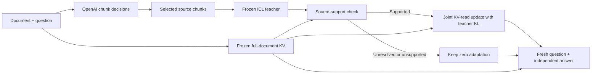

# Masked TTT via Selective Self-Distillation

**Learn from focused evidence. Answer with the full working document.**

A standalone implementation of chunk-guided, request-local KV adaptation for
long-context question answering. A frozen model builds an ICL teacher from
selected source chunks. Source-supported teacher distributions then train the
student's attention allocation and value readout. The student answers anew with
its full working-document cache.

[完整中文方法说明](docs/METHOD.zh-CN.md) · [Main algorithm](src/masked_ttt/pipeline.py)
· [Implementation notes](docs/IMPLEMENTATION.md)



## Method

1. Split the original document into chunks using its actual prompt-token positions.
   OpenAI Decisions scores relevance to the original question. Keep the top 10%
   as the supervision source, preserving document order.
2. Prefill the complete working document with the frozen backbone. Its original
   keys and values remain immutable throughout adaptation.
3. Build a fresh selected-context input for the same frozen model. Generate one
   teacher response and retain the full next-token distributions along that response.
4. Check the candidate against source excerpts and the original task. Supported
   signals receive up to 16 joint update steps; unresolved or unsupported signals
   receive zero steps. The check does not rewrite the teacher.
5. Minimize standard forward KL on teacher answer positions. The student sees the
   full working document and the same preceding answer tokens. Only selected-chunk
   read biases and value-map coefficients are optimized.
6. Freeze the final state, discard every training/checking suffix, recompute the
   original question, and generate an independent answer. Discard the adapters afterward.

For a selected document position, the effective attention is

$$
z_{t,u}=q_t^\top k_{u,0}/\sqrt{d_h}+m_u g_{c(u)},\qquad
o_t=\sum_u\operatorname{softmax}(z_t)_u
\left[v_{u,0}+m_u\operatorname{clip}_{\rho\lVert v_{u,0}\rVert}
\left((v_{u,0}U)B_{c(u)}\right)\right].
$$

The backbone projections stay frozen. The basis $U$ is fixed from the selected
source values; $g$ and $B$ are the request's trainable state. Query/answer suffix
positions receive no document-chunk bias or value correction.

## Install and run

Python 3.10+, a matching CUDA/PyTorch installation, and a full-attention Qwen3 model
are required for the production path. The extraction was checked with PyTorch
2.9.1 and Transformers 4.57.6. The included small-model tests run on CPU.

```bash
pip install -e '.[test]'
pip install 'flash-attn>=2.7,<3' --no-build-isolation
```

Supply an OpenAI API credential through `OPENAI_API_KEY`, `OPENAI_API_KEY_FILE`,
or a private key file. For a key file, restrict its permissions with `chmod 600`.
The credential is never included in returned diagnostics or cached responses.

```bash
masked-ttt \
  --model /path/to/Qwen3-4B-Instruct-2507 \
  --local-files-only \
  --request examples/request.json \
  --api-key-file /path/to/private/openai.key \
  --output outputs/answer.json
```

The request accepts `document`, `question`, an optional original `prompt`, an
optional `answer_prefix`, and `max_new_tokens`. Supply the original prompt when
the task has specific answer formatting or multiple-choice instructions.

```python
from masked_ttt import Backbone, MaskedTTT, Request, TTTConfig

backbone = Backbone.load("/path/to/Qwen3-4B-Instruct-2507", TTTConfig())
method = MaskedTTT(backbone)
result = method.answer(Request(document=document, question=question))
print(result["prediction"])
```

## Defaults

| Component | Default |
|---|---|
| Chunk size / selection | Up to 256 tokens / top 10% by Decisions relevance |
| Teacher | Same frozen backbone, selected source only, one greedy generation |
| Student context | Full working document |
| Adapted layers | Every attention layer: layers 0–35 for Qwen3-4B |
| Read-allocation state | One bounded scalar per selected chunk, layer, and KV head |
| Value state | Per-chunk rank-8 coefficients; fixed source-derived basis |
| Initialization | Zero read bias and zero value coefficients |
| Value residual bound | 15% of the original value-vector norm |
| Objective | Mean full-vocabulary $\mathrm{KL}(p_T\Vert p_S)$ on answer positions |
| Update | Joint Adam-preconditioned directions and a checked output-Fisher trust step |
| Supported / unresolved budget | 16 / 0 optimizer iterations |
| Final answer | Fresh original question suffix; final adapters fixed |

Documents beyond the model context limit use an explicit source-only overflow
adapter: API-ranked verbatim chunks are retained in original order. Such requests
set `selection.complete_original_document` to `false` and include a source map.
Within the context limit, all original chunks remain visible to the student.

## Read the code

| Entry | Responsibility |
|---|---|
| [`pipeline.py`](src/masked_ttt/pipeline.py) | Complete request lifecycle |
| [`selection.py`](src/masked_ttt/selection.py) | Decisions scoring, masks, overflow handling |
| [`teacher.py`](src/masked_ttt/teacher.py) | Fresh selected-context teacher and fixed soft targets |
| [`support.py`](src/masked_ttt/support.py) | Source verification and update admission |
| [`memory.py`](src/masked_ttt/memory.py) | Trainable read-allocation and value state |
| [`reader.py`](src/masked_ttt/reader.py) | Same causal KV reader for training and generation |
| [`optimizer.py`](src/masked_ttt/optimizer.py) | Coupled KL optimization and accepted-step checks |
| [`checkpointing.py`](src/masked_ttt/checkpointing.py) | Layer recomputation for long-context gradients |

`timing.ttft_seconds` includes tokenization, selection, teacher generation, source
checks, optimization, and the first final token. Model loading and queue time are
excluded. Selection cache hits and each major phase are reported separately.

## Validation

```bash
pytest -q
```

The tests cover causal masking, exact GQA bias arithmetic and derivatives, bounded
selected-only value writes, a native zero state, fixed soft-target KL, source
admission, suffix rebuilding, and unchanged backbone/cache storage.

The extraction also passed a direct comparison against the submitted runtime:
zero and nonzero adapter logits and gradients, a three-step optimizer trajectory,
teacher tokens/distributions, and selection payloads matched on a small CPU Qwen3
fixture. See [`extraction_validation.json`](docs/extraction_validation.json) and
[`source_provenance.json`](docs/source_provenance.json). These are implementation
checks; this repository contains the method, tests, and an example request.
