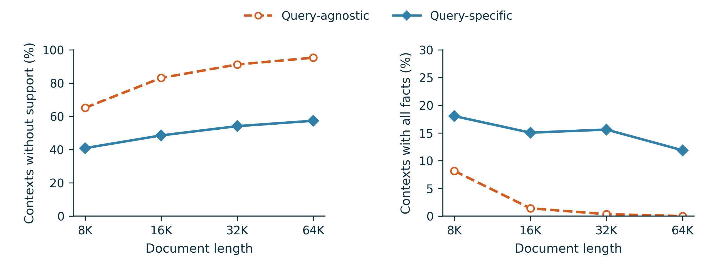
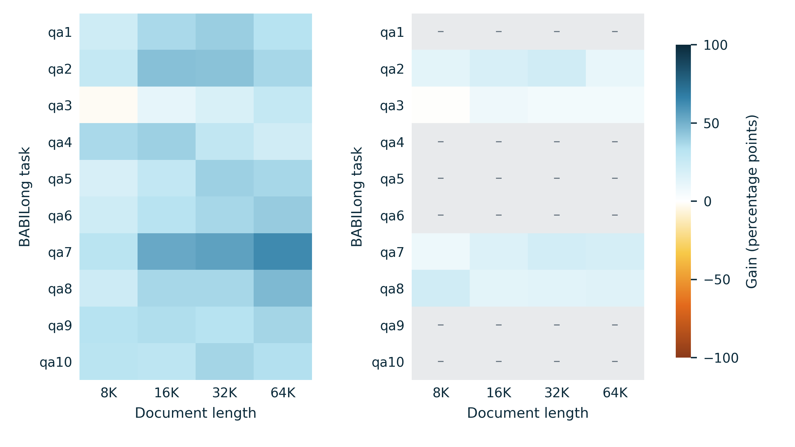
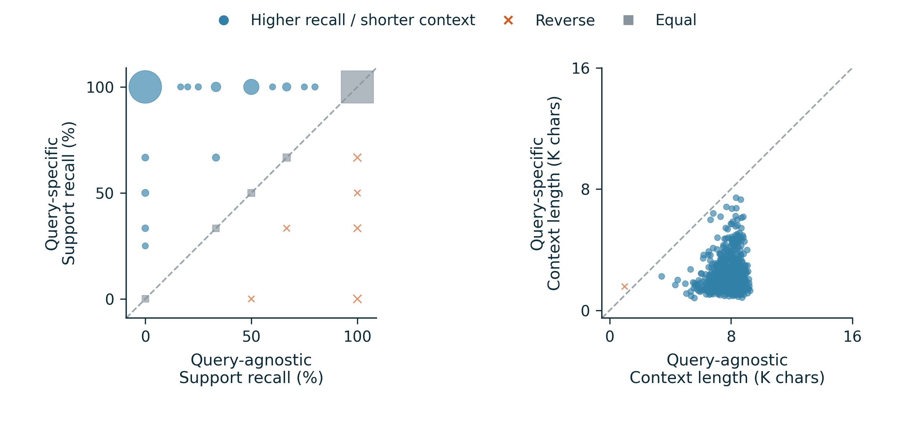
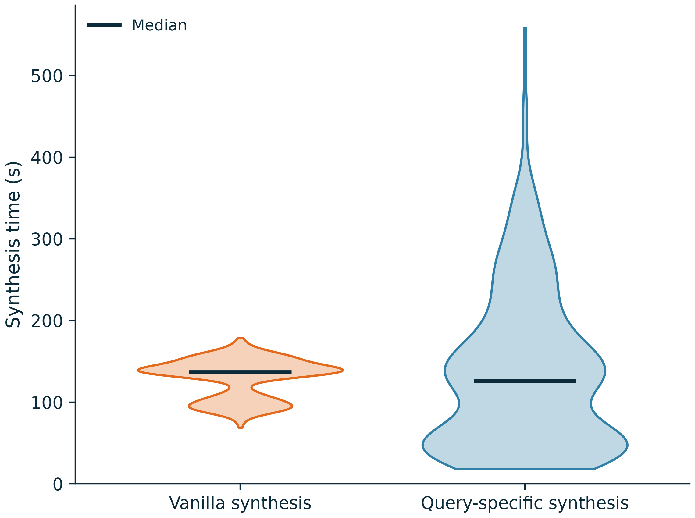

<!-- contextual-acl-package -->
# Contextual Cartridges

**Query-Guided Test-Time Learning with Selective Self-Distillation**

[ACL paper and complete results package](paper/contextual_cartridges/README.md) · [Paper PDF](paper/contextual_cartridges/paper.pdf) · [完整中文方法](paper/contextual_cartridges/METHOD.zh-CN.md) · [BABILong 待填结果表](paper/contextual_cartridges/RESULTS.md)

1,000 BABILong requests; 26,451 count-matched synthetic exercises per method. Three separate experimental figures, using only axes, legends, and the blue–cyan / yellow–orange palette. No bars or confidence bands.

[Definitions, denominators, figure PDFs/SVGs and source JSON](paper/contextual_cartridges/README.md). These completed data audits measure source coverage and organization; final answer accuracy is not inferred from them.

[Three backbones × three datasets cache–performance template](paper/contextual_cartridges/figures/figure4_cache_grid_pending.pdf). Downstream tables and cache curves are explicitly pending; no missing result is filled with zero or an older run.

[Reproduction code and software references](paper/contextual_cartridges/REPRODUCE.md).

<!-- synthesis-time-violin -->
## Synthetic data generation time

Two violins, each using the same 635 BABILong requests with matched generated train/validation counts
(20,272 QA pairs per method). Horizontal lines mark medians: Vanilla **137.09 s**, query-specific
**126.02 s**. The query-specific tail is longer; historical hardware/concurrency and cached evidence
selection differ, so this is not a controlled end-to-end speedup claim.

[Figure PDF/SVG, raw timing CSV, definitions and reproduction code](paper/contextual_cartridges/synthesis_time/README.md).
<!-- /synthesis-time-violin -->

<!-- previous-report -->
[Historical report (previous protocols)](archive/README_before_acl_20261111.md)
