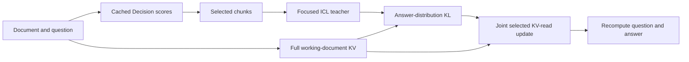

# Masked TTT via Selective Self-Distillation

**Select evidence for learning; keep the working document for answering.**

Masked TTT adapts a frozen language model to one long-context question. A
Decision API score selects a small set of source chunks. The same frozen model
answers from those chunks as an in-context teacher. A student reads the full
working document and learns from the teacher's next-token distributions by
updating request-local attention allocation and value-read corrections. The
student then answers independently and discards the corrections.

[中文方法说明](docs/METHOD.zh-CN.md) · [Implementation](docs/IMPLEMENTATION.md)



## Method

1. **Select.** Rank source chunks using question-conditioned Decision scores;
   by default, use the top 10%. Cached scores are loaded by case ID and are
   reused across backbones. The selection is not an answer label.
2. **Build the teacher.** The frozen backbone reads the selected chunks in
   document order, with the original question and a concise-answer instruction.
   It also generates an answer for the ICL baseline, and keeps the selected
   document cache available for scoring student prefixes.
3. **Adapt.** Prefill the complete working document once and keep its original
   KV cache immutable. Optimize a chunk-level attention-score correction and a
   low-rank value-read correction, jointly, only at selected positions. The
   student generates a short rollout from its current state. The teacher scores
   the same prefixes with full-vocabulary probabilities, and the student
   minimizes $\mathrm{KL}(p_T\|p_S)$. The rollout is refreshed after each
   update. Original model weights remain frozen.
4. **Answer.** Freeze the corrections, discard the training suffix, recompute
   the original question and generate the student's own answer. All per-request
   state is then discarded.

For selected document position $u$ in chunk $c$, the read operation is

$$
z_{t,u}=q_t^\top k_{u,0}/\sqrt{d_h}+m_u g_c,\qquad
o_t=\sum_u \operatorname{softmax}(z_t)_u
\left(v_{u,0}+m_u\operatorname{clip}_{0.15\lVert v_{u,0}\rVert}
((v_{u,0}U)B_c)\right).
$$

Here $m_u$ marks selected positions; $U$ is a fixed per-layer, per-KV-head
basis computed from selected values, while $g$ and $B$ are trained jointly.
No cached key or value is overwritten. Full-attention layers are adapted;
sliding-attention layers retain their native behavior.

The shipped profile uses a 32-token ICL teacher cap, up to 8 student rollout
tokens and two Adam steps, and for a
recognized multiple-choice answer may continue up to eight steps until its
answer-position KL is at most 0.5. Other answers use all available student-prefix
positions and two steps. There is **no separate LLM judge, source NTP,
centering, or output-answer routing** in this profile. Earlier experiments used
different trajectories or selective filters and must be reported as separate
configurations. This online student-trajectory implementation is a new
candidate and does not reuse the earlier teacher-prefix accuracy as its own.

If a document exceeds a backbone's native context window, the cached selector
constructs a source-prioritized working document and records its source mapping.
For inputs that fit, every original chunk remains readable by the student.

## Install

```bash
pip install -e '.[test]'
# Install a compatible FlashAttention build for the target CUDA hardware.
```

The tested cluster environment uses PyTorch 2.9.1 with CUDA 12.8,
Transformers 4.57.6 and FlashAttention 2.8.3. Qwen3-4B, OLMo-3-7B and
GPT-OSS-20B backbones are supported by the implementation; the currently
submitted benchmark jobs are tracked separately from this repository.

## Run with cached decisions

The JSON request contains `document`, `question`, and optionally `prompt`,
`answer_prefix` and `max_new_tokens`. The case ID must match the saved
score index and the original question.

```bash
masked-ttt --model /path/to/model --request request.json \
  --score-json-dir /path/to/shared_scores --case-id YOUR_CASE_ID \
  --local-files-only --output result.json
```

The score directory contains `case_to_score_file.json` and `scores/`. The
shared benchmark score bundle is available on the
[data branch](https://github.com/XiangqiWang77/AsyncStack-TTT/tree/data/shared-source-scores-20261102).
To score a new request online, pass `--online-decisions` instead; this uses
the configured Decision API credentials and budget.

`timing.ttft_seconds` measures cached-score loading, teacher inference,
adaptation, question recomputation and the first final token. It excludes model
loading, queueing and previously completed offline Decision scoring; those
selection costs are recorded separately. Compare methods on the same cases,
hardware and timing scope.

## Verify

```bash
pytest -q
```

Tests cover causal teacher forcing, selected-only gradients, zero-state
equivalence, immutable document KV, fresh question recomputation, cached-score
identity and full/sliding attention backbones.
