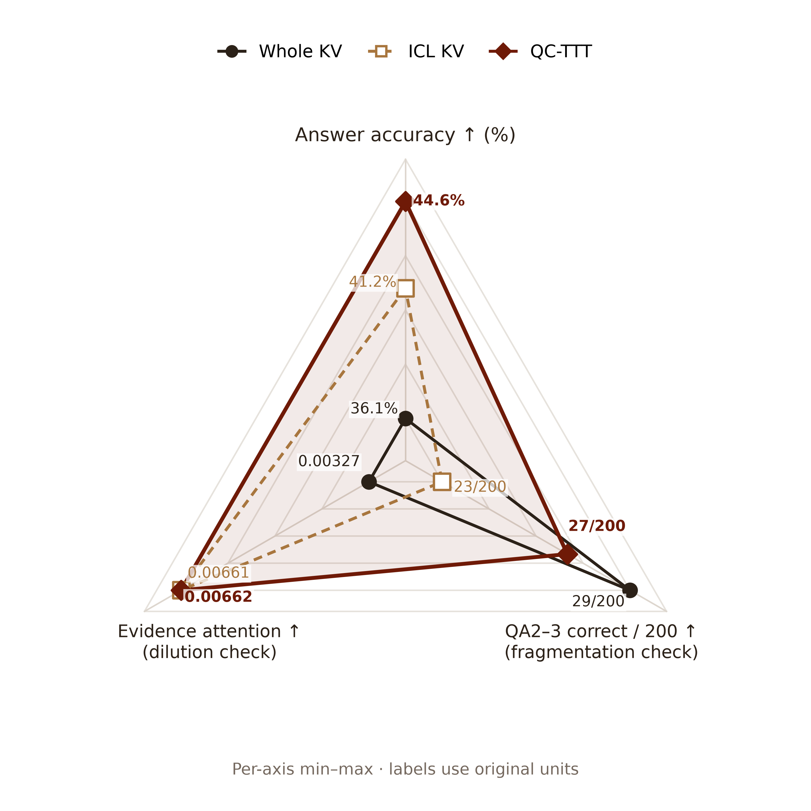
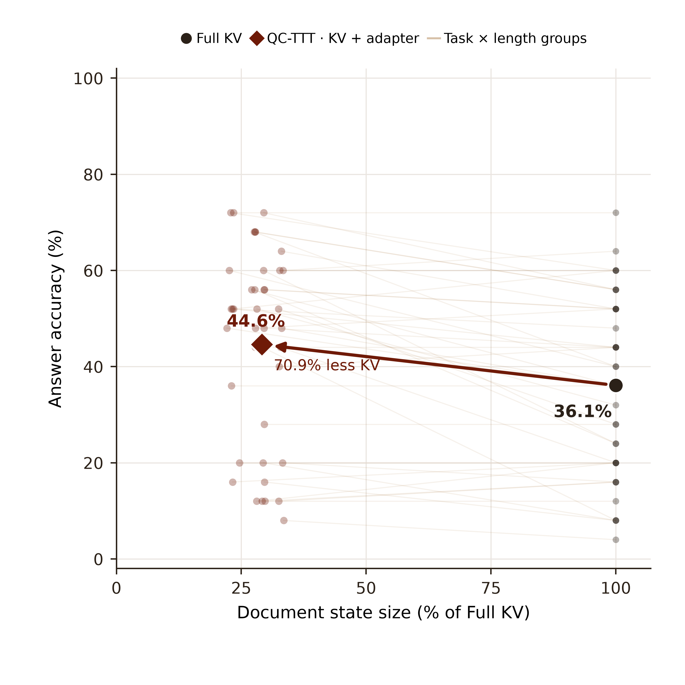

# Query Cartridges：三个动机、完整方法与实验结果

> 本报告只保留 Motivation 1、2、3 三张图。结果来自已完成的 BABILONG 日志，统一使用 `answer_focused_lexical_v2` 宽松词面评分。

## Motivation 1：全文视野与证据聚焦

[PDF](motivation_1/figure.pdf) · [SVG](motivation_1/figure.svg)

**问题。** 全文 KV 保留所有支持事实，却可能让相关证据只分到少量注意力。选中 KV 让输入更聚焦，但有些题需要的事实或跨段联系可能不在选中的片段中。Query Cartridges 的目标是利用全文环境训练一个面向当前问题的小读取状态，再将它应用到紧凑的选中缓存。

**图怎么读。** 上轴是整体回答准确率；左轴是支持事实获得的平均注意力质量，用来观察读取是否集中；右轴是需要两个或三个支持事实的 QA2／QA3 中答对的次数，用作多事实问答的检查。各轴分别对三种方法的结果做 min–max 归一化，图内小字保留各指标的原始单位；不能直接比较不同轴的长度或把多边形面积当综合分数。

**实测观察。** OLMo 的整体准确率为 Whole **36.1%**、ICL **41.2%**、QC-TTT **44.6%**。支持事实注意力在一组单独的配对探针中，Whole 为 **0.00327**，QC 为 **0.00662**。QA2／QA3 共 200 次请求中，ICL 答对 **23** 次，QC 答对 **27** 次，Whole 答对 **29** 次。

整体准确率来自 1,000 次请求，多跳题是其中 200 次；注意力则来自 12 个来源问题在四种长度下的 **48 次配对读出**。多跳答题表现是碎片化的功能性检查，不能单凭它断定跨段关系已被恢复。ICL 与 QC 的回答格式不同，具体见下表说明。[图和指标来源](https://github.com/XiangqiWang77/Masked-TTT/tree/c0e5606/docs/analysis/olmo-triangle-result-20261104)

## Motivation 2：为什么用问题条件下的 SD

[PDF](motivation_2/figure.pdf) · [SVG](motivation_2/figure.svg)

**问题。** 原文 NTP 让模型预测文档的下一个 token，信号来自原文，但训练位置和正式问题的答案位置不同。SD 给模型一个与问题和答案前缀直接相关的分布目标：在同一个学生前缀上，学习聚焦 Teacher 如何预测下一个 token。

**图怎么读。** 这是 Qwen3-4B 的 1,000 次配对请求，三组都从 **54.2%** 的未适配模型出发。每个小点是同一题型与长度组成的 25 题组；半小提琴显示这些组的分布，大菱形显示总体变化。经过最多 16 步，Whole NTP 为 **52.2%**（−2.0 点）、Selected NTP 为 **50.4%**（−3.8 点）、Soft SD 为 **57.8%**（+3.6 点）。

这说明本次对照中，SD 的问题条件信号更有效地转化为自由生成的答题收益。该消融的 SD 在**全文 KV**上进行，并非 OLMo 独立卡带的直接消融；图也没有把未记录的中间步骤准确率画成实测结果。两组 NTP 分别有 999／1,000 次完成 16 步，SD 有 994／1,000 次完成 16 步，其余零更新请求仍计入结果。[图和数据来源](https://github.com/XiangqiWang77/Masked-TTT/tree/c0e5606/docs/analysis/qc-ttt-motivation-replot-20261104)

## Motivation 3：独立卡带的文档缓存大小

[PDF](motivation_3/figure.pdf) · [SVG](motivation_3/figure.svg)

**问题。** 如果训练完成后仍需保留整份全文 KV，长上下文的文档缓存成本仍在。独立 Query Cartridge 把训练后的读取状态物化到选中 KV，使正式回答阶段可以只读取卡带。

**图怎么读。** 横轴是文档状态相对于全文 KV 的大小，纵轴是准确率。大点是 OLMo 1,000 次请求的总体结果，浅色点与连线是题型 × 长度的配对组。逐请求计算的卡带／全文文档 KV 比值中位数为 **29.1%**，即文档状态中位数减少 **70.9%**；图中的整体准确率为 **36.1% → 44.6%**。

这里的大小是记录的文档 KV 与卡带状态，不包括模型权重、问题／答案后缀、训练临时状态或总显存峰值。它也不是端到端 TTFT 的测量。[图和数据来源](https://github.com/XiangqiWang77/Masked-TTT/tree/c0e5606/docs/analysis/qc-ttt-motivation-replot-20261104)

## 完整方法：Query Cartridges

### 目标与输入

给定长文档 $D$ 和问题 $Q$，系统为这个请求构造可丢弃的读取状态，基础模型参数 $\theta$ 始终冻结。方法的输出是一份**针对当前问题的独立卡带**，以及模型读取卡带后生成的答案。

核心有三步：Decision API 选择证据；用证据构造 ICL Teacher，并在全文环境中进行请求内 SD；把学到的读取状态物化到选中缓存，以紧凑状态重新回答原问题。

### 1. 选择片段，建立两个视图

将文档分成小块 $C_1,\ldots,C_N$，结合问题使用已缓存的 Decision API 分数，选择约 **10%** 的块，按原顺序组成 $E$。历史主表复用这些 JSON 分数，不在本次整理中重新调用 API。

冻结模型分别预填充两个视图：

- **全文 Student：**读工作文档 $D$，获得原始文档 KV，保留全文上下文。
- **选中 Teacher：**重新组织并预填充 $E$，再输入原问题，获得独立的选中 KV。

两个缓存独立建立；Teacher 不是从全文 KV 里直接摘取位置，因此它的读取条件确实是选中文本。选择发生在适配之前；标准答案不参与选块或训练。

### 2. 在选中位置建立可学习读取状态

在允许适配的全文注意力层，令 $m_u=1$ 表示位置 $u$ 属于选中块。问题和生成后缀、未选中位置以及开头的 sink 位置不加文档修正。一个适配头的读取为：

$$z_{t,u}=\frac{q_tk_{u,0}^{\mathsf T}}{\sqrt d}+m_u g_{c(u)},\qquad
o_t=\sum_{u\le t}\operatorname{softmax}(z_t)_u\left(v_{u,0}+m_u\Delta v_u\right).$$

$g$ 按层、KV 头和选中块设置，决定一个块获得多少读取份额；$\Delta v$ 决定读取到的 Value 特征如何调整。当前实现使用每层每 KV 头的固定低秩基底 $A$ 与每个选中块的可训练系数 $B_c$：

$$\Delta v_u=\operatorname{clip}_{\rho}\!\left((v_{u,0}A)B_{c(u)}\right).$$

基底从全文缓存中选中位置的 Value 统计量构造；$g$ 和 $B$ 初始化为零，通过同一个损失联合更新。代码默认低秩维度为 8，并限制增益和单位置 Value 修正幅度。GQA 下，同组 Query 头共享对应 KV 头的增益；混合注意力模型只在其全局注意力层挂载此读取状态。原模型权重和原始文档 KV 不被优化器覆盖。

### 3. 利用 ICL Teacher 做 on-policy 自蒸馏

Student 在全文视图、当前读取状态下先生成短回答前缀 $r$。Teacher 然后在自己的选中视图中，对**相同的学生前缀**计算每个位置的完整词表分布；学生也计算对应分布。训练损失为：

$$\mathcal L_{\mathrm{SD}}(\phi)=\frac{1}{|r|}\sum_i
\operatorname{KL}\!\left(p_T(\cdot\mid E,Q,r_{<i})\,\|\,
p_{S,\phi}(\cdot\mid D,Q,r_{<i})\right).$$

每次更新重新取得当前 Student 前缀，Teacher 参数冻结；反向传播经过冻结模型，但只有请求内的 $g$ 与 $B$ 更新。原主设置使用两步基础更新、最多 8 个 Student 前缀 token；通过原文引用和独立回答检查的小练习可额外提供更新。小练习不是评测答案，历史 OLMo 运行中 170／1,000 次请求至少有一道通过检查。

Teacher 的完整分布包含对多个候选 token 的相对支持，而不仅是它最终生成的一个 token。训练让这些问题条件下的信号改变同一份共享读取状态。Student 最终独立生成，因此有可能与 Teacher 答得不同；是否更好由配对实验决定。

### 4. 物化并独立回答

训练结束后固定 $g^*$ 和 $B^*$，将它们迁移到独立的选中视图：对选中视图自身的 Value 应用学到的低秩映射；块增益通过扩展 Key／Query 的附加维度实现等价的注意力分数偏置。新的选中 KV 与这份读取状态组成 Query Cartridge。

正式独立解码路径释放全文 KV 和不再需要的训练状态，重新输入原问题，再由冻结模型从头生成答案；Teacher 的完整答案不会作为提示塞给最终回答。请求结束后卡带可释放。这里的“从全文迁移”描述的是**训练状态的来源与物化位置**；它本身不证明所有被选块遗漏的事实或关系都已被编码进卡带。

当前代码中可选的双顺序 self-judge 用来审查全文读取的诊断输出；本报告的最终独立卡带答案并没有使用该 judge 作保底选择。

### 三个设计各自负责什么

| 设计 | 负责的事情 | 要验证的结果 |
| --- | --- | --- |
| Chunk selection | 挑出与问题相关的证据，限定 Teacher 输入及可训练位置 | 证据覆盖、聚焦阅读效果 |
| KV-based TTT | 在请求内联合调整读取份额和 Value 读出，并支持物化 | 固定缓存和格式后的训练收益 |
| ICL self-distillation | 用问题条件下的 Teacher 分布提供训练信号 | 对答题质量的影响，以及相对 NTP 的差别 |

## BABILONG：完整展示表

按指定口径展示各模型在已核对的完整 1,000 题结果中选取的较低 ICL、较低未训练 Selective KV 与较好 QC。每个模型都是同一批 250 个来源问题 × 四种长度；准确率使用 `answer_focused_lexical_v2` 宽松词面评分。表中 Δ 是两个展示配置的数值之差，单位为百分点。

**这些列不全来自同一配置。** Qwen 的低 ICL 为历史约 10% 选块，QC Best 使用约 30% 选块；GPT-OSS 的低 ICL／Selective KV 使用原分数选块，QC Best 使用同预算的实体关联选块。OLMo 按指定使用原运行的 ICL 和 QC，Selective KV 来自另一轮复跑。因此跨配置 Δ 不是单独的 SD 或 TTT 增益；同配置结果列在下面。

ICL Lowest 的选择范围是本报告核对的这些完整配置，并非所有历史实验。OLMo 为保留指定原表的 **41.20%**；另一轮复跑的 Teacher 为 **41.00%**。每一列按全量运行选取，没有逐题型挑选最低值。GPT-OSS 的 qTTT 未完成 1,000 题，记为 `—`。

### 总体

| 范围 | Vanilla | qTTT 式 | ICL Lowest | Selective KV Lowest | QC Best | Δ ICL* | Δ Selective* |
| --- | ---: | ---: | ---: | ---: | ---: | ---: | ---: |
| Qwen3-4B | 54.20 | 54.40 | 56.60 | 56.00 | 60.20 | +3.60 | +4.20 |
| OLMo-3-7B | 36.10 | 36.00 | 41.20 | 44.30 | 44.60 | +3.40 | +0.30 |
| GPT-OSS-20B | 48.70 | — | 57.10 | 55.10 | 60.30 | +3.20 | +5.20 |

### Qwen3-4B：按题型

每个题型均为 100 次请求。

| 范围 | Vanilla | qTTT 式 | ICL Lowest | Selective KV Lowest | QC Best | Δ ICL* | Δ Selective* |
| --- | ---: | ---: | ---: | ---: | ---: | ---: | ---: |
| QA1：单事实 | 78.00 | 79.00 | 56.00 | 55.00 | 78.00 | +22.00 | +23.00 |
| QA2：两事实 | 33.00 | 34.00 | 25.00 | 26.00 | 31.00 | +6.00 | +5.00 |
| QA3：三事实 | 19.00 | 19.00 | 28.00 | 26.00 | 30.00 | +2.00 | +4.00 |
| QA4：双参数关系 | 64.00 | 65.00 | 74.00 | 74.00 | 71.00 | -3.00 | -3.00 |
| QA5：三参数关系 | 71.00 | 70.00 | 79.00 | 80.00 | 77.00 | -2.00 | -3.00 |
| QA6：是非 | 76.00 | 74.00 | 84.00 | 86.00 | 87.00 | +3.00 | +1.00 |
| QA7：计数 | 40.00 | 41.00 | 37.00 | 29.00 | 38.00 | +1.00 | +9.00 |
| QA8：列表与集合 | 43.00 | 43.00 | 48.00 | 48.00 | 56.00 | +8.00 | +8.00 |
| QA9：否定 | 75.00 | 75.00 | 87.00 | 87.00 | 83.00 | -4.00 | -4.00 |
| QA10：不确定知识 | 43.00 | 44.00 | 48.00 | 49.00 | 51.00 | +3.00 | +2.00 |

### OLMo-3-7B：按题型

每个题型均为 100 次请求。

| 范围 | Vanilla | qTTT 式 | ICL Lowest | Selective KV Lowest | QC Best | Δ ICL* | Δ Selective* |
| --- | ---: | ---: | ---: | ---: | ---: | ---: | ---: |
| QA1：单事实 | 23.00 | 23.00 | 40.00 | 37.00 | 37.00 | -3.00 | +0.00 |
| QA2：两事实 | 17.00 | 16.00 | 12.00 | 13.00 | 13.00 | +1.00 | +0.00 |
| QA3：三事实 | 12.00 | 11.00 | 11.00 | 14.00 | 14.00 | +3.00 | +0.00 |
| QA4：双参数关系 | 31.00 | 32.00 | 40.00 | 53.00 | 54.00 | +14.00 | +1.00 |
| QA5：三参数关系 | 62.00 | 61.00 | 64.00 | 68.00 | 68.00 | +4.00 | +0.00 |
| QA6：是非 | 42.00 | 42.00 | 52.00 | 54.00 | 54.00 | +2.00 | +0.00 |
| QA7：计数 | 37.00 | 36.00 | 41.00 | 46.00 | 47.00 | +6.00 | +1.00 |
| QA8：列表与集合 | 29.00 | 31.00 | 41.00 | 40.00 | 40.00 | -1.00 | +0.00 |
| QA9：否定 | 57.00 | 57.00 | 65.00 | 63.00 | 64.00 | -1.00 | +1.00 |
| QA10：不确定知识 | 51.00 | 51.00 | 46.00 | 55.00 | 55.00 | +9.00 | +0.00 |

### GPT-OSS-20B：按题型

每个题型均为 100 次请求。

| 范围 | Vanilla | qTTT 式 | ICL Lowest | Selective KV Lowest | QC Best | Δ ICL* | Δ Selective* |
| --- | ---: | ---: | ---: | ---: | ---: | ---: | ---: |
| QA1：单事实 | 58.00 | — | 56.00 | 56.00 | 70.00 | +14.00 | +14.00 |
| QA2：两事实 | 28.00 | — | 20.00 | 18.00 | 37.00 | +17.00 | +19.00 |
| QA3：三事实 | 23.00 | — | 22.00 | 23.00 | 27.00 | +5.00 | +4.00 |
| QA4：双参数关系 | 28.00 | — | 57.00 | 55.00 | 59.00 | +2.00 | +4.00 |
| QA5：三参数关系 | 71.00 | — | 81.00 | 78.00 | 73.00 | -8.00 | -5.00 |
| QA6：是非 | 48.00 | — | 76.00 | 74.00 | 78.00 | +2.00 | +4.00 |
| QA7：计数 | 68.00 | — | 67.00 | 66.00 | 68.00 | +1.00 | +2.00 |
| QA8：列表与集合 | 56.00 | — | 54.00 | 57.00 | 64.00 | +10.00 | +7.00 |
| QA9：否定 | 73.00 | — | 88.00 | 86.00 | 90.00 | +2.00 | +4.00 |
| QA10：不确定知识 | 34.00 | — | 50.00 | 38.00 | 37.00 | -13.00 | -1.00 |

### 按上下文长度

每个长度均为 250 次请求。

| 范围 | Vanilla | qTTT 式 | ICL Lowest | Selective KV Lowest | QC Best | Δ ICL* | Δ Selective* |
| --- | ---: | ---: | ---: | ---: | ---: | ---: | ---: |
| Qwen3-4B · 8K | 59.20 | 59.20 | 55.20 | 53.60 | 60.40 | +5.20 | +6.80 |
| Qwen3-4B · 16K | 54.40 | 55.60 | 60.00 | 58.40 | 64.80 | +4.80 | +6.40 |
| Qwen3-4B · 32K | 49.60 | 50.40 | 58.80 | 58.00 | 60.00 | +1.20 | +2.00 |
| Qwen3-4B · 64K | 53.60 | 52.40 | 52.40 | 54.00 | 55.60 | +3.20 | +1.60 |
| OLMo-3-7B · 8K | 43.60 | 43.60 | 43.60 | 48.00 | 48.00 | +4.40 | +0.00 |
| OLMo-3-7B · 16K | 37.60 | 38.40 | 46.00 | 47.60 | 48.40 | +2.40 | +0.80 |
| OLMo-3-7B · 32K | 34.00 | 32.80 | 37.60 | 40.80 | 40.80 | +3.20 | +0.00 |
| OLMo-3-7B · 64K | 29.20 | 29.20 | 37.60 | 40.80 | 41.20 | +3.60 | +0.40 |
| GPT-OSS-20B · 8K | 56.00 | — | 54.40 | 54.00 | 60.80 | +6.40 | +6.80 |
| GPT-OSS-20B · 16K | 50.80 | — | 64.00 | 61.60 | 63.20 | -0.80 | +1.60 |
| GPT-OSS-20B · 32K | 50.00 | — | 57.20 | 53.20 | 59.60 | +2.40 | +6.40 |
| GPT-OSS-20B · 64K | 38.00 | — | 52.80 | 51.60 | 57.60 | +4.80 | +6.00 |

### 同配置核对

| 模型 / 配置 | ICL Teacher | 同选块零更新 | QC | QC − 同配置 Teacher |
| --- | ---: | ---: | ---: | ---: |
| Qwen，约 30% 校准 | 60.60 | — | 60.20 | −0.40 |
| Qwen，原约 10% 选块 | 56.60 | 56.00 | 56.70 | +0.10 |
| OLMo，原运行 | 41.20 | — | 44.60 | +3.40 |
| OLMo，同缓存复跑 | 41.00 | 44.30 | 44.50 | +3.50 |
| GPT-OSS，原约 10% 选块 | 57.10 | 55.10 | 55.40 | −1.70 |
| GPT-OSS，关联约 10% 选块 | 62.60 | 60.40 | 60.30 | −2.30 |

同配置 Teacher 与 QC 在历史日志中仍使用不同的通用回答格式要求。GPT-OSS 关联配置的另一项同缓存、同格式诊断为 **62.60% → 63.30%**；它是释放前诊断，与表中的原问题格式正式 QC 不同。OLMo 的 64K 组有 162 次请求先构造了压缩工作文档。

Qwen 的 ICL 和零更新列来自不同的约 10% 运行，尽管总体 ICL 都是 56.60%，逐题型结果并不完全相同。OLMo 的零更新列是复跑，不是原始 QC 运行中的同轮零更新。两组差异均保留在本表的来源说明里。

[逐项聚合数据](table_data.json) · [原始同配置表](https://github.com/XiangqiWang77/Masked-TTT/blob/c0e5606/docs/analysis/query-cartridges-full-performance-20261104/README.md) · [跨模型选择设置汇总](https://github.com/XiangqiWang77/Masked-TTT/blob/c0e5606/docs/analysis/three-model-babilong-20261104/README.md)

## 数据与代码

- [三模型完整配对汇总及不同选块设置](https://github.com/XiangqiWang77/Masked-TTT/blob/c0e5606/docs/analysis/three-model-babilong-20261104/README.md)
- [逐题型、逐长度的配对结果](https://github.com/XiangqiWang77/Masked-TTT/blob/c0e5606/docs/analysis/query-cartridges-full-performance-20261104/README.md)；OLMo 题型本报告取原始运行，而该链接中的 OLMo 题型来自另一轮复跑。
- [Teacher 与训练流程](https://github.com/XiangqiWang77/Masked-TTT/blob/c0e5606/src/masked_ttt/pipeline.py) · [KV 状态](https://github.com/XiangqiWang77/Masked-TTT/blob/c0e5606/src/masked_ttt/memory.py) · [独立卡带](https://github.com/XiangqiWang77/Masked-TTT/blob/c0e5606/src/masked_ttt/standalone.py)

写作与证据核对

- **贡献是否明确？** 是：报告分别说明选块、KV 读取适配和 ICL 自蒸馏。
- **流程是否清楚？** 是：按双视图、读取状态、训练、物化和回答的顺序描述。
- **实验是否对应结论？** 是：三张图分别标注各自模型、测量对象与对照；图 2 是全文 KV 消融。
- **评估范围是否可见？** 是：表格区分同轮对照、样本量、输出格式和 Teacher 选择范围。
- **实现表述是否准确？** 是：区分低秩读取状态、原始缓存、独立卡带与全文诊断的 self-judge。

| 要检验的论点 | 本报告证据 | 当前状态 |
| --- | --- | --- |
| OLMo 完整方法高于 ICL | 44.60% 对 41.20% | 已观察到；包含格式差异 |
| SD 相对 NTP 改善答题 | 图 2 的 Qwen 全文 KV 对照 | 在该对照中观察到 |
| 卡带减少文档状态 | 图 3 的逐请求中位比例 | 已观察到；不是总显存 |
| QC 在每个模型都超过自己的 Teacher | 上述同配置核对 | 当前 Qwen 校准版与 GPT-OSS 关联选块结果不支持 |

