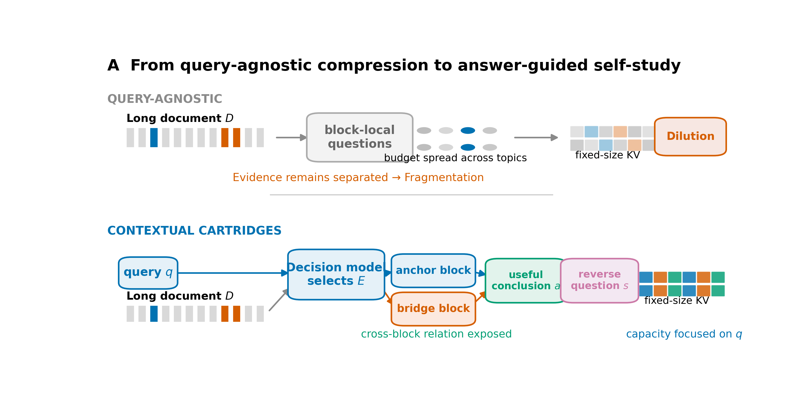
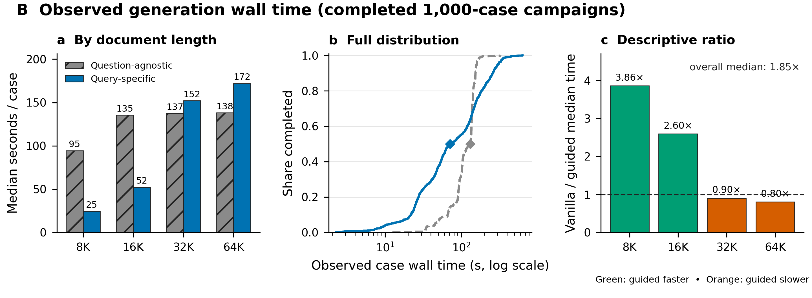
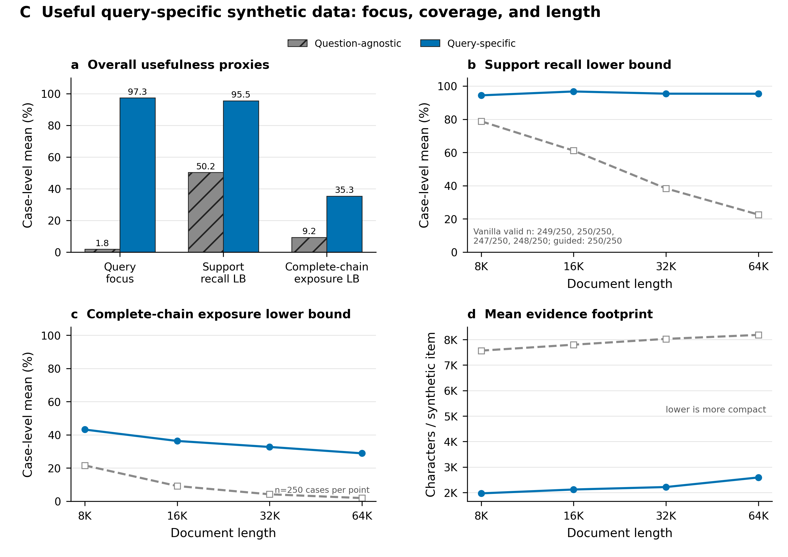

# Answer-Guided v3: usefulness and generation cost

This directory contains the three figures used by the current Contextual Cartridges method report. Figure 1 is a mechanism schematic; Figures 2 and 3 are computed from completed 1,000-case BABILong synthetic-data campaigns. Every figure is available as PNG, editable SVG, and PDF, with the plotting code, per-case source CSV, aggregate CSV, export metadata, and a machine-readable manifest.

## Figure 1 — targeting Fragmentation and Dilution



The upper path illustrates the risk of query-agnostic, block-local question generation: a fixed training budget is spread across topics, while complementary evidence can remain disconnected. The lower path shows the current two-call recipe: a lightweight Decision Model selects query anchors and bridge blocks; Qwen3-4B extracts a useful answer or intermediate conclusion; the generator then reverses that answer into a closed-book synthetic question. This is a schematic and contains no measured values.

[SVG](figure1_fragmentation_dilution_mechanism.svg) · [PDF](figure1_fragmentation_dilution_mechanism.pdf) · [export record](figure1_fragmentation_dilution_mechanism.export.json)

## Figure 2 — observed generation speed



Across all 1,000 completed cases, the observed per-case wall-time median decreases from **131.5 s** for the matched question-agnostic generation campaign to **71.1 s** for Answer-Guided query-specific generation, a descriptive **1.85× median ratio**. The length breakdown is deliberately retained: query-specific generation is 3.86× and 2.60× faster by the median at 8K and 16K, but 0.90× and 0.80× at 32K and 64K. These are separate campaigns with different concurrency and backend scheduling; the query-specific marker explicitly includes waiting for shared concurrent batches. The figure therefore reports observed latency and does not claim a controlled causal speedup at every length.

[SVG](figure2_generation_speed.svg) · [PDF](figure2_generation_speed.pdf) · [per-case CSV](source_data_speed_per_case.csv) · [summary CSV](source_data_speed_summary.csv) · [export record](figure2_generation_speed.export.json)

## Figure 3 — useful query-specific synthetic data



The query-specific dataset is more useful for the current request according to three pre-registered audit proxies: query focus rises from **1.80% to 97.33%**, support-fact recall lower bound rises from **50.25% to 95.48%**, and complete support-chain exposure lower bound rises from **9.24% to 35.29%**. The length panels show why this is not only an aggregate effect: vanilla support recall declines from **78.77% at 8K to 22.56% at 64K**, whereas query-specific recall remains between **94.40% and 96.73%**; complete-chain exposure remains higher at every length. The selected evidence footprint is also smaller (**2.22K vs 7.89K characters per synthetic item** overall), showing that increased coverage of the answer-relevant support coexists with less irrelevant material.

These are data-construction proxies, not semantic answer correctness or final Cartridge accuracy. Six vanilla cases have unavailable support-recall annotations and are shown as missing, never as zero; exact valid counts are retained in the summary CSV and the figure.

[SVG](figure3_quality_coverage_length.svg) · [PDF](figure3_quality_coverage_length.pdf) · [per-case CSV](source_data_quality_per_case.csv) · [summary CSV](source_data_quality_summary.csv) · [export record](figure3_quality_coverage_length.export.json)

## Reproduce

```bash
module load matplotlib/3.9.2-gfbf-2024a
python code/plot_answer_guided_v3_story.py \
  --quality-report /path/to/answer_guided_v3.quality_report.json \
  --vanilla-timing-dir /path/to/vanilla/dataset_cases \
  --guided-timing-dir /path/to/query_specific_v3/dataset_cases \
  --output-dir . \
  --overwrite
```

The released audit report is attached to the Answer-Guided v3 GitHub release. See [`figure_manifest.json`](figure_manifest.json) for hashes, sample counts, missing-data policy, and figure semantics.

The export, provenance, missing-data, and accessibility checks follow the `scientific-visualization` workflow from Kassis et al., [*Scientific Agent Skills: A Library of Procedural Knowledge for Research Agents*](https://arxiv.org/abs/2609.00065) (2026). The workflow is a plotting aid, not a certification of scientific validity.
