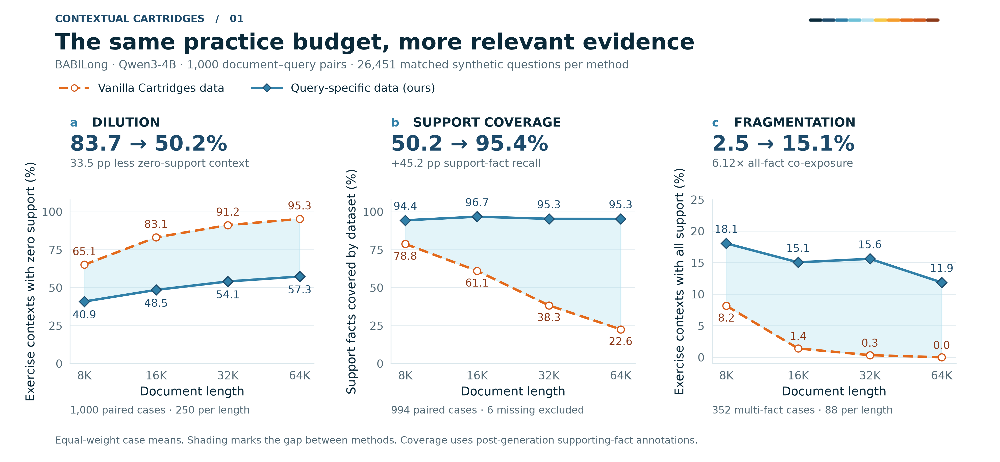
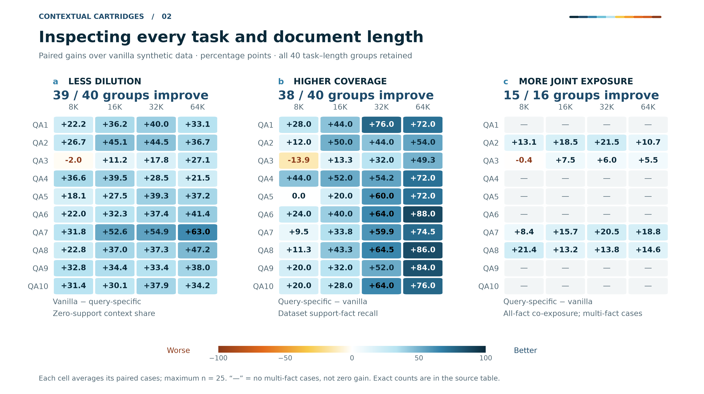
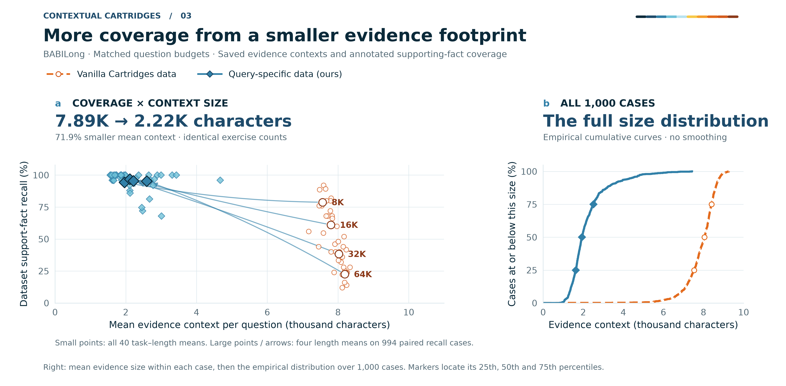

# Contextual Cartridges — 更有用的 Query-Specific Synthetic Data

相同的练习题预算下，Query-specific 数据接触更多真实问题的支持事实，并让多条事实更频繁地出现在同一道练习的材料里。以下三张图全部来自已完成的 JSON 审计：**Qwen3-4B-Instruct-2507、1,000 个 BABILong 文档—问题对、QA1–QA10、8K/16K/32K/64K 各 250 题、每种方法配对保留 26,451 道合成练习题**。

图形采用指定的蓝青／黄橙配色，以曲线、热力图、配对散点和经验分布呈现结果；无柱状图、无置信区间。橙色空心圆／虚线表示 Vanilla Cartridges 数据，蓝色菱形／实线表示 Query-specific v3 数据。这里比较合成数据的证据属性，不将其写成最终 Cartridge 准确率。

## 1. 同样的练习预算，减少 Dilution、增加联合证据



**Dilution：**无支持材料占比由 **83.69% 降到 50.21%**，减少 **33.47 个百分点**。这里统计每道合成题绑定的材料是否完全没有接触真实问题的已标注支持事实。

**Coverage：**整套练习材料的支持事实召回率由 **50.25% 升到 95.45%**，增加 **45.20 个百分点**；在 64K 上为 **22.56% → 95.33%**。

**Fragmentation 的证据聚合指标：**在 352 个需要多条支持事实的样本上，同一道练习材料包含全部支持事实的比例由 **2.48% 升到 15.15%**，达到 **6.12 倍**。它衡量必要事实是否获得共同暴露；不把“材料共同出现”直接等同于问句必须进行跨块推理。

[高清 PNG](query_specific_results/figure1_dilution_fragmentation.png) · [PDF](query_specific_results/figure1_dilution_fragmentation.pdf) · [可编辑 SVG](query_specific_results/figure1_dilution_fragmentation.svg)

## 2. 展开全部题型与长度



每个格子是一组配对请求的平均变化，单位为百分点。**39/40** 个任务—长度组降低无支持材料占比，**38/40** 组提高支持事实召回；有多事实样本的 **15/16** 组提高完整证据同现。热力图保留所有分组及其实际数值，“—”表示该分组没有多事实样本，不代表零分。

[高清 PNG](query_specific_results/figure2_task_length.png) · [PDF](query_specific_results/figure2_task_length.pdf) · [可编辑 SVG](query_specific_results/figure2_task_length.svg) · [每格数值与有效样本数](query_specific_results/task_length_gains.csv)

## 3. 更少的材料，更高的支持事实覆盖



每道练习题的平均材料由 **7,894 字符降到 2,221 字符**，减少 **71.86%**，同时支持事实召回提高。左图保留全部 40 个任务—长度组，小点表示分组均值，大点及连线表示四种长度的配对均值；右图显示全部 1,000 个请求的材料量经验分布，未做平滑。

此处材料量的单位是字符，支持的是“材料更紧凑”的结论；生成时间应另用实际计时比较。

[高清 PNG](query_specific_results/figure3_evidence_efficiency.png) · [PDF](query_specific_results/figure3_evidence_efficiency.pdf) · [可编辑 SVG](query_specific_results/figure3_evidence_efficiency.svg)

## 指标与配对口径

| 指标 | 配对请求数 | Vanilla data | Query-specific data | 变化 |
|---|---:|---:|---:|---:|
| 无支持材料占比 ↓ | 1,000 | 83.69% | 50.21% | −33.47 pp |
| 整套材料支持事实召回率 ↑ | 994 | 50.25% | 95.45% | +45.20 pp |
| 多事实样本的完整证据同现率 ↑ | 352 | 2.48% | 15.15% | +12.67 pp |
| 平均材料字符数 ↓ | 1,000 | 7,894 | 2,221 | −71.86% |

- **配对预算：**沿用原始审计中每个请求、每个 split 的相同练习题前缀数量；没有根据结果筛选题目。两边各 26,451 道练习，覆盖相同的 1,000 个请求。
- **聚合：**先在请求内计算比例，再对请求等权平均；不让练习题多的请求占更高权重。
- **支持事实：**来自生成结束后读取的 BABILong supporting-fact 位置。召回率及完整同现采用审计保存的保守下界。绘图不读取 benchmark 答案文本。
- **缺失：**原版数据有 6 个支持召回值缺失，因此所有召回对比同时排除两侧对应请求，使用 994 个完整配对样本；无支持材料占比和同现率没有这类缺失。此前单侧汇总的 95.48% 与这里严格配对后的 95.45% 因此略有差别。
- **多事实子集：**352 个请求具有至少两条已标注支持事实，每种长度 88 个。这不是严格的“必须跨原始 chunk”子集。
- **曲线和散点：**仅显示测量点及其连接；曲线间浅色区域是两种方法的观测差值。ECDF 为经验阶梯函数。
- **热力图：**所有任务—长度分组都保留；正值统一表示改善，色阶固定为 −100 到 +100 pp。未抽样、未平滑、未插补缺失值。

## 源数据、完整 JSON 与复现

[逐题绘图数据 JSON](query_specific_results/source_data.json) · [逐题 CSV](query_specific_results/per_case_metrics.csv) · [总体／长度汇总 CSV](query_specific_results/summary.csv) · [绘图代码](code/plot_query_specific_evidence.py) · [来源及导出记录](query_specific_results/figure_manifest.json) · [配色检查](query_specific_results/palette_audit.json)

完整合成数据见 [Answer-Guided v3 发布清单](../answer_guided_v3_release.json) 与 [GitHub Release](https://github.com/XiangqiWang77/Masked-TTT/releases/tag/contextual-cartridges-answer-guided-v3-20261109)。本页绘图快照只包含复现图形所需的逐题统计，不替代完整合成问答 JSON。

在本目录运行：

```bash
python code/plot_query_specific_evidence.py \
  --data query_specific_results/source_data.json \
  --output-dir regenerated_figures
```

依赖 Matplotlib、NumPy、Pillow；本次实际版本记录在 manifest 中。PNG 为 300 DPI，PDF 嵌入 TrueType 字体，SVG 保留可编辑文字。原始审计、支持注释和绘图快照均记录 SHA-256；导出前检查页面文字边界，导出后核对像素尺寸、透明度与文件哈希。

绘图与来源记录流程参考 Kassis et al., [*Scientific Agent Skills: A Library of Procedural Knowledge for Research Agents*](https://arxiv.org/abs/2609.00065), 2026。
