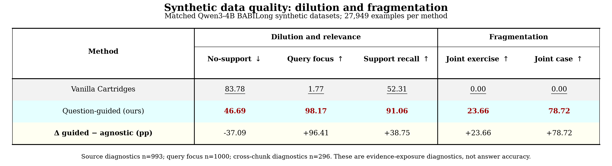
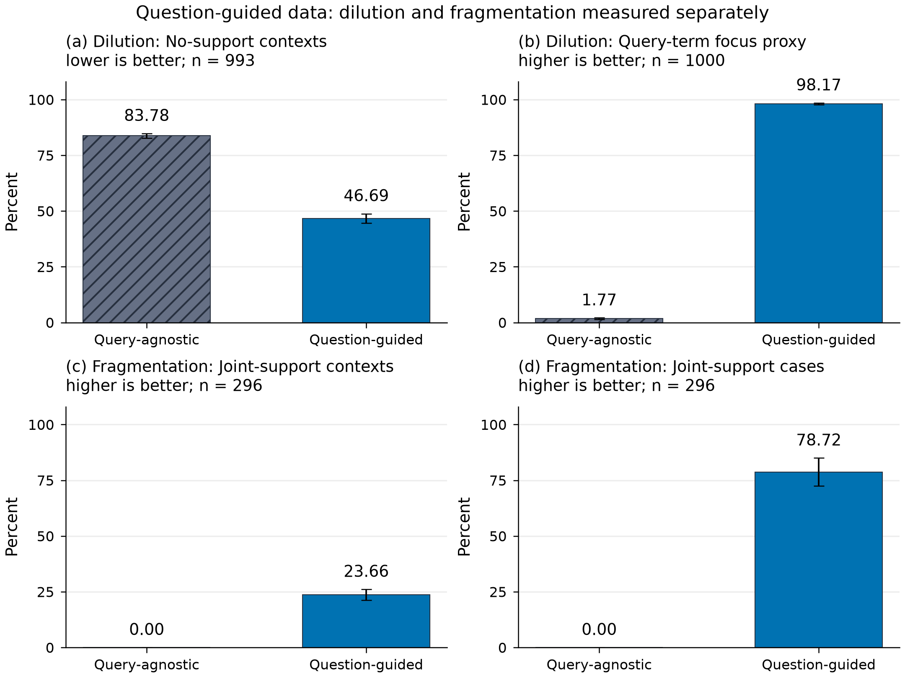
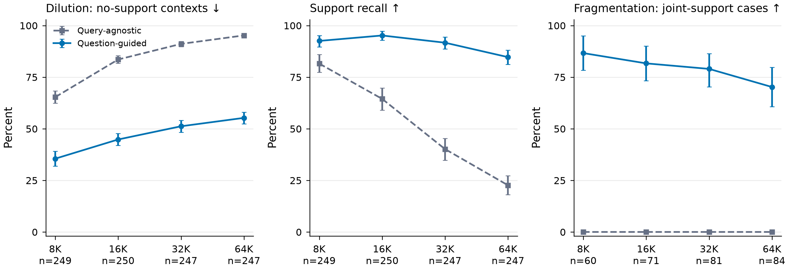
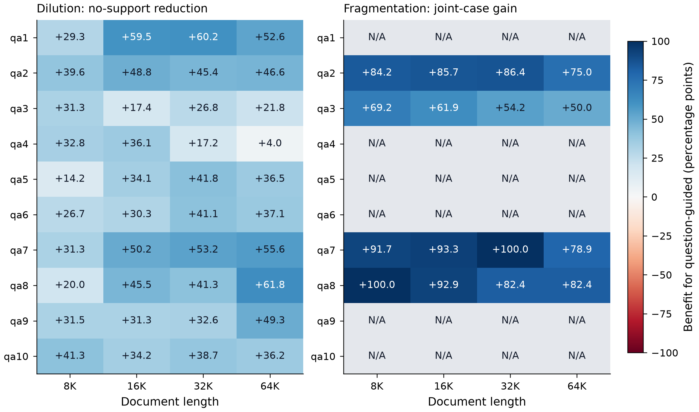

# Question-guided synthetic data：Dilution 与 Fragmentation 分别测量

[全部7张排版表 PDF](tables/all_styled_tables.pdf) · [总体表 LaTeX](tables/overall.tex) · [全部表 LaTeX入口](tables/paper_tables.tex)

表格按提供的样式组织：分组表头、粗细竖线、灰色基线行、浅青色guided行、深红色最佳值与次优下划线。

Qwen3-4B-Instruct-2507；同一批1000个BABILong文档问题对；qa1–qa10；8K/16K/32K/64K各250题。两种方法逐题匹配训练与验证题数量，各20,558道训练题、7,391道验证题，共27,949道合成题。

本报告只比较合成数据，不在vanilla synthetic上运行SD。SD对照另在固定的question-guided数据上进行。

主结果：无支持材料占比从83.78%降至46.69%；在296个确需跨原版chunk取证的样本上，至少一道完整证据练习题的覆盖率从0.00%增至78.72%。

## 1. Dilution：练习预算有多少没有接触真实问题的支持事实？

对每个真实问题q，使用生成结束后读取的BABILong官方supporting-fact位置作为评估参照。“无支持材料占比”是合成题所绑定材料不包含任何一条q的支持事实的比例，越低越好。先在每个文档问题对内算占比，再对配对样本等权平均。它不是生成题错误率：未包含这些支持事实的题也可能提供其他有用的中间知识。

“问题关键词聚焦率”是合成问句命中真实问题非停用词的比例；只读问句，不把已知q前缀或生成答案计入。它是可复现的词面代理，不是语义相关性的人工评分。“整套材料支持事实召回率”衡量所有练习材料的并集能覆盖多少q的官方支持事实。

| 分组 | 指标 | 有效配对样本 | Query-agnostic | Question-guided | Δ (guided−agnostic) | Δ 的95% CI |
|---|---|---:|---:|---:|---:|---|
| 总体 | 无支持材料占比 ↓ | 993 | 83.78 | 46.69 | -37.09 | [-39.38, -34.90] |
| 总体 | 问题关键词聚焦率 ↑ | 1000 | 1.77 | 98.17 | +96.41 | [+95.92, +96.86] |
| 总体 | 整套材料支持事实召回率 ↑ | 993 | 52.31 | 91.06 | +38.75 | [+35.79, +41.66] |

## 2. Fragmentation：分散的支持事实有没有在同一道练习中聚合？

只纳入至少两条必要支持事实、且无法在同一个实际原版2048-token生成chunk内完整获得的样本。“跨块完整证据练习题占比”是其绑定材料同时覆盖q全部支持事实的练习题比例；“至少一道跨块完整证据题的样本占比”衡量每份合成数据是否至少有一次完整证据同现。

原版在这个子集上的0%由被评估的单chunk数据协议与子集定义共同决定；它不表示原版Cartridges模型的准确率为0，也不表示官方方法的所有配置都不能跨块推理。材料共同出现仍不等于问句必须联合这些材料才能回答。

| 分组 | 指标 | 有效配对样本 | Query-agnostic | Question-guided | Δ (guided−agnostic) | Δ 的95% CI |
|---|---|---:|---:|---:|---:|---|
| 跨块支持子集 | 跨块完整证据练习题占比 ↑ | 296 | 0.00 | 23.66 | +23.66 | [+21.30, +26.08] |
| 跨块支持子集 | 至少一道跨块完整证据题的样本占比 ↑ | 296 | 0.00 | 78.72 | +78.72 | [+72.42, +85.00] |

## 3. 按文档长度

| 分组 | 指标 | 有效配对样本 | Query-agnostic | Question-guided | Δ (guided−agnostic) | Δ 的95% CI |
|---|---|---:|---:|---:|---:|---|
| 8K | 无支持材料占比 ↓ | 249 | 65.35 | 35.53 | -29.82 | [-34.17, -25.52] |
| 8K | 整套材料支持事实召回率 ↑ | 249 | 81.58 | 92.57 | +10.99 | [+5.77, +16.08] |
| 8K | 跨块完整证据练习题占比 ↑ | 60 | 0.00 | 32.14 | +32.14 | [+26.36, +38.47] |
| 8K | 至少一道跨块完整证据题的样本占比 ↑ | 60 | 0.00 | 86.67 | +86.67 | [+78.33, +95.00] |
| 16K | 无支持材料占比 ↓ | 250 | 83.57 | 44.83 | -38.74 | [-42.12, -35.36] |
| 16K | 整套材料支持事实召回率 ↑ | 250 | 64.49 | 95.20 | +30.71 | [+24.86, +36.50] |
| 16K | 跨块完整证据练习题占比 ↑ | 71 | 0.00 | 20.61 | +20.61 | [+18.41, +22.74] |
| 16K | 至少一道跨块完整证据题的样本占比 ↑ | 71 | 0.00 | 81.69 | +81.69 | [+73.24, +90.14] |
| 32K | 无支持材料占比 ↓ | 247 | 91.13 | 51.23 | -39.90 | [-43.24, -36.77] |
| 32K | 整套材料支持事实召回率 ↑ | 247 | 40.16 | 91.70 | +51.55 | [+45.21, +57.79] |
| 32K | 跨块完整证据练习题占比 ↑ | 81 | 0.00 | 22.05 | +22.05 | [+19.08, +25.38] |
| 32K | 至少一道跨块完整证据题的样本占比 ↑ | 81 | 0.00 | 79.01 | +79.01 | [+70.37, +86.42] |
| 64K | 无支持材料占比 ↓ | 247 | 95.23 | 55.29 | -39.94 | [-42.83, -37.09] |
| 64K | 整套材料支持事实召回率 ↑ | 247 | 22.65 | 84.72 | +62.06 | [+56.48, +67.53] |
| 64K | 跨块完整证据练习题占比 ↑ | 84 | 0.00 | 21.71 | +21.71 | [+18.27, +25.32] |
| 64K | 至少一道跨块完整证据题的样本占比 ↑ | 84 | 0.00 | 70.24 | +70.24 | [+60.71, +79.76] |

## 4. 按任务类型

| 分组 | 指标 | 有效配对样本 | Query-agnostic | Question-guided | Δ (guided−agnostic) | Δ 的95% CI |
|---|---|---:|---:|---:|---:|---|
| qa1 | 无支持材料占比 ↓ | 100 | 87.32 | 36.91 | -50.41 | [-59.47, -41.69] |
| qa1 | 跨块完整证据练习题占比 ↑ | 0 | — | — | — | — |
| qa1 | 至少一道跨块完整证据题的样本占比 ↑ | 0 | — | — | — | — |
| qa2 | 无支持材料占比 ↓ | 100 | 81.08 | 35.95 | -45.13 | [-53.82, -36.37] |
| qa2 | 跨块完整证据练习题占比 ↑ | 86 | 0.00 | 25.99 | +25.99 | [+21.65, +30.31] |
| qa2 | 至少一道跨块完整证据题的样本占比 ↑ | 86 | 0.00 | 82.56 | +82.56 | [+72.83, +91.30] |
| qa3 | 无支持材料占比 ↓ | 99 | 78.41 | 54.18 | -24.23 | [-31.03, -17.50] |
| qa3 | 跨块完整证据练习题占比 ↑ | 82 | 0.00 | 17.02 | +17.02 | [+10.86, +22.69] |
| qa3 | 至少一道跨块完整证据题的样本占比 ↑ | 82 | 0.00 | 57.32 | +57.32 | [+37.80, +74.70] |
| qa4 | 无支持材料占比 ↓ | 99 | 88.33 | 65.74 | -22.59 | [-27.34, -17.85] |
| qa4 | 跨块完整证据练习题占比 ↑ | 0 | — | — | — | — |
| qa4 | 至少一道跨块完整证据题的样本占比 ↑ | 0 | — | — | — | — |
| qa5 | 无支持材料占比 ↓ | 100 | 87.18 | 55.52 | -31.65 | [-38.78, -24.57] |
| qa5 | 跨块完整证据练习题占比 ↑ | 0 | — | — | — | — |
| qa5 | 至少一道跨块完整证据题的样本占比 ↑ | 0 | — | — | — | — |
| qa6 | 无支持材料占比 ↓ | 100 | 88.23 | 54.41 | -33.81 | [-40.67, -26.90] |
| qa6 | 跨块完整证据练习题占比 ↑ | 0 | — | — | — | — |
| qa6 | 至少一道跨块完整证据题的样本占比 ↑ | 0 | — | — | — | — |
| qa7 | 无支持材料占比 ↓ | 98 | 76.23 | 28.83 | -47.41 | [-54.18, -40.39] |
| qa7 | 跨块完整证据练习题占比 ↑ | 64 | 0.00 | 26.82 | +26.82 | [+22.86, +31.38] |
| qa7 | 至少一道跨块完整证据题的样本占比 ↑ | 64 | 0.00 | 90.62 | +90.62 | [+82.61, +97.06] |
| qa8 | 无支持材料占比 ↓ | 97 | 77.50 | 35.50 | -42.00 | [-48.94, -35.06] |
| qa8 | 跨块完整证据练习题占比 ↑ | 64 | 0.00 | 25.85 | +25.85 | [+21.90, +29.90] |
| qa8 | 至少一道跨块完整证据题的样本占比 ↑ | 64 | 0.00 | 89.06 | +89.06 | [+78.57, +97.01] |
| qa9 | 无支持材料占比 ↓ | 100 | 86.92 | 50.75 | -36.17 | [-43.02, -29.49] |
| qa9 | 跨块完整证据练习题占比 ↑ | 0 | — | — | — | — |
| qa9 | 至少一道跨块完整证据题的样本占比 ↑ | 0 | — | — | — | — |
| qa10 | 无支持材料占比 ↓ | 100 | 86.26 | 48.67 | -37.58 | [-43.93, -31.34] |
| qa10 | 跨块完整证据练习题占比 ↑ | 0 | — | — | — | — |
| qa10 | 至少一道跨块完整证据题的样本占比 ↑ | 0 | — | — | — | — |

## 5. 任务×长度：全部40个单元格

空白子集用“—”表示该单元格没有满足跨块定义的样本，不作为0分处理；负结果完整保留。

| 分组 | 指标 | 有效配对样本 | Query-agnostic | Question-guided | Δ (guided−agnostic) | Δ 的95% CI |
|---|---|---:|---:|---:|---:|---|
| qa1/8K | 无支持材料占比 ↓ | 25 | 67.56 | 38.23 | -29.33 | [-43.82, -15.41] |
| qa1/8K | 至少一道跨块完整证据题的样本占比 ↑ | 0 | — | — | — | — |
| qa1/16K | 无支持材料占比 ↓ | 25 | 91.30 | 31.83 | -59.48 | [-69.53, -49.44] |
| qa1/16K | 至少一道跨块完整证据题的样本占比 ↑ | 0 | — | — | — | — |
| qa1/32K | 无支持材料占比 ↓ | 25 | 94.50 | 34.26 | -60.24 | [-71.56, -48.65] |
| qa1/32K | 至少一道跨块完整证据题的样本占比 ↑ | 0 | — | — | — | — |
| qa1/64K | 无支持材料占比 ↓ | 25 | 95.92 | 43.33 | -52.58 | [-64.00, -41.50] |
| qa1/64K | 至少一道跨块完整证据题的样本占比 ↑ | 0 | — | — | — | — |
| qa2/8K | 无支持材料占比 ↓ | 25 | 62.07 | 22.43 | -39.65 | [-56.20, -22.18] |
| qa2/8K | 至少一道跨块完整证据题的样本占比 ↑ | 19 | 0.00 | 84.21 | +84.21 | [+68.42, +100.00] |
| qa2/16K | 无支持材料占比 ↓ | 25 | 83.04 | 34.23 | -48.82 | [-60.44, -37.44] |
| qa2/16K | 至少一道跨块完整证据题的样本占比 ↑ | 21 | 0.00 | 85.71 | +85.71 | [+71.43, +100.00] |
| qa2/32K | 无支持材料占比 ↓ | 25 | 87.55 | 42.12 | -45.43 | [-57.81, -33.38] |
| qa2/32K | 至少一道跨块完整证据题的样本占比 ↑ | 22 | 0.00 | 86.36 | +86.36 | [+68.18, +100.00] |
| qa2/64K | 无支持材料占比 ↓ | 25 | 91.66 | 45.02 | -46.64 | [-55.77, -37.05] |
| qa2/64K | 至少一道跨块完整证据题的样本占比 ↑ | 24 | 0.00 | 75.00 | +75.00 | [+58.33, +91.67] |
| qa3/8K | 无支持材料占比 ↓ | 24 | 60.16 | 28.84 | -31.32 | [-46.62, -16.27] |
| qa3/8K | 至少一道跨块完整证据题的样本占比 ↑ | 13 | 0.00 | 69.23 | +69.23 | [+46.15, +92.31] |
| qa3/16K | 无支持材料占比 ↓ | 25 | 75.62 | 58.25 | -17.38 | [-25.75, -9.00] |
| qa3/16K | 至少一道跨块完整证据题的样本占比 ↑ | 21 | 0.00 | 61.90 | +61.90 | [+42.86, +80.95] |
| qa3/32K | 无支持材料占比 ↓ | 25 | 85.62 | 58.88 | -26.75 | [-38.13, -16.25] |
| qa3/32K | 至少一道跨块完整证据题的样本占比 ↑ | 24 | 0.00 | 54.17 | +54.17 | [+33.33, +75.00] |
| qa3/64K | 无支持材料占比 ↓ | 25 | 91.50 | 69.75 | -21.75 | [-29.75, -13.25] |
| qa3/64K | 至少一道跨块完整证据题的样本占比 ↑ | 24 | 0.00 | 50.00 | +50.00 | [+29.17, +70.83] |
| qa4/8K | 无支持材料占比 ↓ | 25 | 76.13 | 43.29 | -32.84 | [-47.02, -17.59] |
| qa4/8K | 至少一道跨块完整证据题的样本占比 ↑ | 0 | — | — | — | — |
| qa4/16K | 无支持材料占比 ↓ | 25 | 89.18 | 53.06 | -36.11 | [-46.28, -26.16] |
| qa4/16K | 至少一道跨块完整证据题的样本占比 ↑ | 0 | — | — | — | — |
| qa4/32K | 无支持材料占比 ↓ | 24 | 92.19 | 75.00 | -17.19 | [-27.39, -7.20] |
| qa4/32K | 至少一道跨块完整证据题的样本占比 ↑ | 0 | — | — | — | — |
| qa4/64K | 无支持材料占比 ↓ | 25 | 95.98 | 91.97 | -4.02 | [-9.50, +1.47] |
| qa4/64K | 至少一道跨块完整证据题的样本占比 ↑ | 0 | — | — | — | — |
| qa5/8K | 无支持材料占比 ↓ | 25 | 72.26 | 58.01 | -14.24 | [-29.33, +0.48] |
| qa5/8K | 至少一道跨块完整证据题的样本占比 ↑ | 0 | — | — | — | — |
| qa5/16K | 无支持材料占比 ↓ | 25 | 85.83 | 51.71 | -34.12 | [-42.00, -25.75] |
| qa5/16K | 至少一道跨块完整证据题的样本占比 ↑ | 0 | — | — | — | — |
| qa5/32K | 无支持材料占比 ↓ | 25 | 94.12 | 52.38 | -41.75 | [-51.38, -31.75] |
| qa5/32K | 至少一道跨块完整证据题的样本占比 ↑ | 0 | — | — | — | — |
| qa5/64K | 无支持材料占比 ↓ | 25 | 96.50 | 60.00 | -36.50 | [-44.38, -28.25] |
| qa5/64K | 至少一道跨块完整证据题的样本占比 ↑ | 0 | — | — | — | — |
| qa6/8K | 无支持材料占比 ↓ | 25 | 74.61 | 47.88 | -26.74 | [-37.33, -16.50] |
| qa6/8K | 至少一道跨块完整证据题的样本占比 ↑ | 0 | — | — | — | — |
| qa6/16K | 无支持材料占比 ↓ | 25 | 85.50 | 55.22 | -30.28 | [-43.57, -16.45] |
| qa6/16K | 至少一道跨块完整证据题的样本占比 ↑ | 0 | — | — | — | — |
| qa6/32K | 无支持材料占比 ↓ | 25 | 94.79 | 53.67 | -41.12 | [-49.38, -33.50] |
| qa6/32K | 至少一道跨块完整证据题的样本占比 ↑ | 0 | — | — | — | — |
| qa6/64K | 无支持材料占比 ↓ | 25 | 98.00 | 60.89 | -37.11 | [-47.68, -27.38] |
| qa6/64K | 至少一道跨块完整证据题的样本占比 ↑ | 0 | — | — | — | — |
| qa7/8K | 无支持材料占比 ↓ | 25 | 49.33 | 18.00 | -31.33 | [-43.63, -19.88] |
| qa7/8K | 至少一道跨块完整证据题的样本占比 ↑ | 12 | 0.00 | 91.67 | +91.67 | [+75.00, +100.00] |
| qa7/16K | 无支持材料占比 ↓ | 25 | 77.54 | 27.33 | -50.21 | [-62.62, -37.50] |
| qa7/16K | 至少一道跨块完整证据题的样本占比 ↑ | 15 | 0.00 | 93.33 | +93.33 | [+80.00, +100.00] |
| qa7/32K | 无支持材料占比 ↓ | 25 | 86.62 | 33.46 | -53.17 | [-64.04, -41.62] |
| qa7/32K | 至少一道跨块完整证据题的样本占比 ↑ | 18 | 0.00 | 100.00 | +100.00 | [+100.00, +100.00] |
| qa7/64K | 无支持材料占比 ↓ | 23 | 92.75 | 37.18 | -55.57 | [-65.35, -45.79] |
| qa7/64K | 至少一道跨块完整证据题的样本占比 ↑ | 19 | 0.00 | 78.95 | +78.95 | [+57.89, +94.74] |
| qa8/8K | 无支持材料占比 ↓ | 25 | 48.98 | 28.93 | -20.05 | [-28.80, -11.15] |
| qa8/8K | 至少一道跨块完整证据题的样本占比 ↑ | 16 | 0.00 | 100.00 | +100.00 | [+100.00, +100.00] |
| qa8/16K | 无支持材料占比 ↓ | 25 | 77.00 | 31.46 | -45.54 | [-58.71, -32.58] |
| qa8/16K | 至少一道跨块完整证据题的样本占比 ↑ | 14 | 0.00 | 92.86 | +92.86 | [+78.57, +100.00] |
| qa8/32K | 无支持材料占比 ↓ | 23 | 90.47 | 49.17 | -41.30 | [-52.22, -30.53] |
| qa8/32K | 至少一道跨块完整证据题的样本占比 ↑ | 17 | 0.00 | 82.35 | +82.35 | [+64.71, +100.00] |
| qa8/64K | 无支持材料占比 ↓ | 24 | 95.31 | 33.46 | -61.85 | [-74.48, -48.70] |
| qa8/64K | 至少一道跨块完整证据题的样本占比 ↑ | 17 | 0.00 | 82.35 | +82.35 | [+64.71, +100.00] |
| qa9/8K | 无支持材料占比 ↓ | 25 | 71.93 | 40.47 | -31.46 | [-43.25, -19.75] |
| qa9/8K | 至少一道跨块完整证据题的样本占比 ↑ | 0 | — | — | — | — |
| qa9/16K | 无支持材料占比 ↓ | 25 | 85.62 | 54.29 | -31.33 | [-43.96, -19.88] |
| qa9/16K | 至少一道跨块完整证据题的样本占比 ↑ | 0 | — | — | — | — |
| qa9/32K | 无支持材料占比 ↓ | 25 | 92.14 | 59.59 | -32.55 | [-42.45, -22.75] |
| qa9/32K | 至少一道跨块完整证据题的样本占比 ↑ | 0 | — | — | — | — |
| qa9/64K | 无支持材料占比 ↓ | 25 | 98.00 | 48.65 | -49.35 | [-57.85, -40.29] |
| qa9/64K | 至少一道跨块完整证据题的样本占比 ↑ | 0 | — | — | — | — |
| qa10/8K | 无支持材料占比 ↓ | 25 | 70.23 | 28.94 | -41.30 | [-56.64, -25.12] |
| qa10/8K | 至少一道跨块完整证据题的样本占比 ↑ | 0 | — | — | — | — |
| qa10/16K | 无支持材料占比 ↓ | 25 | 85.04 | 50.88 | -34.17 | [-42.00, -26.04] |
| qa10/16K | 至少一道跨块完整证据题的样本占比 ↑ | 0 | — | — | — | — |
| qa10/32K | 无支持材料占比 ↓ | 25 | 93.25 | 54.54 | -38.71 | [-46.50, -30.54] |
| qa10/32K | 至少一道跨块完整证据题的样本占比 ↑ | 0 | — | — | — | — |
| qa10/64K | 无支持材料占比 ↓ | 25 | 96.50 | 60.33 | -36.17 | [-42.67, -30.00] |
| qa10/64K | 至少一道跨块完整证据题的样本占比 ↑ | 0 | — | — | — | — |

## 6. 重复与题目长度等质量控制

| 分组 | 指标 | 有效配对样本 | Query-agnostic | Question-guided | Δ (guided−agnostic) | Δ 的95% CI |
|---|---|---:|---:|---:|---:|---|
| 总体 | 真实问题直接复制率 | 1000 | 0.00 | 0.23 | +0.23 | [+0.17, +0.28] |
| 总体 | 样本内重复题占比 ↓ | 1000 | 0.05 | 0.00 | -0.04 | [-0.07, -0.02] |
| 总体 | 每道练习题词数 | 1000 | 57.84 | 13.19 | -44.65 | [-45.42, -43.89] |
| 总体 | 每道练习题材料字符数 | 993 | 7910.03 | 2207.16 | -5702.87 | [-5795.47, -5608.20] |

Question-guided问句整体更短；短本身不等于质量更高。材料字符数反映单题绑定材料大小，不等于端到端GPU时间。完整数据包含24份已有生成结果及976份新生成结果，下表分开报告。

| 分组 | 指标 | 有效配对样本 | Query-agnostic | Question-guided | Δ (guided−agnostic) | Δ 的95% CI |
|---|---|---:|---:|---:|---:|---|
| 976份新生成 | 无支持材料占比 ↓ | 969 | 83.86 | 47.05 | -36.81 | [-39.09, -34.60] |
| 976份新生成 | 问题关键词聚焦率 ↑ | 976 | 1.74 | 98.13 | +96.39 | [+95.88, +96.85] |
| 976份新生成 | 整套材料支持事实召回率 ↑ | 969 | 52.37 | 91.05 | +38.68 | [+35.72, +41.62] |
| 976份新生成 | 跨块完整证据练习题占比 ↑ | 286 | 0.00 | 23.36 | +23.36 | [+20.94, +25.83] |
| 976份新生成 | 至少一道跨块完整证据题的样本占比 ↑ | 286 | 0.00 | 78.32 | +78.32 | [+71.81, +84.59] |
| 24份已有 | 无支持材料占比 ↓ | 24 | 80.63 | 32.10 | -48.53 | [-66.10, -29.64] |
| 24份已有 | 问题关键词聚焦率 ↑ | 24 | 2.81 | 100.00 | +97.19 | [+94.79, +99.48] |
| 24份已有 | 整套材料支持事实召回率 ↑ | 24 | 50.00 | 91.67 | +41.67 | [+29.17, +54.17] |
| 24份已有 | 跨块完整证据练习题占比 ↑ | 10 | 0.00 | 32.04 | +32.04 | [+26.94, +38.25] |
| 24份已有 | 至少一道跨块完整证据题的样本占比 ↑ | 10 | 0.00 | 90.00 | +90.00 | [+77.78, +100.00] |

## 7. 配对收益与退步：不只报告平均提升

| 指标（按有利方向） | 有效配对 | 改善 | 不变 | 退步 |
|---|---:|---:|---:|---:|
| 无支持材料占比 ↓ | 993 | 848 | 73 | 72 |
| 问题关键词聚焦率 ↑ | 1000 | 1000 | 0 | 0 |
| 整套材料支持事实召回率 ↑ | 993 | 488 | 454 | 51 |
| 跨块完整证据练习题占比 ↑ | 296 | 233 | 63 | 0 |
| 至少一道跨块完整证据题的样本占比 ↑ | 296 | 233 | 63 | 0 |

原版材料并集已经覆盖全部支持事实的448个样本中，guided保留了403个（89.96%），仍有45个丢失了一部分支持。因此平均改善明显，但本轮数据尚不满足“原版好的样本一个都不能损害”的严格保证。

## 测量协议与边界

- 全部1000对数据均已保存；7个样本中，至少一个原版token chunk的解码文本无法与记录的原文字符区间完全对应，因此涉及全量材料定位的指标统一排除双方该样本。其余993对用于主要支持事实指标；不依赖原文定位的词面聚焦率使用全部1000对。
- 跨块子集296个文档问题对；同一个源问题可在不同长度下重复出现。
- 1000个文档问题对来自250个源问题/源episode簇；95% CI按task分层、对源episode簇做配对bootstrap，保留其所有长度，4000次，随机种子20261109。
- 所有百分比为每个有效case内计算后等权宏平均，Δ单位为百分点；字符数和词数为原单位差。
- 支持事实标注只在数据生成完成后读取，不回传给检索、出题或训练。没有新模型调用、GPU job或生成检查循环。
- 这些结果支持“训练材料更聚焦、跨块证据组织更完整”。尚未证明合成答案的语义正确率、每道题的跨块推理必要性、最终Cartridge准确率或Oracle Trap的解决。
- 本对照评估完整question-guided生成流程，材料召回与出题分布一起改变；不能据此单独归因于“把q加入prompt”或某一个子步骤。
- 本次两批历史生成的GPU数量、并发和缓存不同，不据此报告公平加速比。
- 图是通用研究报告版本，未声称满足某一会议最终投稿版式要求。

## 完整数据与复现

- [总体CSV](tables/overall.csv)；[按长度CSV](tables/by_length.csv)；[按任务CSV](tables/by_task.csv)；[全部40单元格CSV](tables/by_task_length.csv)。
- [全部统计CSV](tables/all_metrics.csv)；[逐case指标](tables/per_case_metrics.csv)；[统计JSON](comparison.json)。
- 每张图提供PNG、可编辑SVG和PDF；配对分析与绘图代码保存在本目录code中。可用`python code/plot_matched_synthetic_comparison.py --statistics comparison.json --output reproduced`重绘。
- 完整合成JSON见[两套1000题数据](../README.md)。

## 软件说明与参考

图表采用scientific-visualization技能的样式、导出及完整性检查流程，并按research-paper-writing技能检查结论与证据的对应。
Kassis, T., Agarwal, V., He, Y., Patel, D., & Brueckner, A. M. (2026). *Scientific Agent Skills: A Library of Procedural Knowledge for Research Agents*. [arXiv:2609.00065](https://doi.org/10.48550/arXiv.2609.00065). 官方记录核对日期：2026-11-09。
