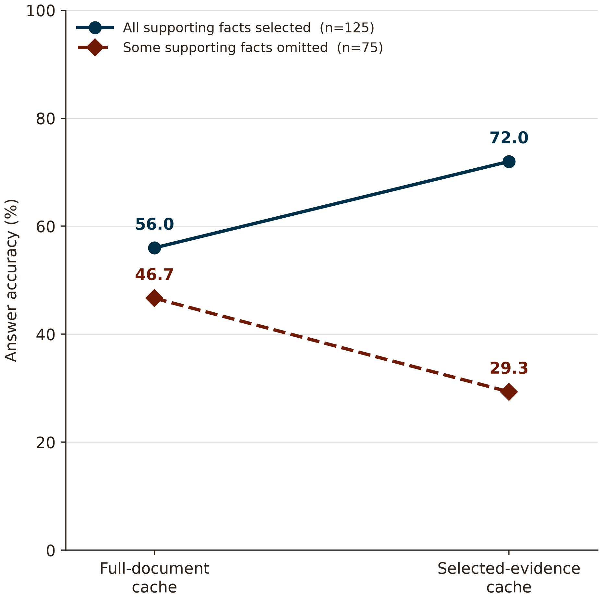
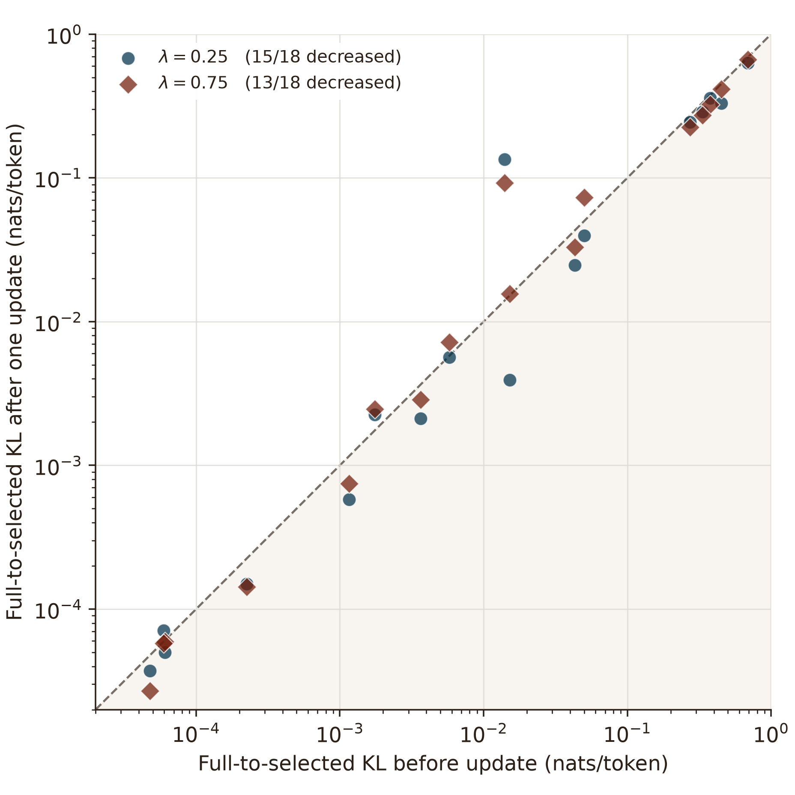
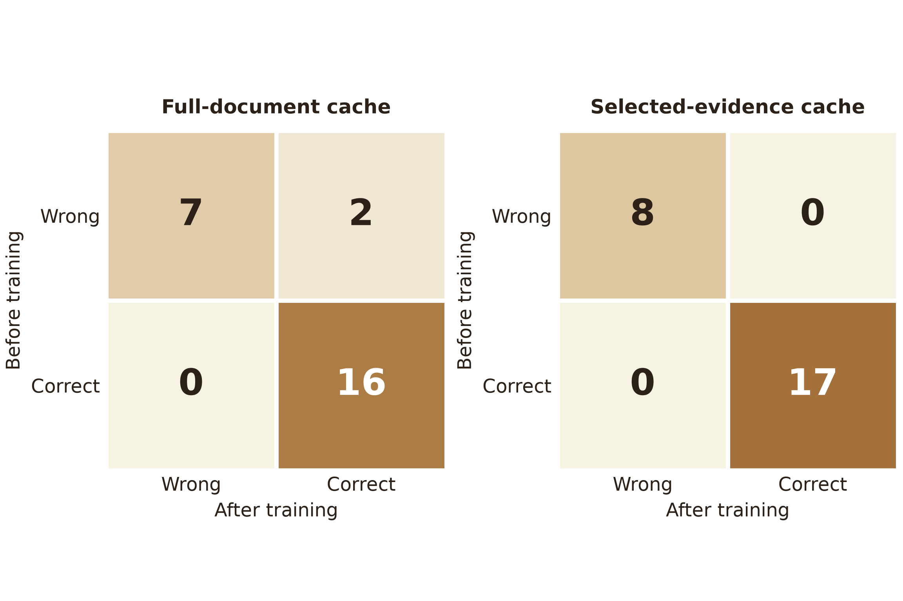
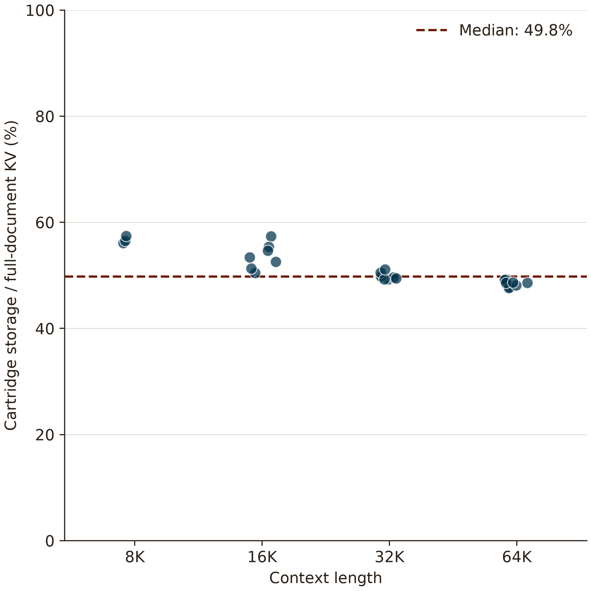

# GPT-OSS Query Cartridges：直接证据

这份报告固定于 2026-11-03 23:43 UTC 的数据快照。正在进行的全文到证据转移实验完成了 **25 / 40** 道配对开发题；这些题来自 10 个来源问题的多个长度版本，并非 25 个完全独立的问题。统一使用 answer-focused loose 词面评分。参考答案和支持事实标注仅用于生成后的分析。

## 1. 为什么需要两种视图？

在另一份已完成的 **200 题 GPT-OSS 开发集对照**中，选中约 10% 的原文时：

- 125 题的标注支持事实全部覆盖，零更新的选中缓存准确率为 72.0%，全文缓存为 56.0%。
- 75 题存在支持事实漏选，零更新的选中缓存准确率为 29.3%，全文缓存为 46.7%。

这直接展示了聚焦与覆盖之间的取舍。两种缓存数据来自不同次运行，题目和选块配对，不能把它们当成同一次模型状态的严格四路干预。支持事实覆盖只代表标注位置被包含，不等于证明模型已经使用了这些事实。

## 2. 全文信号是否影响了证据缓存？

横轴与纵轴分别是第一次更新前、更新一次后的 $D_{KL}(S_D\|S_E)$，自然对数，按 token 平均。只保留两次使用相同问题路径、相同选中 Student 前缀及目标位置的样本，因此每种强度有 18 个配对点；线下表示两种预测分布更接近。$\lambda=0.25$ 时 15 / 18 点下降，$\lambda=0.75$ 时 13 / 18 点下降。

这里每一步的全文目标由当前全文 Student 重新计算，因此两次的目标分布也可能变化。这支持“共享更新能够改变两个视图的分布差距”，但不单独证明转入了正确的全局逻辑。

## 3. 这种变化带来答题收益了吗？

图中使用新实验的 $\lambda=0.25$，25 题同一批题、同一份选块与同一组训练状态：

| 阅读条件 | 更新前 | 更新后 | 新答对 / 新答错 |
|---|---:|---:|---:|
| 全文缓存 | 64.00% | 72.00% | 2 / 0 |
| 选中缓存 | 68.00% | 68.00% | 0 / 0 |
| 选中 ICL Teacher | 72.00% | — | — |

$\lambda=0$ 和 $\lambda=0.75$ 的选中缓存也都是 68.00%。当前直接证据说明训练改变了全文路径的回答，但这批题里还没有观察到收益转移为选中缓存的新答对。它不支持“已经验证了移植全局逻辑”或“GPT-OSS 稳定高于 Teacher 3 点”的结论。

另一条**直接在选中缓存上训练**的 GPT-OSS 试验完成 173 / 200 道开发题，同格式 Teacher 为 58.96%，训练后 60.69%，提升 1.73 点，新答对 8 题、新答错 5 题。它是不同的训练路径，不能作为全文到证据移植已成功的证据。

## 4. 独立 Cartridge 占多少空间？

每个点是一道已完成的开发题。物化后的选中 KV 与适配状态的总字节数，相对原始全文文档 KV 的中位比例是 **49.8%**；本次 GPT-OSS 选块比例为 30%，并非 10%。额外维度补齐和适配状态会增加存储。

这张图比较的是文档缓存与 Cartridge 本身，不含模型权重、训练峰值、问题和生成后缀。当前实验实现确实在独立预填的选中缓存上生成，未读取全文缓存；但整条配对流程仍保留全文缓存的引用，尚未单独测得释放全文后的解码峰值显存，因此不能据此声称当前整次请求的峰值显存下降了 50%。

## 5. 如何直接验证“移植了全局关联”？

构造两个全文 $D_A$ 和 $D_B$，保留完全相同的证据 $E$ 和问题 $Q$，只修改被排除的关联句：

- $E$：红钥匙在抽屉，蓝钥匙在柜子。
- $U_A$：维修员的钥匙是红色；$U_B$：维修员的钥匙是蓝色。
- $Q$：维修员的钥匙在哪里？

分别由两个全文训练出 $\phi_A$ 与 $\phi_B$，再将它们装到**完全相同的**选中缓存与问题上。比较零更新、各自补丁和交换补丁的答案。如果输出随补丁的来源从“抽屉”切换到“柜子”，并且与各自全文一致，就直接说明请求内状态携带了被选中证据遗漏、随全文变化的任务信息。

已提交单 GPU 任务 **31867392**，覆盖 8 对合成关系和三种转移权重；正文、问题、选中缓存输入和零更新输出均逐对核对，参考答案只在生成后用于评分。当前任务排队中，还没有结果。这是受控机制测试，不能直接替代 BABILONG 的准确率实验。

## 复现与可视化

- [data_snapshot.json](data_snapshot.json)：不含原文或参考答案，只保存逐题的二元评分、KL、缓存字节数及来源说明。
- [collect_snapshot.py](collect_snapshot.py)：从保存的实验输出创建快照，并核对支持事实所对应的选块。
- [plot.py](plot.py)：从固定快照生成 PNG、PDF 和 SVG；未绘制置信区间。
- 图形制作采用 [Scientific Visualization skill](https://github.com/K-Dense-AI/scientific-agent-skills) 的可视化原则；参考 Kassis et al., 2026, [Scientific Agent Skills](https://arxiv.org/abs/2609.00065)。
