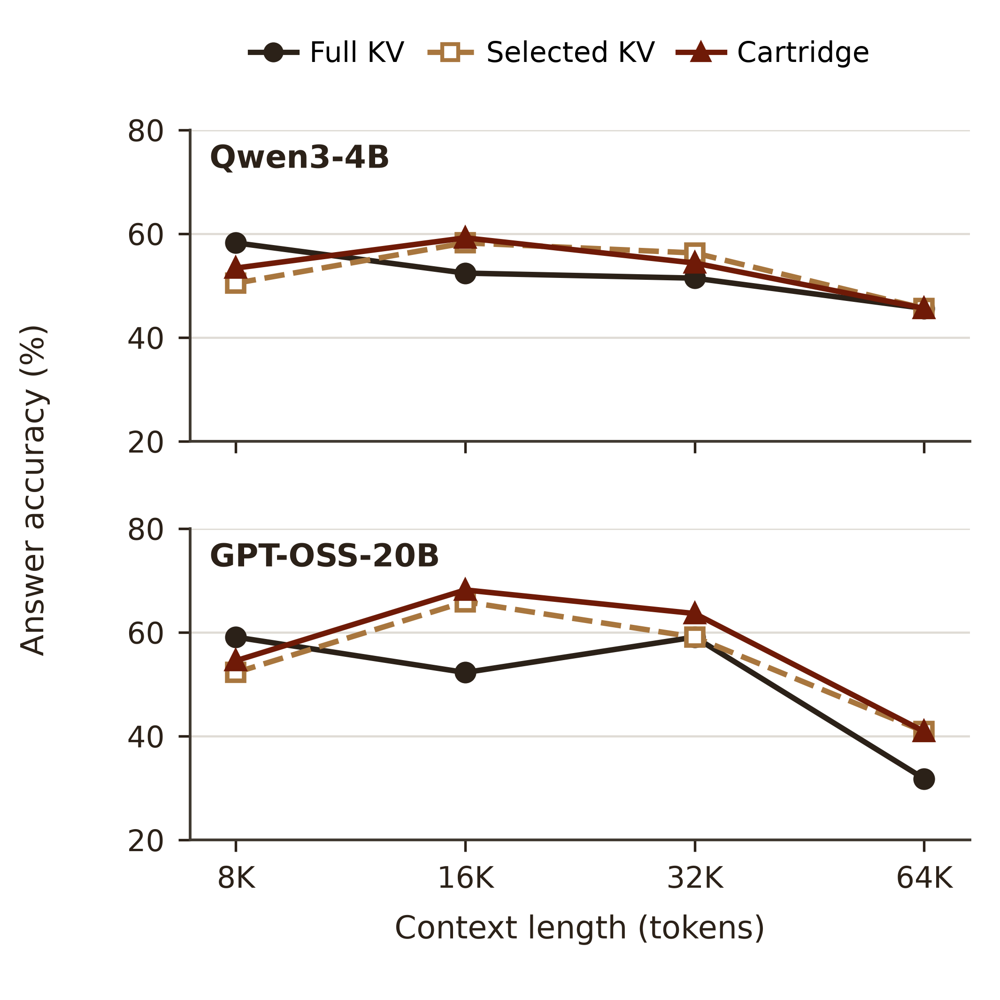
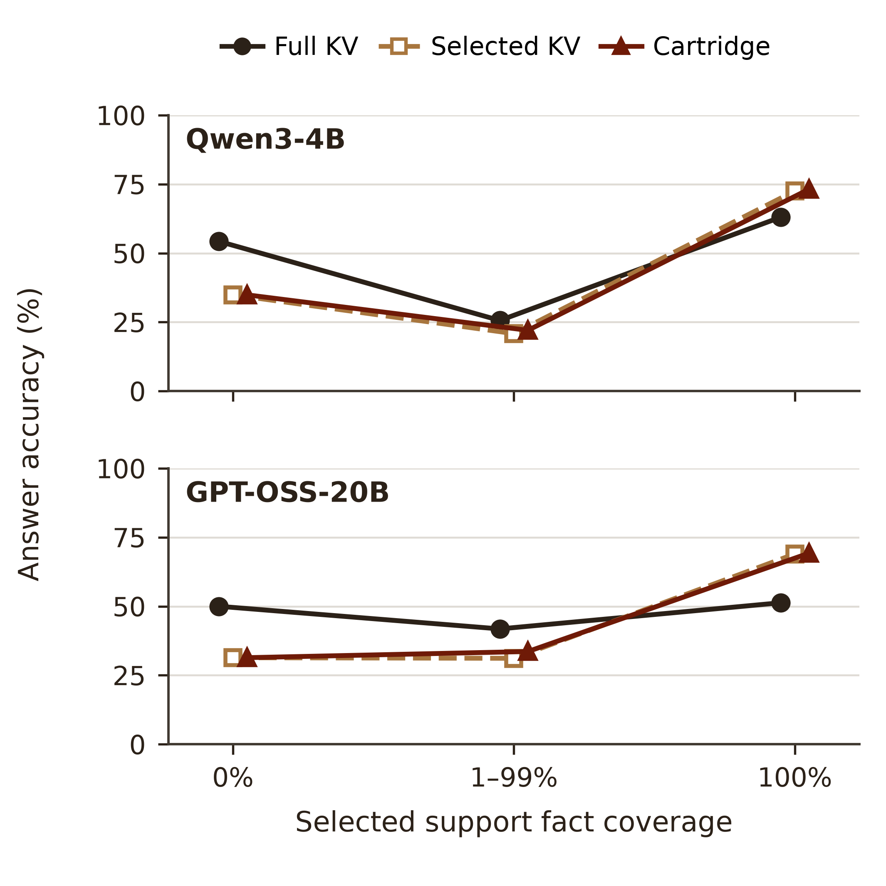

# Query Cartridges：两张规模与证据覆盖动机图

白底、正方形、无图内标题；颜色同时配合线型和点型。两张图都提供 PNG、PDF 和 SVG，适合插入论文再按版面缩放。

## 图 1：长上下文规模

[PDF](figures/motivation_1_context_scale.pdf) · [SVG](figures/motivation_1_context_scale.svg) · [PNG](figures/motivation_1_context_scale.png)

横轴是 8K、16K、32K、64K 上下文；纵轴是回答准确率。为使不同长度的比较对应同一来源问题，只保留四种长度均已完成的问题：Qwen3-4B 为 103 个来源问题，GPT-OSS-20B 为 44 个。每个长度点分别使用同一批来源问题，但不同长度文档中的干扰文本可能不同。

这个快照里，全文 KV 的 Qwen 准确率从 8K 的 58.25% 降至 64K 的 45.63%；GPT-OSS 从 59.09% 降至 31.82%。所画三条线是同题的全文 KV、选中 KV 零更新及独立 Cartridge。图显示长上下文下的表现变化，**没有直接测量注意力分布**。

## 图 2：选中证据的覆盖程度

[PDF](figures/motivation_2_evidence_coverage.pdf) · [SVG](figures/motivation_2_evidence_coverage.svg) · [PNG](figures/motivation_2_evidence_coverage.png)

横轴将每题选中的标注支持事实比例分为 0%、1–99% 和 100%；纵轴仍是同题准确率。两个模型分别使用已完成的 792 和 614 道配对题。Qwen 三组题数为 129、168、495；GPT-OSS 为 102、122、390。横向的小偏移只用于区分重合的点。

当标注支持事实全部被选中时，聚焦视角在这份快照上优于全文视角；没有选中标注支持事实时，全文视角更有优势。这是按现有选块结果的事后分组，组间任务难度可能不同，并非对同一道题强制改变覆盖率的因果实验。

## 方法如何结合两者？

Cartridge 在构造时使用全文 KV 作为 Student 的训练环境，用选中片段构建 ICL Teacher；训练后的读取修正被物化到独立选中 KV 中，正式回答前释放全文 KV。两图中的 Cartridge 使用的是实际生成的独立回答。

这两张图同时显示了尚待解决的地方：在 0% 覆盖组，当前 Cartridge 的表现与选中 KV 基本相同，还没有恢复全文优势。同问题格式、选块和物化精度的改进正在分别做配对验证。

## 复现和图注

- [data_snapshot.csv](data_snapshot.csv)：只包含公开任务编号、长度、事后覆盖率和三个方法的二元评分；不包含文档原文或答案文本。
- [data_snapshot.metadata.json](data_snapshot.metadata.json)：冻结时间、输入与评分方式。
- [plot_summary.csv](plot_summary.csv)：每个点的分子、分母和准确率。
- [capture_snapshot.py](capture_snapshot.py) 和 [plot.py](plot.py)：数据冻结及作图脚本。

统一评分为 `answer_focused_lexical_v2`。三个方法在每道题上使用相同的问题格式和生成预算；原运行中的 ICL Teacher 另有格式要求，因此没有与这三条线混在一起。两图未绘制置信区间。原始快照在图生成时尚未覆盖每个模型的全部 1,000 题。

可视化工作使用 Scientific Visualization skill；参考 Kassis, Agarwal, He, Patel, and Brueckner (2026), [*Scientific Agent Skills: A Library of Procedural Knowledge for Research Agents*](https://doi.org/10.48550/arXiv.2609.00065)。
