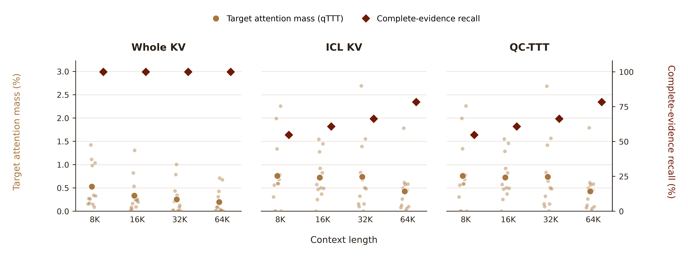

# 图 1：全文读取、选中 ICL 与 Query Cartridge

[PDF](figures/motivation_1_official_metrics.pdf) · [SVG](figures/motivation_1_official_metrics.svg) · [PNG](figures/motivation_1_official_metrics.png) · [绘图数据](data/figure_data.csv) · [48 个匿名配对数据点](data/target_attention_points.csv)

三个面板依次是 Whole KV、ICL KV 和 QC-TTT；横轴为上下文长度。金色小点和大点分别是逐题及平均目标注意力质量，读取左轴；深红菱形是完整证据召回率，读取右轴。两个指标越高，分别表示支持事实受到更多注意力、标注事实保留得越完整。没有连接缺失点，也没有用面积表示效果大小。

## 指标和数据

**左轴：Target attention mass。** 采用 [qTTT 论文 Appendix E](https://arxiv.org/html/2512.13898) 的指标：对目标 token 的注意力概率求和，再平均层、头和答案位置。这里目标集合使用 BABILONG 标注的全部支持事实 token，而非论文的合成 needle；为对齐三个方法，本实验使用相同的参考答案前缀进行事后 teacher forcing。支持事实与参考答案都只用于训练后的测量。

这是 12 个按任务分层抽取的来源问题，分别构造 8K、16K、32K、64K 四种上下文，共 **48 次配对请求**、每个长度 12 次；不能视作 48 个相互独立的来源问题。全部 32 层均纳入平均，滑动窗口层只能读取窗口内的支持位置。读出按部署时 Q/K 和物化偏置以 FP32 重建。参考答案分别为 1 或 2 个 token。选择使用固定种子，不依据任何方法的正确率挑题。三个方法使用相同原问题后缀；这里的 ICL KV 是匹配后缀的零更新选中缓存控制，不是历史 Teacher 带额外输出指令的回答。

**右轴：Complete-evidence recall。** 按 [Retrieval from Within / INTRA](https://arxiv.org/html/2605.05806) 的完整证据召回定义，计算全部标注支持证据均被保留的问题占比。本图以 BABILONG 的支持事实字符区间作为证据单位，而非 INTRA 的 oracle chunk。范围是原文完整且可核对的 **838 次请求**：8K、16K、32K 各 250 次，64K 为 88 次；另 162 次 64K 工作文档已先压缩，不计入此分母。字符区间判定对块边界上的标点较严格。

同一选择结果下，ICL KV 与 QC-TTT 的**文本证据完整率相同**。该指标能够衡量标注事实是否全部保留，并不直接衡量事实之间的关系是否完整，也不衡量适配参数里是否携带了未选中的信息。

| 长度 | Whole 注意力质量 | ICL 注意力质量 | QC 注意力质量 | ICL / QC 完整证据召回 |
| --- | ---: | ---: | ---: | ---: |
| 8K | 0.527% | 0.758% | 0.757% | 54.8% |
| 16K | 0.333% | 0.722% | 0.725% | 60.8% |
| 32K | 0.253% | 0.738% | 0.738% | 66.4% |
| 64K | 0.196% | 0.426% | 0.426% | 78.4% |

在这 12 个配对来源问题上，Whole KV 的平均支持事实注意力质量随长度从 0.527% 降到 0.196%；选中视图的质量更高，但并非每道题都保留完整事实。QC-TTT 与匹配的 ICL KV 在此指标上非常接近，因此本次测量不能声称 QC 显著增加了 ICL 的目标注意力或文本证据覆盖。完整答题准确率见[三模型性能报告](../query-cartridges-full-performance-20261104/README.md)。

## 复现

作业 **32027776** 在一张 B200 上完成，用时 6 分 18 秒，48／48 请求完成且无错误、无在线 API 调用。输入清单由固定随机种子按题型选择；模型、原始文档 KV 与原回答生成逻辑保持不变。[实验代码与定义](../../../experiments/official_motivation_metrics/README.md)包含精确复现参数与五项预检。结果 CSV 不包含原文或答案。

可视化使用 Scientific Visualization skill，参考 [Kassis 等（2026）](https://arxiv.org/abs/2609.00065)。
