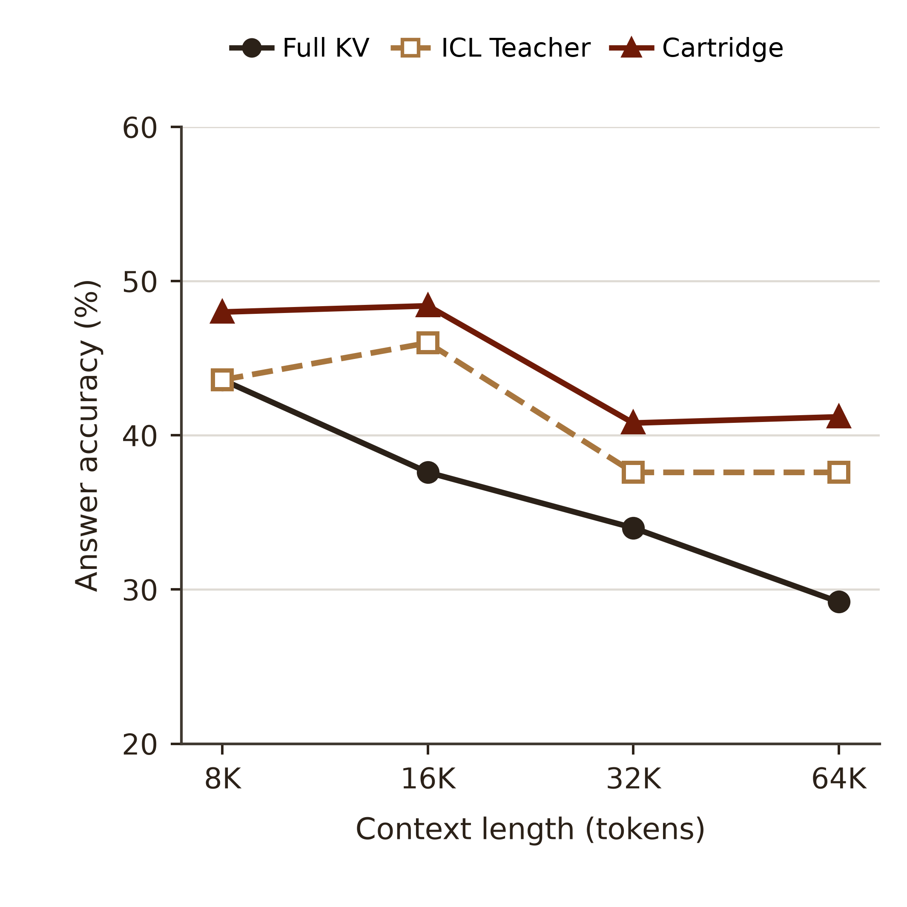
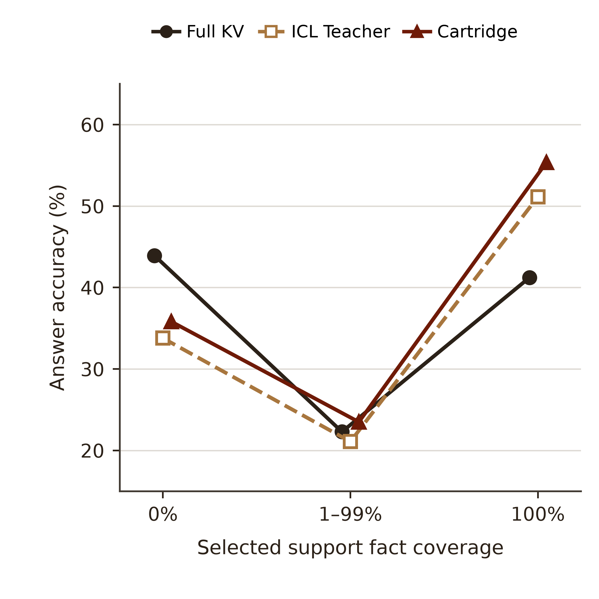

# OLMo-3-7B：两张 Query Cartridge 动机图

两图使用原始 OLMo BABILONG 1,000 题逐题结果，白底、正方形，无图内标题。横轴和纵轴均采用相同模型、同题评分；数据、作图代码和图形源文件都在本目录。

## 图 1：上下文长度

[PDF](figures/motivation_1_olmo_context_scale.pdf) · [SVG](figures/motivation_1_olmo_context_scale.svg) · [PNG](figures/motivation_1_olmo_context_scale.png)

横轴为原题的 8K、16K、32K、64K 长度，每组 250 题；纵轴为回答准确率。Cartridge 在四组上分别为 48.0%、48.4%、40.8% 和 41.2%，高于对应的 ICL Teacher。全文读取随长度增长的表现下降，是使用聚焦视角的动机；此图不直接测量注意力分布。

OLMo 的窗口限制使 64K 组中 162 题先根据缓存分数压缩工作文档；三种方法在每题使用同一工作文档。不能把那 162 题标成全文完整输入。

## 图 2：选中支持事实覆盖

[PDF](figures/motivation_2_olmo_evidence_coverage.pdf) · [SVG](figures/motivation_2_olmo_evidence_coverage.svg) · [PNG](figures/motivation_2_olmo_evidence_coverage.png)

横轴将选中原文覆盖的标注支持事实比例分为 0%、1–99% 和 100%。只纳入工作文档保留完整原文且支持事实与选块映射可核对的 **838 题**，三组分别为 148、166、524 题；162 题使用压缩工作文档，未放入此覆盖图。横向小偏移只用于区分重合的点。

在支持事实全部被选中的组，Cartridge 为 55.34%，ICL Teacher 为 51.15%，全文 KV 为 41.22%；在没有选中标注支持事实的组，全文 KV 仍高于两种选中视角。这说明选择聚焦与保留完整证据之间的取舍。不同覆盖组的题型和难度可能不同，该图不是对同一道题改变覆盖率的因果实验。

## 统一方案与涨点复现

方法先让全文 Student 在选中 ICL Teacher 的监督下更新请求内读取状态，再将状态物化到独立的选中 KV，释放全文 KV，最后由 Cartridge 自行回答。

原始 1,000 题中，Cartridge 为 **44.60%**，ICL Teacher 为 **41.20%**，相差 **3.40 个百分点**；另一轮 1,000 题配对复跑中，分别为 **44.50%** 和 **41.00%**，相差 **3.50 个百分点**。两轮的 Teacher 额外使用通用回答格式要求，Cartridge 使用原问题格式；因此这个方法级差值不应全部归因于 SD 更新。复跑中同一选中缓存、同一输出格式的零更新与训练后分别为 44.30% 和 44.50%。

图中的准确率使用 `answer_focused_lexical_v2`，不是 LLM 语义判分；没有绘制置信区间。[data_snapshot.csv](data_snapshot.csv) 不包含原文或答案文本，[plot_summary.csv](plot_summary.csv) 记录每个点的分子、分母和数值，[capture_snapshot.py](capture_snapshot.py) 与 [plot.py](plot.py) 分别负责冻结记录和绘图。[data_snapshot.metadata.json](data_snapshot.metadata.json) 记录源快照和设置。

可视化工作使用 Scientific Visualization skill；参考 Kassis, Agarwal, He, Patel, and Brueckner (2026), [*Scientific Agent Skills: A Library of Procedural Knowledge for Research Agents*](https://doi.org/10.48550/arXiv.2609.00065)。
