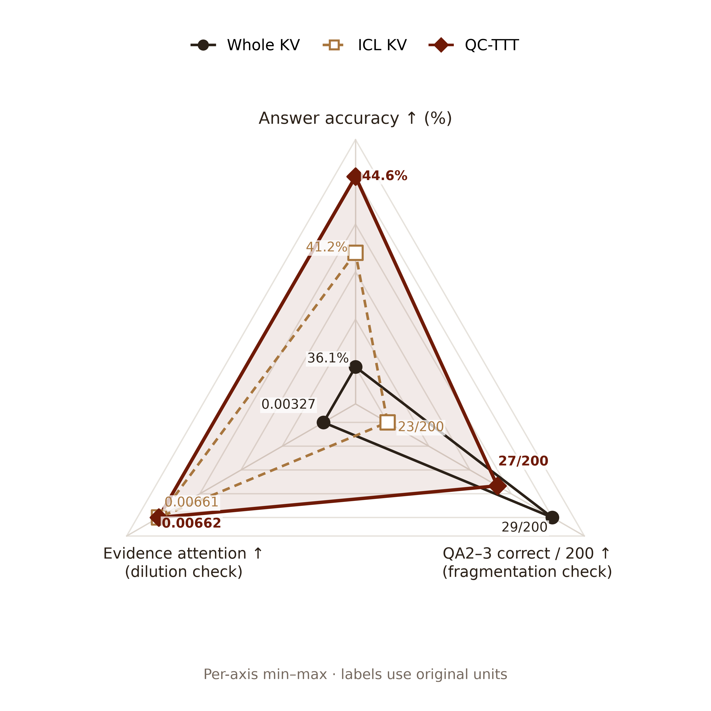

# OLMo：准确率、证据注意力与多跳问答

[矢量 PDF](figures/olmo_three_axis.pdf) · [可编辑 SVG](figures/olmo_three_axis.svg) · [PNG](figures/olmo_three_axis.png) · [计算数值](summary.json)

三条轴分别显示：整体准确率（%）；缓解注意力弥散所对应的**支持事实注意力质量**（0–1 之间的概率质量）；用来检查碎片化对多事实问答影响的 **QA2／QA3 多跳题答对数**（共 200 次请求）。三条轴均越向外数值越高。为显示不同量级上的变化，每条轴分别对三个方法的均值进行 min–max 归一化：`r = 0.14 + 0.72 × (x − min) / (max − min)`；内外留白是为了放置标签。**图中标注保留各自的原始单位，不是归一化后的数值。** 各轴的缩放独立且样本数不同，不能跨轴比较距离；多边形面积不代表综合得分。

| 方法 | 整体准确率 | 支持事实注意力质量 | QA2／QA3 答对数 |
| --- | ---: | ---: | ---: |
| Whole KV | 36.10% | 0.00327 | **29 / 200** |
| ICL KV | 41.20% | 0.00661 | 23 / 200 |
| QC-TTT | **44.60%** | 0.00662 | 27 / 200 |

整体和多跳准确率复用 OLMo 的 1,000 次 BABILONG 运行：整体含 1,000 次请求，多跳含全部 200 次 QA2／QA3 请求；每个来源问题跨四种上下文长度重复，64K 中有 162 次工作文档在运行前已经压缩。准确率使用 `answer_focused_lexical_v2` **宽松词面评分**。ICL 使用额外的通用输出格式要求，QC 使用原问题格式；数值是完整设置的对比，不能全部归因于训练。QC-TTT 的整体准确率比 ICL 高 **3.4 个百分点**，QA2／QA3 高 **2.0 个百分点**；全文 KV 在 QA2／QA3 上比 QC 高 1.0 个百分点。

QA2 需要两个支持事实，QA3 需要三个，定义见 [BABILong 原论文](https://proceedings.nips.cc/paper_files/paper/2024/file/c0d62e70dbc659cc9bd44cbcf1cb652f-Paper-Datasets_and_Benchmarks_Track.pdf)。这项真实任务成绩衡量多事实问答表现，是碎片化问题的**功能性检查**；单看答对率不能证明模型确实连接了所有事实，参考 [DiRe](https://arxiv.org/abs/2005.00789)。

注意力质量参照 [qTTT](https://arxiv.org/html/2512.13898) 的 target attention mass，对标注支持事实 token 的注意力求和，平均各层、各头与相同参考答案前缀位置。该数据来自单独的 **12 个来源问题 × 4 种长度 = 48 次配对读出**；这里的 ICL 为同后缀的零更新选中缓存，和历史 ICL 答题格式不同。QC 与 ICL 的注意力实测几乎相同，而 QC 高于 Whole。原始明细和实验设置见 [指标实验说明](../official-motivation-figure-20261104/README.md)。

运行 `python docs/analysis/olmo-triangle-result-20261104/plot.py` 可从仓库中的冻结数据重绘。作图使用 Scientific Visualization 技能；参考 [Kassis 等（2026）](https://arxiv.org/abs/2609.00065)。
