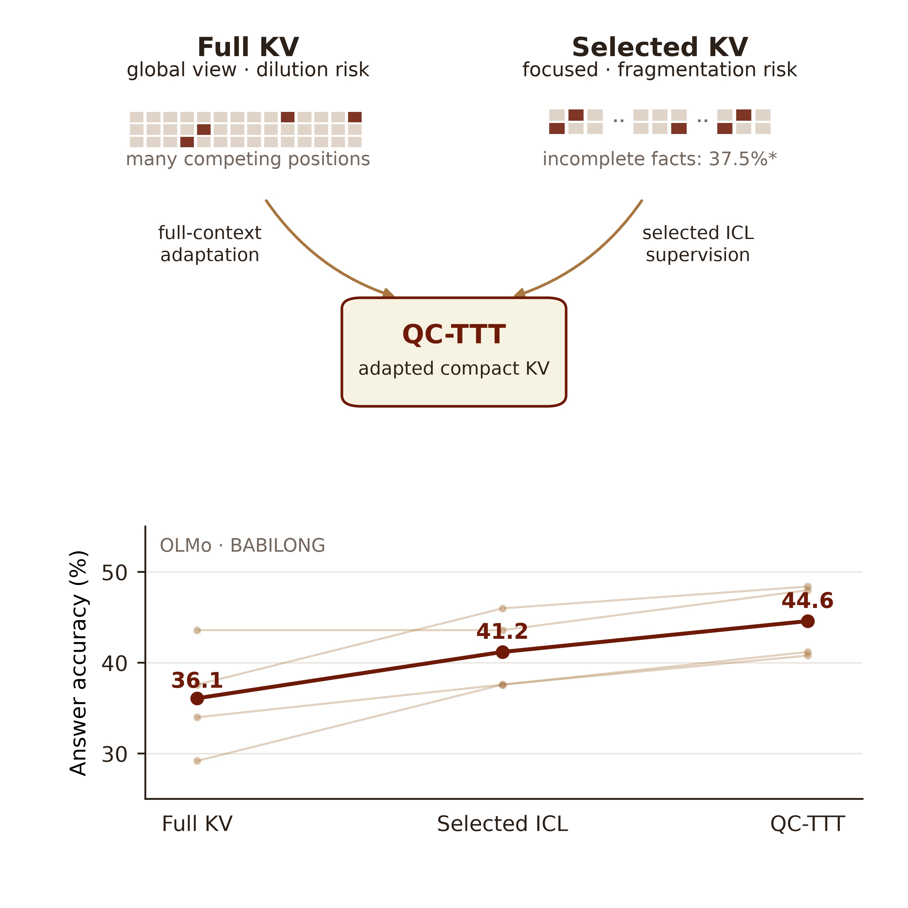
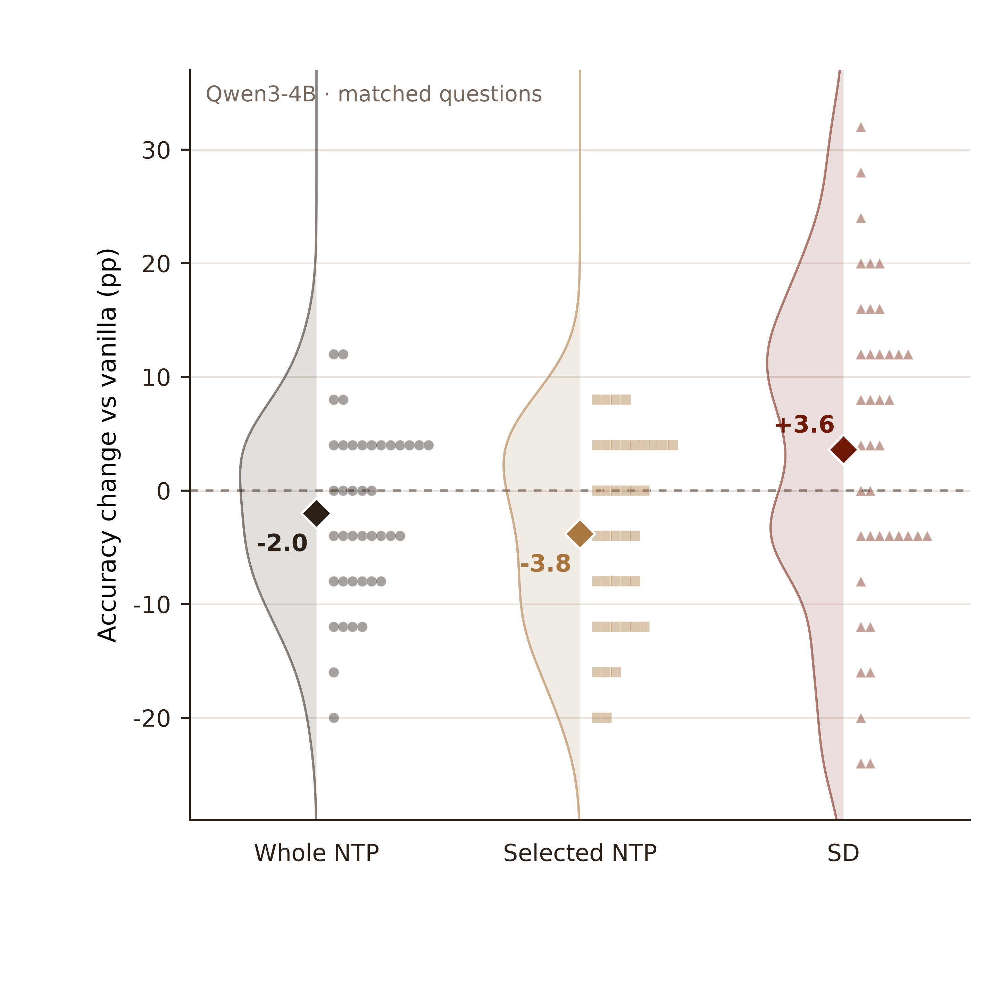
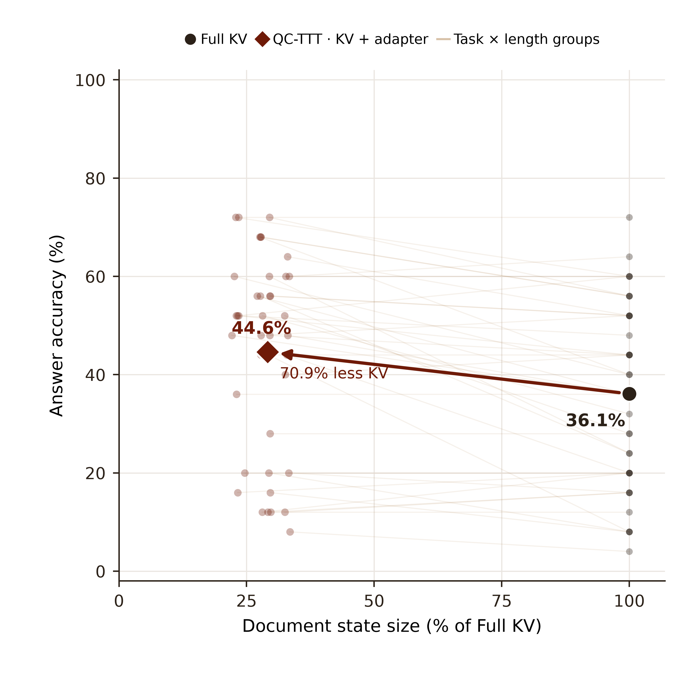

# Query Cartridges：三张动机图

统一白底、棕红色系；每张图提供 600-dpi PNG 和可编辑文字的 PDF／SVG。图与数据来自已有 BABILONG 日志，没有重新提交实验或调用 API。准确率统一使用 `answer_focused_lexical_v2` 宽松词面评分。

## 图 1：全文、选块与 QC-TTT

[PDF](figures/motivation_1_views_and_qc.pdf) · [SVG](figures/motivation_1_views_and_qc.svg) · [PNG](figures/motivation_1_views_and_qc.png)

上半部分是机制**示意**：全文保留全局视野，同时有读取分散的风险；选块更聚焦，但支持事实和关系可能不完整；QC-TTT 使用选中证据的监督，在全文视图中适配读取状态，并物化为紧凑的选中 KV。下半部分是 OLMo-3-7B 已完成实验的实际结果：全文 KV、选中 ICL、QC-TTT 的总体准确率分别为 **36.1%、41.2%、44.6%**。浅线是 8K、16K、32K、64K 四个长度组，深线是整体；准确率纵轴从 25% 开始。

图中“incomplete facts: 37.5%”指 838 道保留完整工作文档且支持事实能核对的题里，有 **314 道**选中片段没有覆盖全部标注支持事实。它度量的是**事实覆盖不完整**，不是已经测量了多少关系被切断。支持事实采用原文字符区间映射，块边界上的标点可能影响覆盖判定。

图中的 dilution 和 fragmentation 是要检验的机制动机；OLMo 现有记录没有保存标注事实上的逐头注意力，也没有保存事实关系边的完整性，不能只凭这条准确率线证明这两个机制。对照 ICL 额外包含通用回答格式要求，QC-TTT 使用原问题格式，因此 44.6% − 41.2% 是完整设置差异，不能全部归因于适配更新；逐题比较中有 58 题新答对、24 题新答错。同缓存、同格式的另一轮配对复跑是 **44.3% → 44.5%**。完整的 1,000 次请求由 250 个来源问题的四种上下文长度构成；其中 64K 组的 162 个工作文档先经过压缩。长度组线并非独立题集。

## 图 2：NTP 与 SD 的收益分布

[PDF](figures/motivation_2_ntp_sd_raincloud.pdf) · [SVG](figures/motivation_2_ntp_sd_raincloud.svg) · [PNG](figures/motivation_2_ntp_sd_raincloud.png)

这是一组已完成的 **Qwen3-4B** KV 更新消融。每个小点是同一题型与上下文长度组成的 25 题组，纵轴是相对相同 Vanilla 的准确率变化；大菱形是全部 1,000 次请求的净变化：Whole NTP **−2.0**、Selected NTP **−3.8**、Soft SD **+3.6** 个百分点。点的纵坐标均为真实分组数据，只在分类横轴上展开；半小提琴是 40 个分组变化的 Gaussian KDE，带宽 4 个百分点。它不是置信区间。

起点均为 54.2%，最终分别为 52.2%、50.4%、57.8%。该消融的 Soft SD 在全文 KV 上进行，**不是** OLMo 独立 QC-TTT 的直接消融；也没有记录每个中间步骤的自由生成准确率。另有参考答案 NLL 记录并未显示 SD 在该指标上优于 NTP，不能把生成准确率直接解释为 NLL 下降。

## 图 3：质量与缓存大小一起看

[PDF](figures/motivation_3_quality_storage.pdf) · [SVG](figures/motivation_3_quality_storage.svg) · [PNG](figures/motivation_3_quality_storage.png)

纵轴是 OLMo 答题准确率；横轴是文档状态大小相对全文 KV 的百分比。浅色线连接同一题型及长度下的 Full KV 与 QC-TTT，共 40 个每组 25 题的配对组。大点是全体：Full KV 为 **36.1%**，QC-TTT 为 **44.6%**；逐题计算的 Cartridge／全文 KV 比值中位数为 **29.1%**，即小 **70.9%**。

Cartridge 大小包含物化后的选中 KV 与适配参数，Full KV 为工作文档 KV；不包括模型、问题／答案 KV、临时训练状态或总显存峰值。横轴是比值的中位数，不是总字节比值；该图不能说明端到端延迟或显存峰值。

## Dilution 与 fragmentation 如何实际测量？

设 $D$ 是文档 token 位置，$S$ 是对应标注支持事实的位置，$\alpha^{\ell,h}_{t,u}$ 是答案位置 $t$ 在第 $\ell$ 层、第 $h$ 个头给位置 $u$ 的注意力。可先测**证据注意力份额**：

$$
\operatorname{EAS} = \operatorname{mean}_{t,\ell,h}
\left[\frac{\sum_{u\in S}\alpha^{\ell,h}_{t,u}}
{\sum_{u\in D}\alpha^{\ell,h}_{t,u}}\right].
$$

这是文档注意力中分给标注证据的比例；答案位置、层和头的汇总方式应事先固定，另可报告逐层分布。证据长度比例 $|S|/|D|$ 可作为均匀读取参考。对同一问题和证据逐步增加无关文本，测 EAS 和正确答案 NLL 或选项 margin 的变化；再对无关位置做受控遮罩，能更直接地研究分散是否影响回答。注意力份额本身只是读取代理，不等同于因果贡献。

对选择后的**事实覆盖**，若 $F$ 是标注支持事实、$F_E$ 是选中片段完整保留的事实：

$$
\operatorname{FactCoverage}=|F_E|/|F|,\qquad
\operatorname{IncompleteRate}=\operatorname{mean}[\mathbf 1(F_E\ne F)].
$$

上图可直接计算的是第二个指标：314/838 = 37.5%。要测真正的**关系碎片化**，还需标注支持事实间所需的指代、时间或推理连接 $R$，并检查每条连接的两个端点及表达该连接的必要文本是否被保留：

$$
\operatorname{LinkRetention}=|R_E|/|R|.
$$

不存在所需关系边的单事实题不纳入 LinkRetention 分母。区分“事实缺失”和“事实都在但关系断了”，才能定位压缩带来的不同问题。

为了检查全文训练是否给选中 KV 带来关系使用收益，可固定同一选中缓存、输出格式与教师信号，配对比较：零更新、只在选中视图更新、在全文视图更新后迁移到选中 KV。再按完整事实与完整关系分组比较回答准确率及答案 NLL。这需要新增受控实验；上图没有把它当成已经完成的结果。

## 文件与复现

[`data/summary.json`](data/summary.json)、[`data/olmo_task_length.csv`](data/olmo_task_length.csv) 与 [`data/qwen_objective_changes.csv`](data/qwen_objective_changes.csv) 仅含汇总计数与缓存比例，不含题目或答案文本。`capture_groups.py` 从既有日志校验配对和统一重评分；`python plot.py` 使用冻结 CSV 和 JSON 重画。每张图的完整原始来源与旧版图在 [`three-motivation-figures-20261104`](../three-motivation-figures-20261104/) 中。

作图参考 Scientific Visualization skill；见 [Kassis 等（2026）](https://arxiv.org/abs/2609.00065)。
