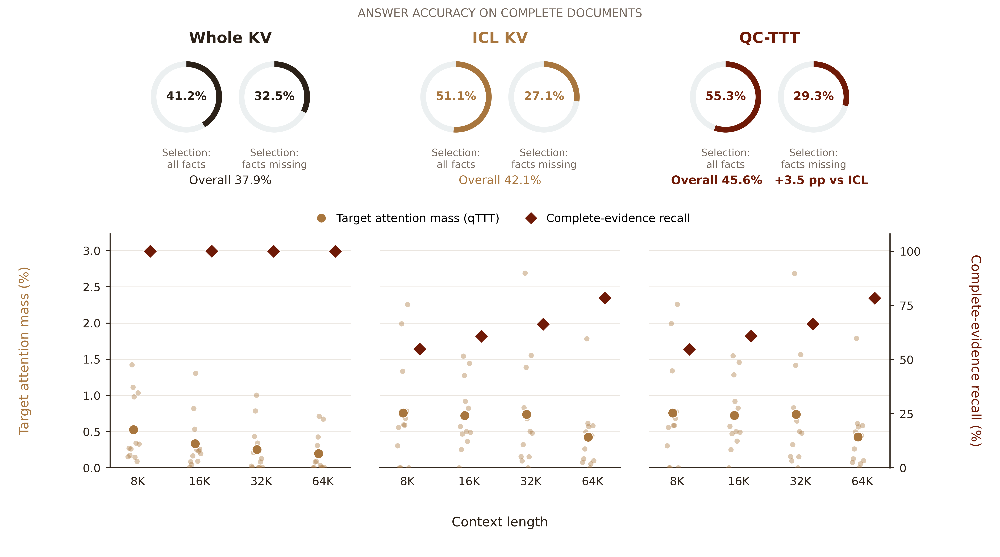

# 图 1：全文、选块和 QC-TTT 的统一比较

[PDF](figures/motivation_1_unified.pdf) · [SVG](figures/motivation_1_unified.svg) · [PNG](figures/motivation_1_unified.png) · [逐长度指标](data/combined_metrics.csv)

图分为 Whole KV、ICL KV、QC-TTT 三个面板，共享上下文长度横轴。下半部分左轴是支持事实的注意力质量，右轴是完整证据召回。上半部分用相同 0–100% 角度范围的圆环显示：选块覆盖全部标注事实，以及选块漏掉至少一个事实时，各方法分别答对多少题；两组划分均依据同一份选块，Whole KV 本身仍可读完整工作文档。

## OLMo 的答题结果

以下使用 838 个保留完整工作文档且标注可核对的请求。各百分比采用 `answer_focused_lexical_v2` 宽松词面评分；差值为百分点。

| 选块的标注事实覆盖 | 题数 | Whole KV | ICL KV | QC-TTT | QC 相对 ICL |
| --- | ---: | ---: | ---: | ---: | ---: |
| 全部事实都被选中 | 524 | 41.22% | 51.15% | **55.34%** | +4.20 |
| 至少漏掉一个事实 | 314 | 32.48% | 27.07% | **29.30%** | +2.23 |
| 总体 | 838 | 37.95% | 42.12% | **45.58%** | +3.46 |

在这 838 个配对请求里，QC 相对 ICL 新答对 47 题、新答错 18 题。事实不完整组中，QC 高于 ICL，但 Whole KV 仍更高。完整 1,000 次请求的原始运行是 Whole **36.10%**、ICL **41.20%**、QC **44.60%**；838 的图内数字和 1,000 的总体数字分母不同。1,000 次请求来自 250 个来源问题的四个上下文长度；64K 中另有 162 题的工作文档先被压缩，未进入本图的 838 题。

ICL Teacher 使用额外通用输出格式要求，QC 使用原问题格式。故这些是各完整设置的配对结果，包含格式与方法差异；同缓存、同格式的另一轮复跑为 **44.30% → 44.50%**。按覆盖分组是事后描述，不是随机删除证据的因果实验。

## 两个读取指标

- **左轴：目标注意力质量。** 借鉴 [qTTT 论文的 target attention mass](https://arxiv.org/html/2512.13898)：对标注支持事实 token 的注意力求和，平均所有层、头和回答位置。本图使用 12 个来源问题 × 四种长度的 48 次配对读出；为了位置对齐，三个方法使用相同参考答案前缀做事后 teacher forcing。小点为单次请求，大点为均值。支持事实和答案没有进入训练。
- **右轴：完整证据召回。** 根据 [INTRA 的 complete-evidence recall](https://arxiv.org/html/2605.05806) 思路，计算 838 次请求中全部标注支持事实被保留的比例；这里使用 BABILONG 事实字符区间，而非 INTRA 的 oracle chunk 单位。ICL 和 QC 使用同一选块，所以两者的**文本**完整证据召回相同；该指标不能直接判断参数里是否编码了未选中的信息。

整体上，完整文档的目标注意力随长度从 **0.527%** 降到 **0.196%**；ICL 与 QC 的选中视角更聚焦。QC 与 ICL 的平均目标注意力在这组样本中十分接近，当前测量不能声称 QC 在该单一指标上优于 ICL。

## 内部训练信号

原 OLMo 1,000 题日志中，**1,000／1,000** 题至少有一次已接受的更新，且读取分配与 Value 两组参数分别都出现过非零梯度。这说明两条路径均收到了训练信号；梯度本身不等同于准确率提升。[梯度汇总](data/gradient_signals.json) · [审计脚本](../../../experiments/official_motivation_metrics/audit_gradient_signals.py)

新测的 48 次配对读出中，按 **0.00001 个百分点**的阈值，QC 相对匹配 ICL 的目标注意力有 42 次不同：21 次更高、21 次更低；绝对变化中位数为约 **0.00123 个百分点**。这说明读出有变化，但不能据此声称注意力在所有请求上都提高。[注意力变化汇总](data/attention_changes.json) · [48 个匿名数据点](../official-motivation-figure-20261104/data/target_attention_points.csv)

## 复现

`python experiments/official_motivation_metrics/replot_unified.py` 从已冻结的 OLMo 逐题结果和注意力 CSV 重画，不调用模型或 API。源数据、完整指标定义、格式与样本说明见[论文指标实验](../official-motivation-figure-20261104/README.md)；[答题配对明细](data/outcomes_by_coverage.json)记录了新对和新错数量。

可视化使用 Scientific Visualization skill，参考 [Kassis 等（2026）](https://arxiv.org/abs/2609.00065)。
