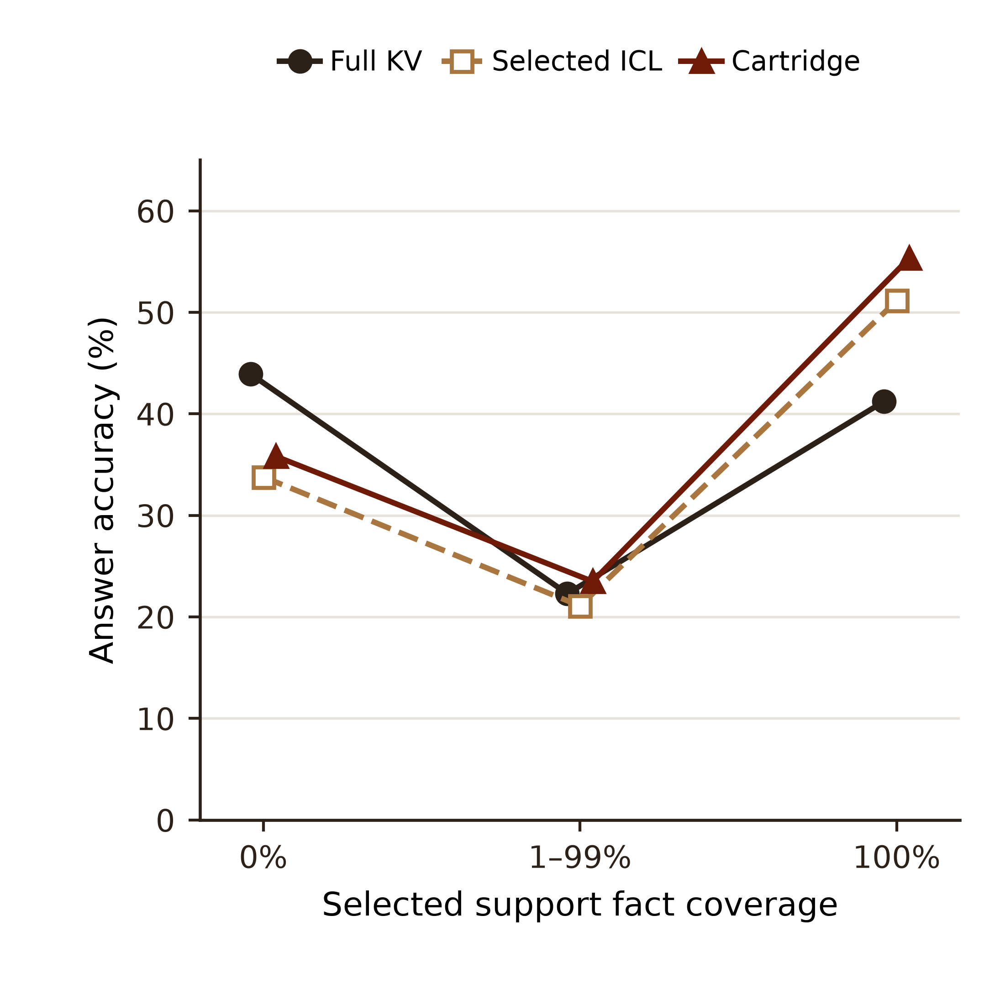
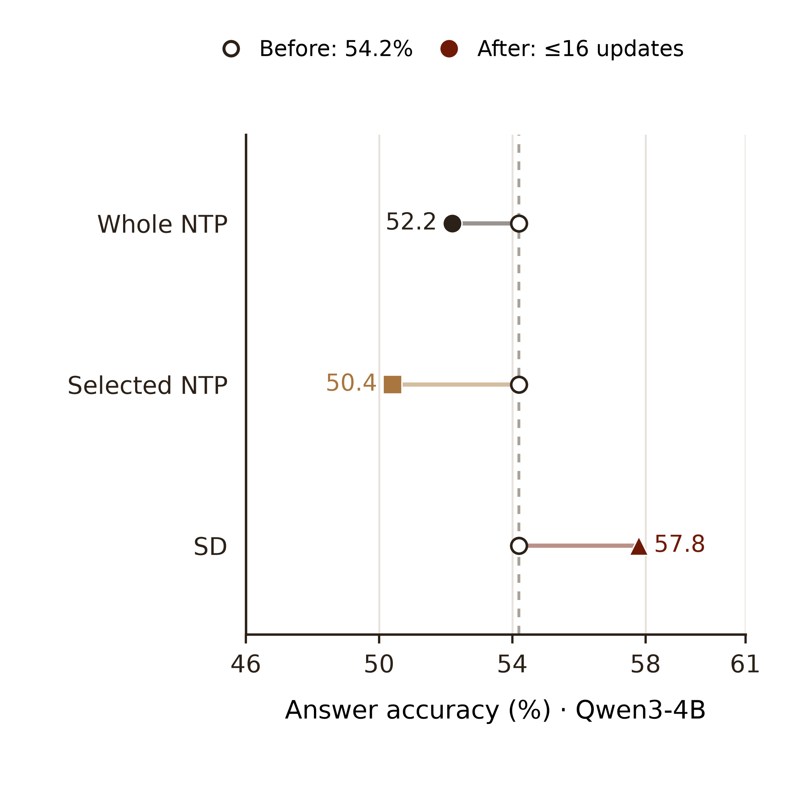
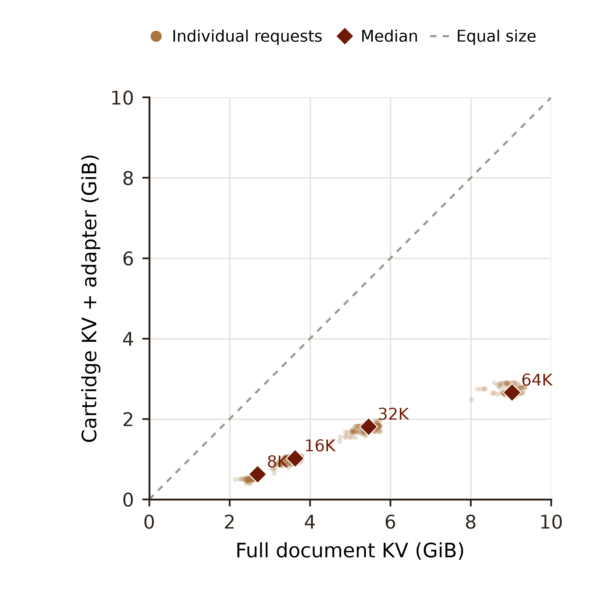

# Three motivation figures: context, objectives, and storage

Three square figures use the same white background and brown/rust palette. They
are redrawn from existing BABILONG logs; no experiment, model, or API was run
for this release. Accuracy below is `answer_focused_lexical_v2`, a common loose
lexical scorer, rather than an LLM semantic judge or official exact-match ACC.
The figures do not include confidence intervals.

## 1. Full-context coverage versus selective focus

[PDF](figures/motivation_1_coverage_tradeoff.pdf) · [SVG](figures/motivation_1_coverage_tradeoff.svg) · [PNG](figures/motivation_1_coverage_tradeoff.png) · [point values](data/coverage.csv)

**Caption.** OLMo-3-7B, BABILONG. For each case, support fact coverage is the
fraction of annotated supporting facts mapped to selected text. We group cases
into 0%, 1–99%, and 100% coverage and plot answer accuracy of full-document KV,
selected-only ICL, and the saved Query Cartridge. Each method uses the same
cases within a coverage group. Points are shifted horizontally only for
legibility. At 0% coverage, Full KV scores 43.9% versus 33.8% for selected ICL;
at 100% coverage, selected ICL scores 51.1% versus 41.2% for Full KV. The
Cartridge scores 35.8% and 55.3% in the same groups, respectively.

There are 148, 166, and 524 cases in the three groups. The remaining 162 of
1,000 used a pre-compacted working document because of the OLMo context
limit and are excluded from this coverage plot. The groups contain different
questions and difficulties: this is an observational comparison, not a
controlled evidence-deletion study. It does not directly measure attention
dilution or prove that a cartridge recovers a fact absent from its input.
The saved selected-only ICL uses an extra generic output-format instruction,
whereas the cartridge uses the original task format; their gap includes this
setting difference. The earlier log calls this selected-only output `teacher`.

## 2. NTP and SD: same initial model, downstream answer accuracy

[PDF](figures/motivation_2_ntp_vs_sd.pdf) · [SVG](figures/motivation_2_ntp_vs_sd.svg) · [PNG](figures/motivation_2_ntp_vs_sd.png) · [point values](data/objective_accuracy.csv)

**Caption.** Qwen3-4B-Instruct-2507, the same 1,000 BABILONG questions.
All rows share the unchanged model's 54.2% starting accuracy. After at most 16
request-specific KV updates, Whole NTP, Selected NTP, and soft SD obtain
52.2%, 50.4%, and 57.8%, respectively. The values are independently generated
final answers, uniformly rescored; the figure is not a loss curve and does not
invent intermediate-step accuracies. The displayed horizontal axis begins at
46%, not zero, to make the differences legible.

The existing paired NTP/SD ablation uses Qwen, rather than OLMo, and uses
fixed-step **soft SD on full-document KV**. It is not the OLMo standalone
cartridge or historical gated selective-SD run. Of 1,000 scheduled cases, each
NTP arm made 16 updates on 999 and zero on one; SD made 16 on 994 and zero on
six. Zero-update cases remain included. These runs do not establish equal FLOPs
or a universal SD advantage. In particular, previously recorded reference-answer
NLL on the 992 fully paired trajectories does not show SD improving that loss
relative to NTP. Generation accuracy and teacher-forced NLL are different
measurements and should not be interchanged.

## 3. Selected cartridge storage

[PDF](figures/motivation_3_kv_storage.pdf) · [SVG](figures/motivation_3_kv_storage.svg) · [PNG](figures/motivation_3_kv_storage.png) · [per-request bytes](data/storage_points.csv)

**Caption.** OLMo-3-7B, 1,000 BABILONG cases; one translucent point per
request. The x-coordinate is recorded document-KV bytes, and the y-coordinate
is recorded materialized selected KV plus cartridge adapter bytes. The dashed
line marks equality; diamonds are per-coordinate medians within each input
length group. The median across cases of the paired cartridge/full-KV ratio is
29.1%, equivalent to a **70.9% median reduction** in this specific stored
document representation. This is the median of individual ratios, not a ratio
of population medians.

Values are sizes of the reported document-cache objects, not measured total
GPU usage, peak training memory, latency, or a claim that every historical run
had already released every temporary copy. Model weights and question/answer
KV are excluded. As above, 162 of the 64K examples use the compacted working
document; the size ratio is measured against that same working document.

## Reproduction and provenance

Run `python plot.py` from any directory after installing Matplotlib and Pillow;
the three source CSVs are under [data](data/). The capture script
[`capture_data.py`](capture_data.py) documents the joins and consistency checks
used on the existing case logs. [`metadata.json`](data/metadata.json) records
the cohort, scoring, source locations, and update counts. PDF and SVG preserve
vector text/lines, with dense scatter points rasterized; PNG is opaque at
600 dpi. These data files contain summary counts and cache byte sizes, not
document or answer text.

Figure design used the Scientific Visualization skill; see Kassis et al.
(2026), [*Scientific Agent Skills: A Library of Procedural Knowledge for
Research Agents*](https://arxiv.org/abs/2609.00065).
