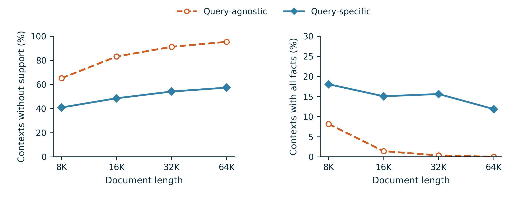
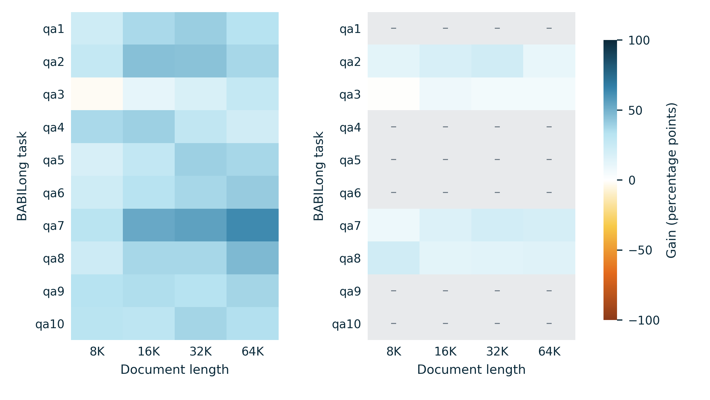
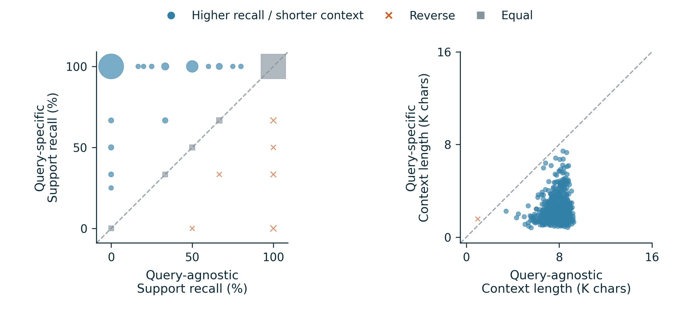
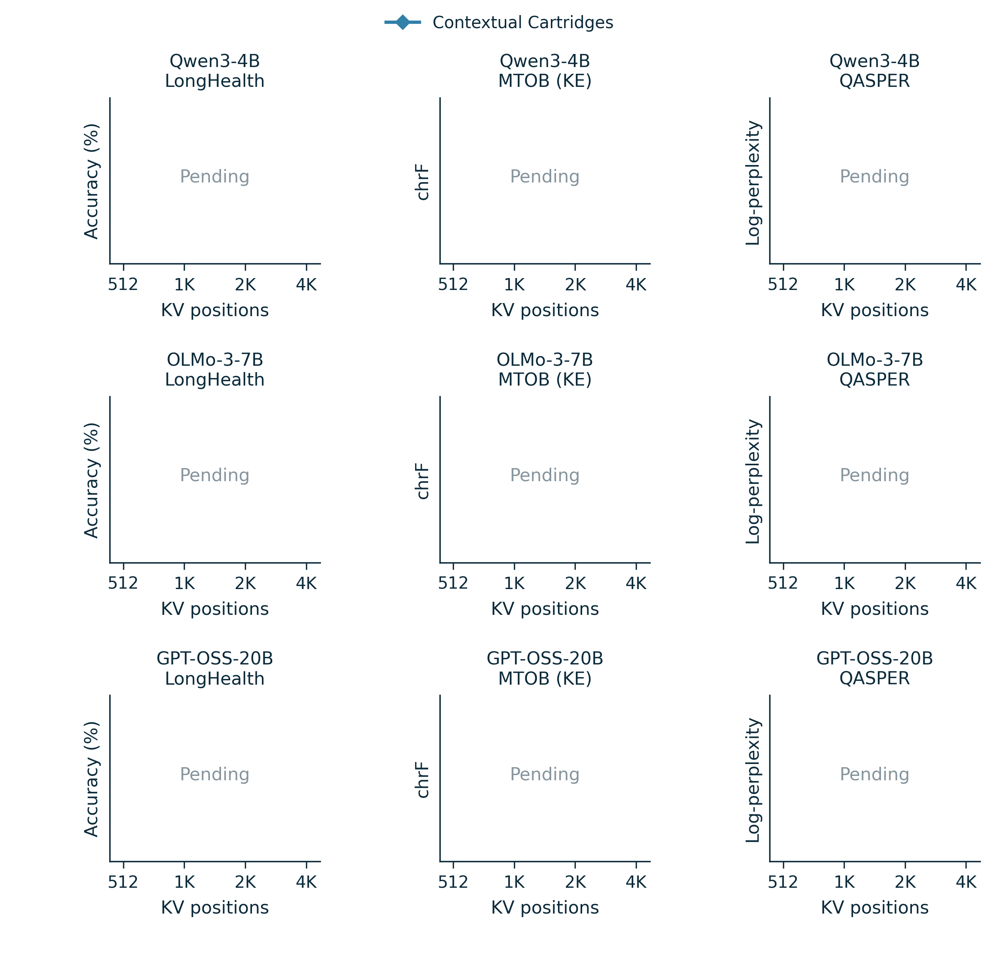

# Contextual Cartridges

**Query-Guided Test-Time Learning with Selective Self-Distillation**

[ACL paper PDF](paper.pdf) · [LaTeX source](paper.tex) · [完整中文方法：是什么、为什么、怎么做](METHOD.zh-CN.md) · [English method source](method.tex) · [BABILong tables](RESULTS.md) · [data and reproduction](REPRODUCE.md)

<!-- reranker-evidence-accuracy -->
## Qwen3-Reranker-0.6B evidence extraction accuracy (12 November 2026)

[**是什么、怎么做、准不准（中文说明与图）**](reranker_evidence/README.md)
audits the label-free evidence extraction against LongHealth `answer_location` and QASPER annotated evidence (labels used only for this audit; MTOB has no evidence labels).
Gold chunk ranked first: LongHealth 62% (lexical 31%, random 10%), QASPER 24% (lexical 14%, random 15%); within top 5: 91% and 86%.
Only 45% / 40% of the 15 query-specific Teacher contexts contain gold evidence, because 32 evidence groups dilute 1–2 gold chunks.

[Figure PDF](reranker_evidence/reranker_evidence_accuracy.pdf) · [Per-request CSV](reranker_evidence/per_request.csv) · [Audit script](reranker_evidence/analyze.py)
<!-- /reranker-evidence-accuracy -->

<!-- jsd-selection-insights -->
## ED-JSD selection diagnostics (12 November 2026)

[**Two square figures: training-pool contours and paired answer transitions**](jsd_selection_insights/README.md)
use the complete saved 32-request BABILong factorial snapshot (7 recorded development, 25 recorded holdout requests), not the current three-dataset experiment.
With query-specific data fixed, JSD-SD retained 390/573 trajectories and produced 2 wrong-to-right changes and 0 right-to-wrong changes (6/32 to 8/32 correct).
All target hashes, training budgets and common warmup losses were checked. Removed trajectories are not necessarily factually wrong; the full rejected-question list and caveats are included.

[Distribution PDF](jsd_selection_insights/jsd_training_distribution.pdf) · [Paired outcomes PDF](jsd_selection_insights/jsd_paired_outcomes.pdf) · [Blocked trajectories CSV](jsd_selection_insights/blocked_trajectories.csv)
<!-- /jsd-selection-insights -->

<!-- synthetic-three-datasets-records -->
## Synthetic question coverage (12 November 2026)

[**LongHealth / MTOB (KE) / QASPER query-term coverage**](synthetic_three_datasets/README.md)
contains one compact square figure for the dilution-related lexical metric, using the unchanged 107 paired requests and 642 exercise exposures per method. Coverage counts questions with at least one shared non-stopword; it does not establish semantic relevance, correctness or SD/JSD benefits. The exact formula, keyword list and fallback sensitivity are provided. The fragmentation panel has been removed.

[Figure PDF](synthetic_three_datasets/synthetic_dilution_coverage.pdf) · [Formula and reproduction](synthetic_three_datasets/README.md#definition-and-formula) · [Earlier synthesis-time violin](synthesis_time/README.md).
<!-- /synthetic-three-datasets-records -->

Contextual Cartridges learns a query-specific native KV memory with two techniques: answer-guided synthetic question construction and entropy-directed JSD (ED-JSD) selective self-distillation: a forward-only gate at half budget over coarsened teacher/student distributions, with a deterministic source-support pre-filter and an exact ordinary-SD fallback when nothing is admitted. The model and attention mechanism remain unchanged. The completed evidence below concerns synthetic source coverage and organization; the downstream accuracy and cache curves remain to be filled.

**Matched synthetic-data comparison.** Qwen3-4B-Instruct-2507; the same 1,000 BABILong document–query pairs; qa1–qa10; 250 requests at each of 8K, 16K, 32K, and 64K. Each method has **26,451 exercises**, matched within request and saved split. Figures are separate PDF/SVG/PNG files, using blue–cyan and yellow–orange, with no bars or confidence intervals.

**Figure 1. Study-source dilution and joint evidence exposure.** Left: fraction of exercise contexts containing none of the real query's annotated supporting facts (lower is better; 1,000 paired requests). Right: fraction co-exposing all supporting facts, restricted to 352 requests with multiple facts (higher is better; 88 per length). Points are equal-weight request means; lines connect only the four measured lengths. The right panel is a co-exposure lower bound, not a test that the generated question requires multiple chunks. Source annotations are used only after generation.

[PDF](figures/figure1_dilution_fragmentation.pdf) · [SVG](figures/figure1_dilution_fragmentation.svg)

**Figure 2. Effects across task and length.** Left: query-agnostic minus query-specific zero-support context fraction. Right: query-specific minus query-agnostic all-fact co-exposure on multi-fact requests. Both use percentage-point gains and the same symmetric color scale; blue is favorable and orange is unfavorable. All 40 task–length cells are retained. Grey with a dash means no eligible multi-fact requests, not a measured zero. The [cell table](data/heatmap_cells.csv) includes denominators and both raw means.

[PDF](figures/figure2_task_length.pdf) · [SVG](figures/figure2_task_length.svg)

**Figure 3. Paired coverage and source footprint.** Left: support-fact recall lower bound for the union of each request's study contexts; 994 paired requests, with six missing query-agnostic annotations excluded only for this metric. Identical coordinate pairs are combined; marker area is 9 + 0.65 × request count in squared points. Right: mean source-context length per exercise in thousands of characters; all 1,000 pairs. The diagonal denotes equality. Blue circles indicate higher recall or shorter context, orange crosses indicate the reverse, and grey squares indicate equality. There is no jitter or fitted curve. Context characters are not latency or GPU memory.

[PDF](figures/figure3_paired_coverage_footprint.pdf) · [SVG](figures/figure3_paired_coverage_footprint.svg)

| Measured property | Paired requests | Query-agnostic | Query-specific |
|---|---:|---:|---:|
| Contexts without query support ↓ | 1,000 | 83.69% | 50.21% |
| Support-fact recall lower bound ↑ | 994 | 50.25% | 95.45% |
| All-fact co-exposure lower bound, multi-fact subset ↑ | 352 | 2.48% | 15.15% |
| Source characters per exercise | 1,000 | 7,894.13 | 2,221.48 |
| Words per exercise question | 1,000 | 58.01 | 15.03 |

These are request-macro means. They support more concentrated and better-covered study materials, while leaving semantic correctness, necessary cross-source reasoning, and downstream answer gains to separate evaluation. Shorter contexts alone do not establish faster end-to-end generation. The saved query-agnostic configuration is a data-construction baseline, not a completed reproduction of the original paper's downstream scores.

**Method.** The lightweight selector recalls single or complementary source groups; the generator extracts a useful answer or intermediate conclusion and reverses it into a question. Native KV is then trained with the upstream sparse soft-target SD objective. Selective SD nominates only trajectories with negative leave-one-out gradient alignment at all three checkpoints, and accepts a deletion only after two matched refits improve survivor mean loss while protecting every survivor against both the current fit and the original full-data pilot. Otherwise it retains the trajectory; no accepted deletion returns the exact trained ordinary-SD checkpoint. These guards constrain synthetic SD losses, not factual truth or a guarantee against correct-to-wrong answers. [Full formulation](METHOD.zh-CN.md).

**BABILong results to fill.** The [overall and length tables](RESULTS.md) reserve the complete 2×2 comparison: query-agnostic/query-specific × ordinary/selective SD, alongside full-context ICL, for Qwen3-4B, OLMo-3-7B, and GPT-OSS-20B. All cells in this paper snapshot are pending. Historical QC or earlier selector configurations are not inserted into these cells.

**Three backbones × three datasets × four cache sizes.** The nine-panel template below reserves 512, 1,024, 2,048, and 4,096 native KV positions for each backbone–dataset combination. No lines or points are invented.

**Figure 4 (pending).** Rows: Qwen3-4B, OLMo-3-7B, GPT-OSS-20B. Columns: LongHealth accuracy (higher is better), MTOB (KE) corpus chrF (higher is better), and QASPER mean gold-answer log-perplexity (lower is better), following the task metrics used in the Cartridges Figure 4 comparison. Cache size is measured in native KV positions, not equal bytes across architectures. Each completed curve must use the same evaluation cases at all capacities. These are publication slots, not a claim that every model is currently scheduled or complete. Published baselines require matching backbone and evaluation protocol; their values are not copied across models.

[Nine-panel PDF](figures/figure4_cache_grid_pending.pdf) · [Qwen3-4B panels](figures/cache_qwen3_4b_pending.pdf) · [OLMo-3-7B panels](figures/cache_olmo3_7b_pending.pdf) · [GPT-OSS-20B panels](figures/cache_gpt_oss_20b_pending.pdf) · [36 pending source rows](data/cache_results.json)

The paper draft uses the [official ACL style](https://acl-org.github.io/ACLPUB/formatting.html) with embedded figure fonts. It is a working draft with incomplete experiments, not a submission-ready claim of improved downstream performance. Figures and integrity checks were prepared with the scientific-visualization workflow; the software reference is recorded in [REPRODUCE.md](REPRODUCE.md).

