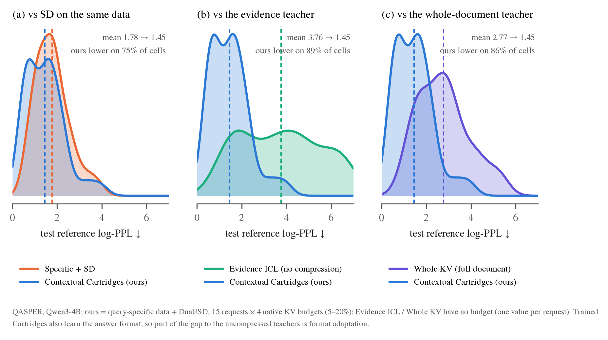
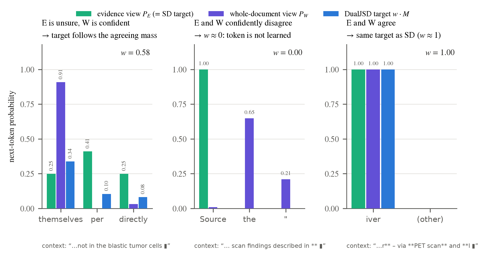
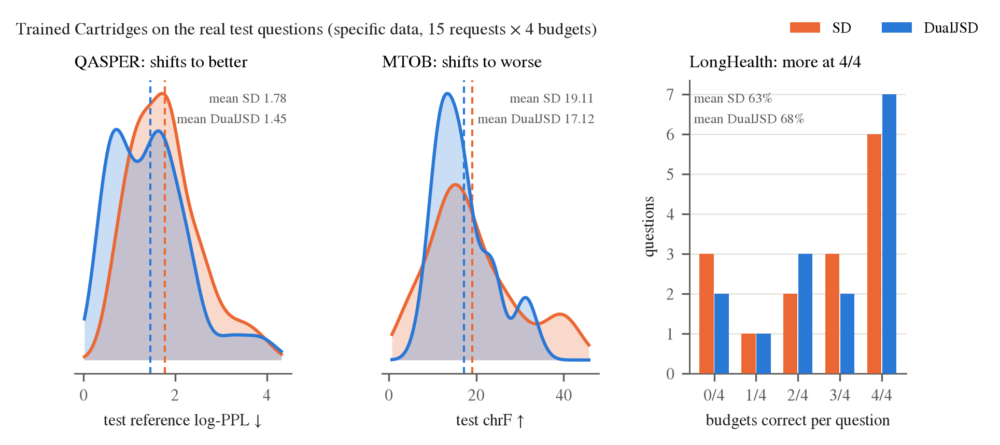
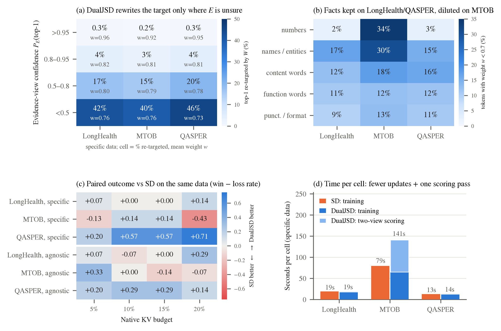

# DualJSD 为什么、怎样比 vanilla SD 好（Qwen3-4B，11/12 配对实验）

## QASPER：和 SD、Evidence ICL（证据 teacher）、Whole KV（全文 teacher）的分布对比

图中蓝色曲线是本文方法 Contextual Cartridges（query-specific 数据 + DualJSD），覆盖 15 个请求 × 4 个预算，共 57 个格子。log-PPL 越低越好。
- **对 SD：** 平均从 1.78 降到 1.45，75% 的格子更低。
- **对 Evidence ICL**（证据放在上下文里，不压缩）：平均从 3.76 降到 1.45，89% 的格子更低。
- **对 Whole KV**（全文放在上下文里，不压缩）：平均从 2.77 降到 1.45，86% 的格子更低。

注意：训练出的 Cartridge 同时也学到了答案格式，所以它和两个不压缩的 teacher 之间的差距里，有一部分来自格式适配，并不全是更好的理解。和 SD 的对比没有这个问题：两边都经过训练，只有 target 不同。

[PDF](fig_qasper_distributions.pdf) · [统计](qasper_stats.json) · [作图](make_fig_qasper.py)

## 角度一：两个视角的分布如何合成一个更好的 target（teacher 侧）

以下三个例子都是真实训练 token。绿色是证据视角的分布 $P_E$，也就是 SD 直接拿来训练的 target；紫色是全文视角的分布 $P_W$；蓝色是 DualJSD 实际训练用的 target $w\cdot M$。

1. **E 拿不准、W 很确定：** E 把概率分散在 "per"、"themselves"、"directly"（0.41、0.25、0.25），W 以 0.91 选 "themselves"。DualJSD 的 target 集中到两个视角都支持的 "themselves"，SD 则会学到 E 那种摇摆的分布。
2. **两个视角确定地互相矛盾：** E 以 1.0 认定下一个词是 "Source"。这是因为只有证据视角看到了 "[Source 0]" 这样的标签，属于伪影；全文视角认为是 "the"（0.65）。这时 $w=0$，这个 token 不学，SD 则会把这个伪影学进去。
3. **两个视角一致：** "Liver" 中的 "iver" 两边都是 1.0，target 和 SD 完全相同。

$P_W$ 是从存储的 target 用 $2M-P_E$ 恢复出来的：在 E 的 top-20 支撑之外，$P_E$ 记为 0。

## 角度二：训练出的 Cartridge 在真实测试题上的分布（student 侧）

同一批 15 个请求 × 4 个预算，只比较训练 target 不同的两种方法：
- **QASPER：** 测试参考答案的 log-PPL 整体左移，平均从 1.78 降到 1.45。
- **LongHealth：** 4 个预算全答对的题从 6 题增加到 7 题，平均准确率从 63% 升到 68%。
- **MTOB：** chrF 分布整体左移，平均从 19.1 降到 17.1。这和下面 (b) 一致：MTOB 的专名和语法细节被稀释了。

[两个视角的图 PDF](fig_dualjsd_two_views.pdf) · [测试分布图 PDF](fig_dualjsd_outcome_dist.pdf) · [例子数据](examples.json) · [作图脚本](make_fig4.py)

## 附：定量热力图与时间成本

[PDF](fig_dualjsd_insights.pdf) · [SVG](fig_dualjsd_insights.svg) · [统计](insights_stats.json) · [作图](make_fig.py) · 数据：[token 级](tokens.py)、[cell 级](collect.py)、[时间](collect_time.py)

数据来自同一批请求的配对实验：DualJSD 与 SD 使用相同的轨迹、初始化、种子和训练配置，唯一的区别是训练 target。
共 342 个配对 cell（3 个数据集 × 2 种数据来源 × 4 个预算 × 每格 14–15 个请求），以及 87.8 万个答案 token。

**(a) DualJSD 只在证据视角 E 没把握的地方改 target。**
E 的 top-1 概率 > 0.95 的 token 约占三分之二，这些 token 的权重保持约 0.95，top-1 几乎不变（0.2–0.3%）。
E 的 top-1 概率 < 0.5 时，权重降到约 0.75，40–46% 的 token 被全文视角 W 改了 top-1。
所以 DualJSD 不是均匀地把 target 变软，而是一个由 E 的不确定性控制的纠错。

**(b) 在 LongHealth 和 QASPER 上事实 token 被保留，在 MTOB 上被稀释。**
数字 token 中权重 < 0.7 的只有 2–3%，DualJSD 基本不碰精确事实。
MTOB 上数字和专名（Kalamang 词、语法标注）有 30–34% 被大幅降权，因为全文视角对 E 的局部语法细节没把握（答案平均 log-prob 是 −0.87 对 −0.16）。
这正好对应 MTOB specific 上 DualJSD 变差。

**(c) 配对结果（win − loss 比例）。**
- QASPER specific 在 4 个预算上都是正的（+0.20 到 +0.71）。
- LongHealth 大多打平或小幅为正。
- MTOB specific 在 20% 预算上 −0.43。

每个请求的收益和 E/W 分歧程度之间只有弱正相关（specific：ρ = 0.17–0.44，n = 15，不显著）。因此这里只说"改在哪里、改了什么"，不说"分歧越大收益越大"。

**(d) 时间成本**（同一种 GPU；DualJSD 只改 target，每次更新的计算量和 SD 一样，实测中位数都是约 1.1 秒）：

| | SD 训练 / cell | DualJSD 训练 / cell | 两视角打分 / 请求（分摊到 4 个预算） | 更新次数 SD → DualJSD |
|---|---|---|---|---|
| LongHealth | 18.6 s | 17.7 s | 6.9 s（1.7 s / cell） | 30.6 → 29.0 |
| QASPER | 12.8 s | 12.8 s | 4.8 s（1.2 s / cell） | 30.3 → 30.3 |
| MTOB | 79.4 s | 64.9 s | 304 s（76 s / cell），其中 254 s 是 26 万 token 的全文 prefill | 28.1 → 22.9 |

DualJSD 的 target 更平滑，所以更早触发 training-loss plateau 早停：MTOB specific 96% 的 cell 提前停止，SD 大多跑满 32 步。
在 LongHealth 和 QASPER 上，总耗时和 SD 基本相同（每个 cell 多 1–2 秒）。只有 MTOB 这种超长文档，一次性的全文打分成为主要开销，每个 cell 多约 60 秒。

**注意事项**
- SD 和 DualJSD 原本在不同作业里运行（SD 一半跑在 B200 上），所以训练时间用"更新次数 × 同一 GPU 上实测的每步时间"来比较。
- 每格只有 14–15 个请求，没有做显著性检验。
- 权重 w 由存储的 w·M（保留至少 0.99 的概率质量）恢复，误差小于 1%。
