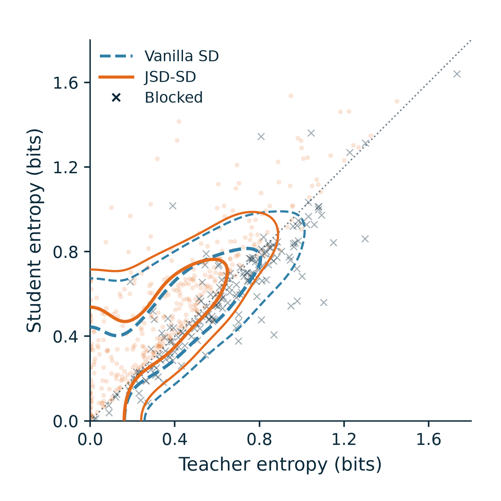
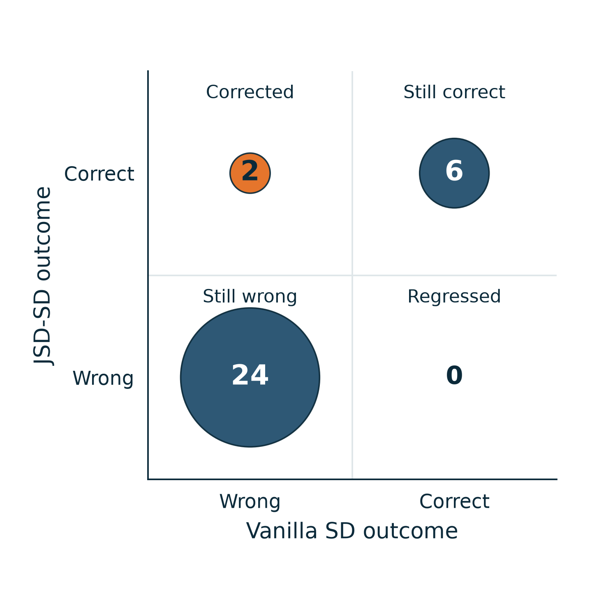

# ED-JSD: what was filtered, and what changed?

两张独立正方形图，使用已保存的 **32 个 BABILong 请求、Qwen3-4B、512-slot KV**。
这是 2026-11-11 已停止实验的完整配对快照，**不是当前三数据集实验，也不是 1,000 请求的完整结果**。
没有重跑模型，没有根据结果选择样本。
原实验将其中 7 个请求标为 development、25 个标为 holdout；图中全部纳入，
不把总体 32 例当成独立、随机抽取的最终测试集。分组结果保留在 summary.json。





## Figure 1 — 筛掉什么

横轴和纵轴分别是同一热身 checkpoint 上、每条完整回答轨迹的 Teacher 与 Student 平均熵，单位 bit。
使用实验实际保存的 **Teacher top-k + rest 合并桶**分布，不称作完整词表熵。
蓝色虚线表示普通 SD 会使用的全部轨迹，橙色实线表示 JSD-SD 留下的轨迹；深蓝叉号逐条标出被屏蔽轨迹。
两组等高线使用相同的核与带宽，分别圈住各自平滑分布的 50% 和 80% 概率质量，**不是置信区间**。
散点不抖动、不删异常值；分布按轨迹等权，不把 573 条练习当成 573 个独立测试请求。

实际门控仍是实验中的 token 聚合公式：

$$
J_i=\frac{1}{|y_i|}\sum_t\operatorname{JSD}_2(p_T^{i,t},p_S^{i,t})
\frac{H_2(p_S^{i,t})-H_2(p_T^{i,t})}{H_2(p_S^{i,t})+H_2(p_T^{i,t})+10^{-12}},
\qquad m_i=\mathbf 1[J_i>0].
$$

**对角线只是“两个平均熵相等”，不是门控分界线。** 由于门控先在 token 上做 JSD 加权再平均，
63/573 条轨迹的保留决定与“直接比较两个平均熵”不同；图上全部保留这些反例。
这也说明不能用一条平均熵对角线替代实际代码。

## Figure 2 — 最终答题发生什么变化

横轴是 Vanilla SD 最终回答的对错，纵轴是 JSD-SD 的对错。圆面积按请求数成比例；0 不画圆。
使用相同 32 个请求、同一套 query-specific 题目、同一 Teacher target SHA256、相同 KV 初始化和训练更新数。
逐步核对了全部 32 对热身损失，最大允许偏差为 $10^{-5}$；所有配对均通过。
横纵轴不是模型置信度，也不是合成练习题的正确性标签。

| 数据 | 请求数 | 轨迹数 | JSD 屏蔽 | SD 正确 | JSD-SD 正确 | 错→对 | 对→错 |
|---|---:|---:|---:|---:|---:|---:|---:|
| Query-agnostic | 32 | 573 | 1 | 7/32 (21.875%) | 7/32 (21.875%) | 0 | 0 |
| Query-specific | 32 | 573 | 183 | 6/32 (18.75%) | 8/32 (25.00%) | 2 | 0 |

Query-specific 下，JSD 对 SD 的观察增益是 **+6.25 个百分点**；query-agnostic 下没有观察到增益。
所有 32 个请求都进入图，没有按门控激活、是否纠错或 Teacher 是否答错筛选。
本次保留集合均非空，因此没有触发“全拒绝后仍继续全量 SD”的回退。
这批实验使用历史的 $J_i>0$ 门控，未使用后来新增的 Teacher 绝对置信度阈值；
不把这些观测作为尚未运行的新配置结果。

[**两个纠错案例：完整问题、门控过程与原始输出**](JSD_CORRECTION_CASES.zh-CN.md) · [两例原始记录 JSON](correction_cases.json)

## 哪些请求、哪些题被屏蔽

全部被屏蔽轨迹见 [blocked_trajectories.csv](blocked_trajectories.csv)，包含请求 ID、练习问题、
原有合成答案、轨迹索引、JSD 分数和双方熵；其中 183 条来自 query-specific，1 条来自 query-agnostic。
该文件的“synthetic_answer”是预先生成的轨迹文本，**不是人为核定的正确标签**。

两条最终纠错请求如下，完整输出保留在 [paired_case_results.csv](paired_case_results.csv)。

| 请求 ID | 最终测试问题 | 参考答案 | SD 输出 | JSD-SD 输出 | 屏蔽轨迹 |
|---|---|---|---|---|---:|
| babilong-32-qa5-300105 | Who did Mary give the apple to? | Fred | 乱码输出（原文见 CSV） | Fred | 1/6 |
| babilong-64-qa6-300147 | Is John in the garden? | yes | $no$ | $yes$ | 10/24 |

这两例代表不同现象：`babilong-32-qa5-300105` 的初始 KV 和保存的全文 Teacher 都答对了 Fred，
普通 SD 最终产生乱码，JSD-SD 保留了正确回答；`babilong-64-qa6-300147` 保存的全文 Teacher、初始 KV
和普通 SD 都输出 no，而 JSD-SD 输出正确的 yes。后者是这组记录中一例“超越保存的全文 Teacher”的观察。
全文 Teacher 输出由当时实验从旧记录复用，不把它包装为本次新跑的 Teacher 对照。

**屏蔽不等于判错。** 例如第一例中被屏蔽的练习题是 “Who received the apple from Mary?”，
其原有合成答案正是 “Fred”；其 $J=-0.069451$、Teacher 平均熵 0.7011 bit、Student 0.4689 bit。
该轨迹虽然被门控拦住，却不能据此称 Teacher 的答案错误。
第二例中也同时屏蔽了声称 John 回到花园的练习，以及把 John 混为无关 John Fleming 的练习。
因此，数据支持“门控改变后半程训练分布，并在这 32 例里带来两次最终纠错”，
**不支持“精确识别所有 Teacher 错误”“逐条删的都是错题”或“零退化保证”**。
没有做逐条轨迹删除的反事实消融，不能把某次纠错归因于单独一条被删题。

## 可复现资料

- [全部轨迹数值 CSV](trajectory_metrics.csv) / [原始门控记录 JSONL](raw_gate_records.jsonl)
- [全部配对最终输出 CSV](paired_case_results.csv) / [配对条件核查](paired_audit.json)
- [分组统计](summary.json) / [图形变换、核带宽与轮廓定义](plot_specification.json)
- [运行配置](run_configuration.json) / [原始文件 SHA256](source_sha256.json)
- [PNG/PDF/SVG 导出核查](export_audit.json) / [绘图脚本](reproduce.py)

```bash
python reproduce.py --output . --render-only
```

渲染只需 NumPy、Matplotlib 和 Pillow，不需要 GPU、模型或原始文档。
CSV 中的参考答案只用于这个离线结果分析，不参与 Teacher、训练、门控或 checkpoint 选择。
未生成的请求不补零、不外推；没有置信区间。默认原生大小为 3.6 × 3.6 inch，PNG 400 dpi，
并提供矢量 PDF/SVG。这是通用论文插图，不声称已通过某出版社格式认证。

## Claim–evidence audit

| Claim | Evidence | Status |
|---|---|---|
| Gate blocks a subset of the query-specific training pool | 183/573 saved decisions have J ≤ 0 | Supported |
| SD/JSD-SD use identical supervision within each pair | Target hashes, packing, update counts, common warmup traces | Supported |
| JSD improves this completed query-specific cohort | 6/32 → 8/32; 2 fixes, 0 regressions | Supported for these 32 requests |
| Removed trajectories are all wrong | Blocked answer “Fred” is a counterexample | Not supported |
| These figures establish a gain on three other datasets or all 1,000 requests | Those paired results are absent | Not supported |

Review: contribution is stated as observed selection behavior; the count rather than contour appearance supports
the performance claim; all completed cases and both data distributions are reported; missing work is not a zero;
confidence and correctness are separated. These checks do not establish generalization or calibration.

## Software acknowledgement

Figure preparation used Scientific Agent Skills. Kassis, T., Agarwal, V., He, Y., Patel, D., & Brueckner, A. M.
(2026). *Scientific Agent Skills: A Library of Procedural Knowledge for Research Agents*.
[arXiv:2609.00065](https://doi.org/10.48550/arXiv.2609.00065), current record checked 2026-11-12.
