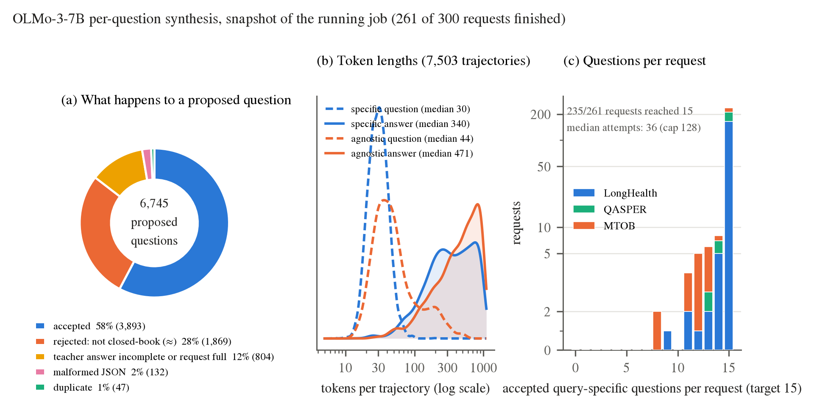

# OLMo-3-7B 逐题合成统计（快照，2026-11-13）

本图是运行中作业的快照：300 个请求中已有 261 个结束合成。

- **(a) 候选问题的去向：** 共生成 6,745 道候选题，其中 58% 被接受。28% 被闭卷过滤器拒绝（问题泄露了答案）；这一项是按相同规则重新计算的，但没有使用原来的引文检查，因此是近似值。12% 是 teacher 答案没写完，或该请求已经凑满 15 道。JSON 格式错误占 2%，重复占 1%。
- **(b) Token 长度（7,503 条轨迹）：** query-specific 问题中位数 30 token、答案中位数 340 token；agnostic 问题中位数 44 token、答案中位数 471 token。agnostic 答案有相当一部分写到了 1024 token 的生成上限。
- **(c) 每个请求被接受的问题数：** 235/261 个请求达到 15 道。LongHealth 和 QASPER 平均都是 14.9 道，MTOB 平均 13.9 道，最低 8 道。凑满的请求中位用了 36 次尝试，MTOB 中位要 70 次（上限 128 次）。没凑满的请求会在下一个作业中把上限提到 256 次继续补，已接受的问题保留。

OLMo 默认会对原提示返回空答案，所以这里使用 OLMo 专用的提示 `nonempty_v2`；Qwen 不受影响。

[PDF](olmo_synthesis_stats.pdf) · [数据快照](snapshot.json) · [收集脚本](collect.py) · [作图脚本](plot.py)
