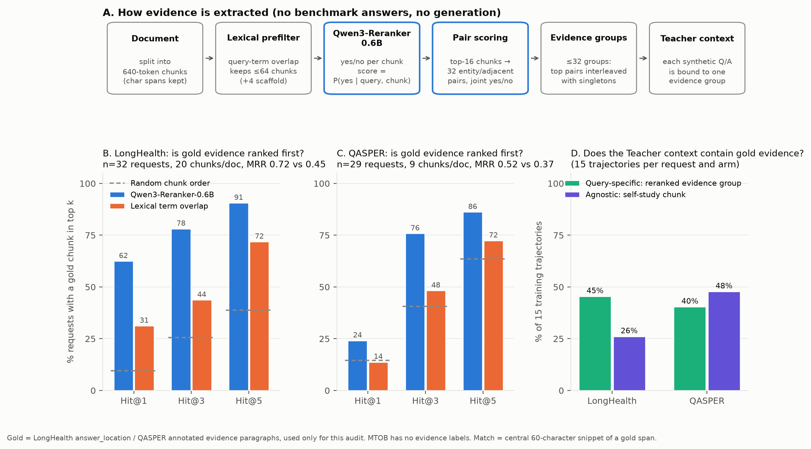

# 基于 Qwen3-Reranker-0.6B 的 evidence chunk 提取：是什么、怎么做、准不准

[PDF](reranker_evidence_accuracy.pdf) · [SVG](reranker_evidence_accuracy.svg) · [逐请求结果 CSV](per_request.csv) · [汇总 JSON](summary.json) · [评测脚本](analyze.py) · [作图脚本](plot.py)

## 是什么

Query-specific 合成数据需要先为每个基准问题从长文档里找出"相关证据"，Teacher 再只看这段证据来回答合成问题。证据提取完全不用标准答案、也不调用生成模型：它只用官方 **Qwen3-Reranker-0.6B**（revision `e61197e`）对"问题–文档片段"打一个是/否相关分数。

## 怎么做（图 A）

1. **切块**：整篇文档按 Qwen 分词切成 640-token 的 chunk，保留原文字符位置。
2. **词汇预筛**：按问题关键词的出现次数保留至多 64 个 chunk，并固定加入首、1/3、2/3、尾 4 个"骨架" chunk，避免纯词汇检索。LongHealth（约 20 块）和 QASPER（约 9 块）的文档本来就不超过 64 块，所以这一步对它们不删任何内容；只对 MTOB 语法书（约 760 块）有实际作用。
3. **单块打分**：reranker 读取 `<Instruct> + <Query> + <Document>`，分数 = softmax([logit_no, logit_yes]) 中 yes 的概率。
4. **成对打分**：取分数最高的 16 块，按"共享实体 / 相邻"提出 32 个组合，用"两段是否互补地共同回答问题"的指令再做一次联合打分。
5. **组成证据组**：最多 32 组，把最高分的成对证据与单块证据交替排列。
6. **绑定 Teacher**：每条合成问答绑定其中一个证据组，Teacher 只在这段证据上作答。

## 准不准（图 B–D）

只能在有人工证据标注的数据集上测：LongHealth 的 `answer_location` 和 QASPER 的标注证据段落。MTOB 没有证据标注，**未评测**。标注只用于这次审计，从未进入提取管线。若某个金标准片段的中心 60 字符（空白归一化后）出现在 chunk 中，就算该 chunk 命中。

| 指标 | LongHealth (n=32) | QASPER (n=29) |
|---|---|---|
| 每篇文档 chunk 数 | 20 | 9 |
| Hit@1 reranker / 词汇 / 随机 | **62%** / 31% / 10% | **24%** / 14% / 15% |
| Hit@3 reranker / 词汇 / 随机 | **78%** / 44% / 26% | **76%** / 48% / 41% |
| Hit@5 reranker / 词汇 / 随机 | **91%** / 72% / 39% | **86%** / 72% / 63% |
| MRR reranker / 词汇 | **0.72** / 0.45 | **0.52** / 0.37 |
| 金标准 chunk 的平均分 / 其它 chunk | 0.80 / 0.24 | 0.75 / 0.45 |
| 第一个证据组含金标准 | 75% | 45% |
| 32 个证据组中含金标准的比例 | 27% | 28% |
| query-specific 训练轨迹的上下文含金标准 | **45%** | 40% |
| agnostic 训练轨迹的上下文含金标准 | 26% | **48%** |

**结论**

- **排序明显有效**：两个数据集上，reranker 在每个 k 都高于词汇匹配和随机。LongHealth 上它有 62% 的概率把金标准排在第一，词汇只有 31%。
- **QASPER 的第一名不准**：Hit@1 只有 24%，和随机（15%）差不多；要到前 3 名才有 76%。原因是 QASPER 论文只有约 9 块，相关内容分散在多处。
- **最终用于训练的证据被稀释了**：32 个证据组里只有约 27% 含金标准，因为组数（32）远多于含金标准的块数（约 1–2）。15 条 query-specific 轨迹中，上下文含金标准的只有 45%（LongHealth）和 40%（QASPER）。
- **QASPER 上 agnostic 甚至更高**（48% 对 40%）：agnostic 的 self-study chunk 较大，在只有约 9 块的短论文里，随便取一块覆盖到证据的概率本来就高。
- **改进方向**：证据组太多会稀释。只用前 3–5 个证据组（Hit@3–5 已经达到 76–91%）来绑定合成问题，应该能显著提高"Teacher 确实看到相关证据"的比例。这一点尚未实验验证。

**注意**：n 较小，只覆盖已完成合成的请求，而且是列表中靠前的请求，不是随机抽样。"命中"只表示原文位置重叠，不代表证据充分或答案正确。排除的请求（LongHealth 4 个、QASPER 6 个）是金标准片段无法在文档中定位的，例如 QASPER 中只指向表格或图的证据。
