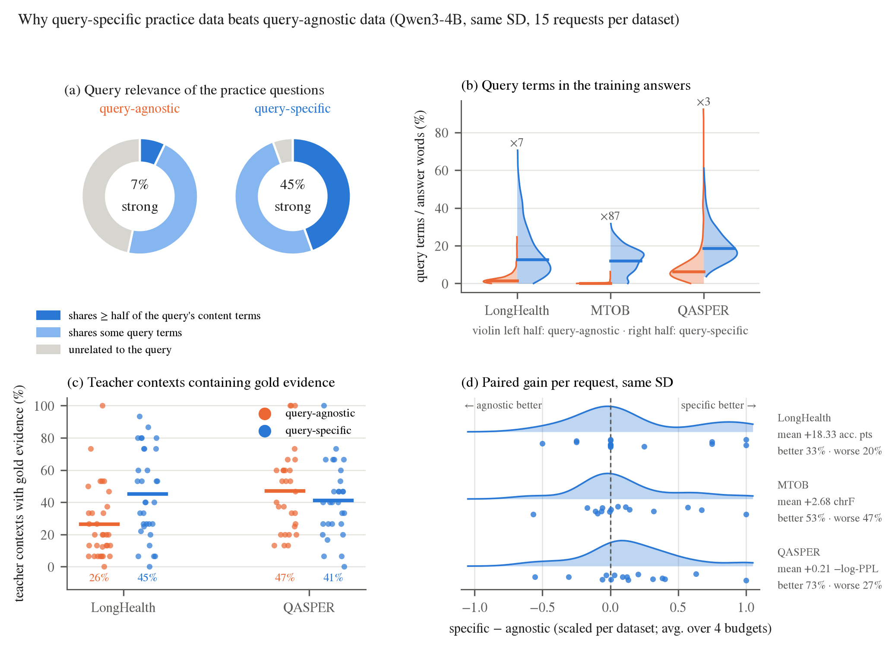

# Query-specific 数据为什么、怎样优于 query-agnostic 数据（Qwen3-4B，同一 SD）

两种数据使用相同的 SD 训练、初始化和训练配置，唯一的区别是合成数据。每个数据集 15 个请求，每个请求每种数据 15 道练习题。

- **(a) 练什么。** 用测试问题的实词（去掉停用词）衡量练习题和问题的相关程度。
  - query-specific：45% 的练习题覆盖测试问题一半以上的实词，只有 6% 与问题无关。
  - query-agnostic：只有 7% 达到这个程度，47% 与问题完全无关。
  - 结论：agnostic 数据有近一半的训练预算花在与测试问题无关的内容上。
- **(b) 训练 token 用在哪里。** 统计 teacher 答案中属于测试问题实词的比例。query-specific 是 agnostic 的 7 倍（LongHealth，16.8% 对 2.3%）、87 倍（MTOB，11.6% 对 0.13%）、3 倍（QASPER，20.7% 对 8.2%）。另外，specific 答案更短（约 100 词对 200 词），内容更集中。
- **(c) teacher 能否看到 gold 证据。**
  - LongHealth：query-specific 的 teacher 上下文中有 45% 含 gold 证据，agnostic 只有 26%。
  - QASPER：论文较短，两者接近（41% 对 47%）。
  - 所以在 QASPER 上，specific 的优势主要来自问题本身更相关，而不是更常看到 gold 证据。
- **(d) 结果。** 同一请求的配对比较（4 个预算取平均）：
  - QASPER：73% 的请求 specific 更好，平均 log-PPL 低 0.21。
  - LongHealth：平均高 18.3 个准确率点（更好 33%，更差 20%，其余持平）。
  - MTOB：平均高 2.7 chrF（更好 53%，更差 47%）。

注意事项：没有做显著性检验。练习题的相关度是基于词汇重叠计算的。gold 证据的标注只在审计时使用，没有参与数据生成。

[PDF](specific_vs_agnostic.pdf) · [统计](stats.json) · [数据收集](collect.py) · [作图](plot.py) · [每题数据](questions.csv) · [配对结果](outcome.csv)
