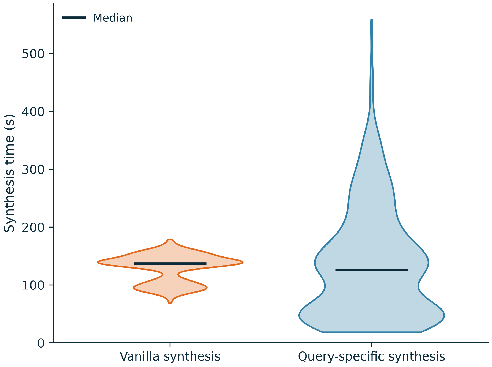

# Synthetic data generation time

The two violins compare historical Qwen3-4B BABILong runs, not the current LongHealth/MTOB/QASPER jobs.
Each observation is the measured time to construct the synthetic dataset for one request. It is not TTFT.

The figure contains 635 matched requests with identical generated train and validation
question counts (20,272 QA pairs per method). All 1,000 records and
their exclusion reasons are preserved in `synthesis_time_per_request.csv`. Eligibility never uses timing
advantages, benchmark answers, or model accuracy. Sixteen query-specific records include checkpoint
replay and are excluded from the primary comparison. Other exclusions reflect unequal generated counts.

| Method | Mean (s) | Median (s) | P90 (s) |
|---|---:|---:|---:|
| Vanilla synthesis | 129.47 | 137.09 | 155.37 |
| Query-specific synthesis | 136.08 | 126.02 | 275.69 |

Query-specific synthesis is faster on 348/635 matched requests.
Its median is lower, but its mean and P90 are higher. These observations do not establish uniform speed superiority.

[PDF](synthesis_time_violin.pdf) · [SVG](synthesis_time_violin.svg) · [Raw timing CSV](synthesis_time_per_request.csv) · [Summary JSON](synthesis_time_summary.json)

Timing includes shared-backend waiting. Concurrency differed (Vanilla 32 versus query-specific 16 cases
per worker), hardware was not held fixed, and the query-specific run reused prior Decision API evidence
selection. Those historical API calls are not included. These are observational run-time distributions,
not a controlled same-hardware speed benchmark. Do not sum per-request durations to infer campaign wall
time: concurrent requests overlap. No runtime changes or GPU submissions were made for this analysis.

Each violin uses all eligible durations, with Scott KDE bounded by the observed minimum and maximum.
Width encodes density, not sample count. The dark horizontal line is the sample median. The original
long tail remains visible. Individual dots, bars, and confidence intervals are not displayed. CSV, JSON,
PDF, PNG, SVG and the reproducible analysis script accompany the figure. General research style;
no ACL compliance certification.

Software: the scientific-visualization skill informed figure integrity and provenance checks.
Timothy Kassis, Vinayak Agarwal, Yuhuan He, Darshil Patel, and Aubrey M. Brueckner (2026),
[Scientific Agent Skills: A Library of Procedural Knowledge for Research Agents](https://doi.org/10.48550/arXiv.2609.00065).

Reproduce the figure from the published CSV with `python replot.py` (Python 3.11+, NumPy, Matplotlib; versions recorded in the summary JSON). The full source-record analysis is in `plot_synthesis_time_distribution.py`.
