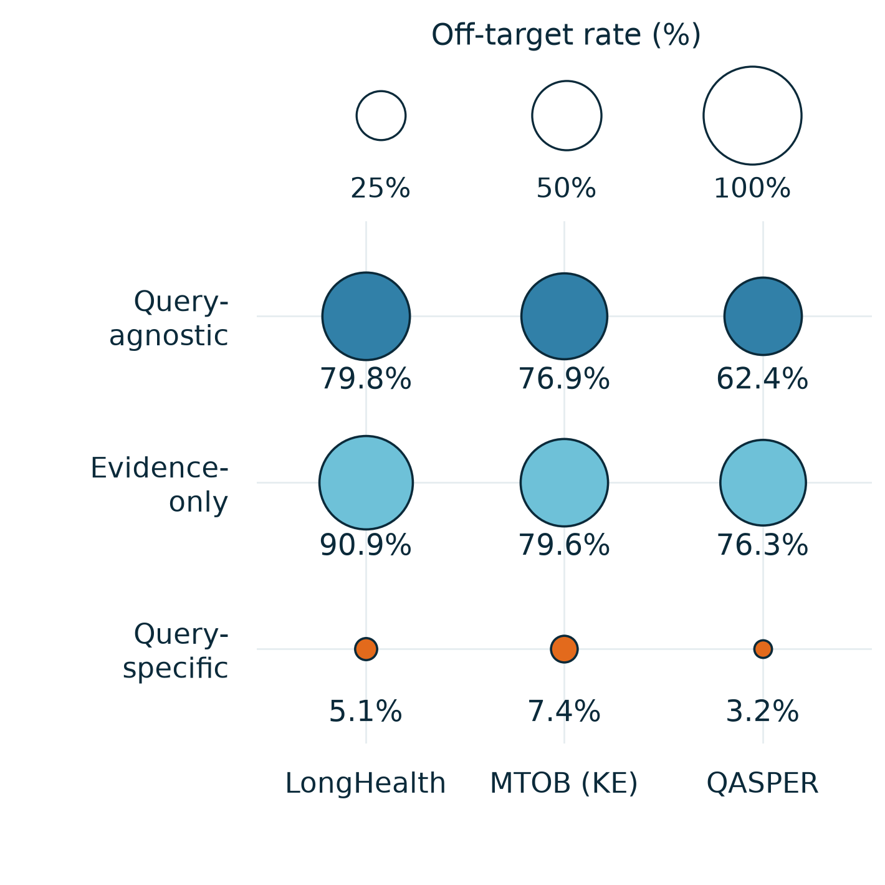

# Three-way synthetic-question comparison

Two separate square figures, each **90.2 × 90.2 mm**. The comparison uses the **same 100 complete requests** and existing saved questions; no new synthetic generation or GPU experiment was run for these figures.

## 1. Query-term coverage: lexical dilution proxy


[PDF](synthetic_dilution_coverage.pdf) · [SVG](synthetic_dilution_coverage.svg) · [CSV](coverage_table.csv)

**Caption.** Query-term coverage on LongHealth, MTOB (KE), and QASPER, using the first 15 saved exercises per method and request. Higher coverage means less dilution under this lexical proxy; it is not a semantic relevance or accuracy score.

## 2. Off-target questions



[PDF](synthetic_off_target_bubbles.pdf) · [SVG](synthetic_off_target_bubbles.svg) · [CSV](off_target_table.csv)

**Caption.** Off-target rate for three fixed sampled question positions per request and method. Each of the **nine data circles** represents one dataset–method pair; circle **area**, not radius, is proportional to off-target percentage. Smaller is better. These are assistant annotations, not an independent human evaluation; unclear items remain in the denominator and are listed below.

## Matched data and methods

The source contains 107 requests. All three methods have at least 15 saved questions on **100 common requests: 33 LongHealth, 36 MTOB (KE), and 31 QASPER**. The seven incomplete requests are excluded from all three arms. Inclusion depends only on availability, not on either plotted metric.

- **Query-agnostic:** document-conditioned questions without the real query in generation.
- **Evidence-only:** questions generated directly from retrieved evidence; retrieval uses the real query, but the question-generation prompt does not explicitly include the query or an extracted pseudo-answer.
- **Query-specific:** query-conditioned pseudo-answer extraction followed by question construction.

The coverage figure uses **1,500 exercise exposures per method** (4,500 total), with equal question budgets. Agnostic questions can be reused across requests sharing a document; these counts are exposures, not necessarily distinct text. The off-target figure uses **300 reviewed questions per method**, drawn at the same three question indices per request across all arms. Existing evidence-only and query-specific labels were retained unchanged; 300 agnostic annotations were added.

## Definitions

Let the retained word set be

$$W(x)=\operatorname{set}\!\left(\operatorname{regex}_{\backslash w+}(\operatorname{casefold}(x))\right)\setminus\mathcal W_{\mathrm{stop}}.$$

The fixed stopword list and exact tokenizer are in [metric_specification.json](metric_specification.json). No stemming, synonym expansion, answer text, or model judgment enters coverage. For real query $q_r$ and saved exercise $s_{ri}$,

$$c_{ri}=\mathbf 1[W(q_r)\cap W(s_{ri})\ne\varnothing],\qquad
\operatorname{Coverage}_d=\frac{100}{|R_d|}\sum_{r\in R_d}\frac{1}{15}\sum_{i=1}^{15}c_{ri}.$$

$$\operatorname{Dilution}^{\mathrm{lex}}_d=100-\operatorname{Coverage}_d.$$

The lexical rule is unchanged from the previous figure in this folder, but the cohort and question budget are updated. Saved questions are used verbatim, without replacing a missing question by the original query.

For the second figure, each reviewed exercise receives one label: **D** (directly asks the target), **P** (a specific identifiable prerequisite), **O** (off-target), or **U** (unclear). Shared patient, paper, or topic alone is insufficient for D/P. With $n_d$ reviewed exercises per method,

$$\operatorname{OffTarget}_d=100\frac{n_{O,d}}{n_d},\qquad
\operatorname{Unclear}_d=100\frac{n_{U,d}}{n_d}.$$

Unclear items are **not** automatically treated as off-target. All item-level decisions and rationales are available in [reviewed_items.jsonl.gz](reviewed_items.jsonl.gz), with the [annotation protocol](annotation_protocol.json).

## Measured values

### Query-term coverage (%) ↑

| Dataset | Requests | Questions / method | Query-agnostic | Evidence-only | Query-specific |
|---|---:|---:|---:|---:|---:|
| LongHealth | 33 | 495 | 74.14 | 64.85 | 98.59 |
| MTOB (KE) | 36 | 540 | 2.22 | 6.48 | 86.48 |
| QASPER | 31 | 465 | 90.32 | 89.03 | 99.35 |
| Overall | 100 | 1500 | 53.27 | 51.33 | 94.47 |

### Annotated off-target rate (%) ↓

Each cell reports **O / reviewed count (rate)**.

| Dataset | Query-agnostic | Evidence-only | Query-specific |
|---|---:|---:|---:|
| LongHealth | 79 / 99 (79.80%) | 90 / 99 (90.91%) | 5 / 99 (5.05%) |
| MTOB (KE) | 83 / 108 (76.85%) | 86 / 108 (79.63%) | 8 / 108 (7.41%) |
| QASPER | 58 / 93 (62.37%) | 71 / 93 (76.34%) | 3 / 93 (3.23%) |
| Overall | 220 / 300 (73.33%) | 247 / 300 (82.33%) | 16 / 300 (5.33%) |

### Unclear annotations (count / reviewed count)

| Dataset | Query-agnostic | Evidence-only | Query-specific |
|---|---:|---:|---:|
| LongHealth | 12 / 99 | 1 / 99 | 1 / 99 |
| MTOB (KE) | 19 / 108 | 12 / 108 | 7 / 108 |
| QASPER | 16 / 93 | 11 / 93 | 3 / 93 |
| Overall | 47 / 300 | 24 / 300 | 11 / 300 |

## Interpretation and limits

Query-specific questions have higher lexical coverage and lower annotated off-target rates in all three datasets in this matched cohort. The two plots measure different properties: matching even one paper-title or patient-name word passes the coverage rule, whereas the off-target annotation requires an identifiable contribution to the actual query. High coverage alone therefore does not establish useful supervision.

- Useful paraphrases can fail lexical coverage, and irrelevant questions can pass it. MTOB's Kalamang queries versus English practice questions make language mismatch especially important.
- The relevance review was performed by an assistant without independent human validation. Original evidence-only/specific review omitted explicit method labels, although style could reveal them; the agnostic extension was not blinded. MTOB's official English reference translation was used only to interpret the query during this offline audit, not for generation or training.
- Some saved data reuse earlier generation configurations. Evidence-only versus query-specific changes both explicit query conditioning and the pseudo-answer stage; this comparison does not isolate the causal contribution of either alone.
- These plots do not measure factual correctness, answer leakage, necessary multi-hop reasoning, fragmentation, or downstream accuracy. No claim that those properties are established follows from these two metrics.

## Reproduce

```bash
python reproduce.py --verify-only
python reproduce.py --output reproduced
```

The first command checks all 4,500 saved question records and all 900 review entries using only the Python standard library, including paired request membership and annotation indices. The second additionally requires Matplotlib and Pillow and exports **exactly two square figures**, each as PNG, PDF, and SVG. There are no confidence intervals, fitted curves, smoothing, or extrapolated outcomes.

[Question records](records.jsonl.gz) · [Review records](reviewed_items.jsonl.gz) · [Request-level values](per_request.csv) · [Summary](summary.json) · [Source hashes](source_sha256.json) · [Artifact hashes](artifact_manifest.json) · [Export metadata](figure_metadata.json)

Full working artifacts are stored in the general project directory:
`/nfs/roberts/project/pi_mg269/shared/da839/Query_Cart/analysis/synthetic_threeway_figures_20261112`.

The former 107-request, 642-exposure two-arm figure remains recoverable in Git history; its values should not be compared to the current ones without accounting for the updated cohort and question budget. Historical `source_analysis.py` is retained for provenance; `reproduce.py` is the entry point for these two figures.

## Software acknowledgment

Figure preparation used the scientific-visualization workflow from Kassis, T., Agarwal, V., He, Y., Patel, D., and Brueckner, A. M. (2026), *Scientific Agent Skills: A Library of Procedural Knowledge for Research Agents*, [arXiv:2609.00065](https://doi.org/10.48550/arXiv.2609.00065). This is a software-workflow reference, not evidence for the experimental conclusions.
