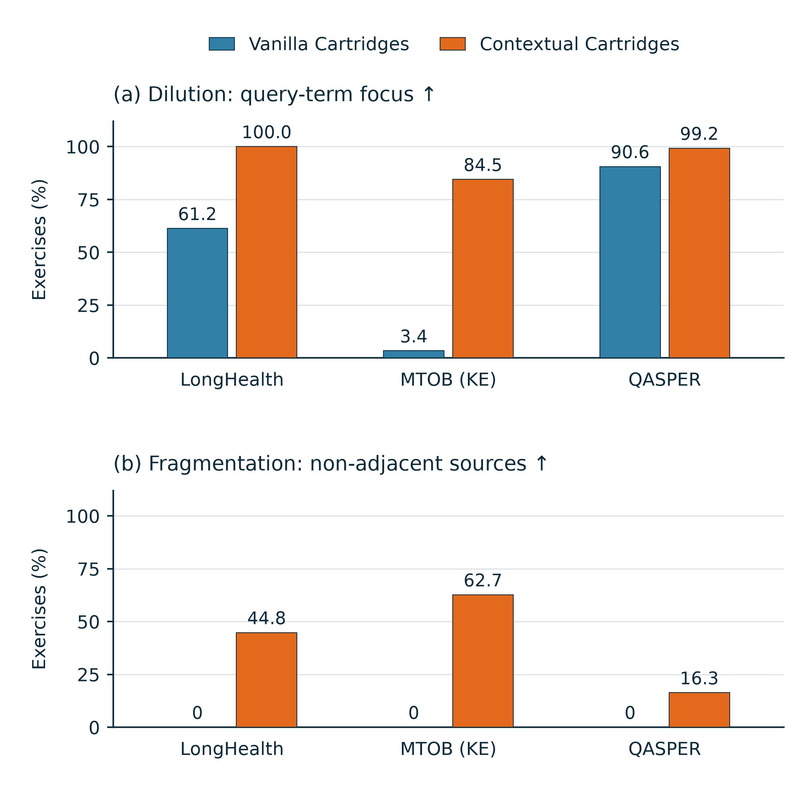

# Synthetic-record diagnostics across three datasets

**This figure describes the saved synthetic data, not model accuracy.** Query-specific records show more query-word overlap and more co-presentation of separated source regions in this cohort. These observations do not establish that dilution or fragmentation has been solved semantically.



[PDF](synthetic_dilution_fragmentation.pdf) · [SVG](synthetic_dilution_fragmentation.svg) · [Table CSV](table.csv) · [Request-level CSV](per_request.csv) · [Record JSONL (gzip)](records.jsonl.gz) · [Reproduction script](reproduce.py)

## Cohort and matching

Qwen3-4B-Instruct-2507; **107 fixed document–query requests**, across **9 source documents**. LongHealth contributes 36 requests from 2 patients, MTOB (Kalamang→English) contributes 36 translations from one grammar book, and QASPER contributes 35 requests from 6 papers. This is a saved experiment cohort, not a random sample or the full benchmarks. Cases share source documents and are not independent replications.

For request r, use all N_r saved query-specific exercises and the first N_r saved query-agnostic exercises, exactly matching the current training inputs. The four cache capacities reuse these records and are counted only once. No examples are selected based on accuracy, SD loss, or these plotting metrics. All 107 request pairs are retained. No model calls, new synthetic generation, GPU submissions, or changes to running jobs are performed.

The 642 observations per method are **exercise exposures across requests**, not 642 distinct generated questions. Vanilla reuses document-level records: there are 100 distinct source records among its 642 exposures. There are 642 distinct saved query-specific records, including repeated fallback queries and potentially similar questions; distinct records are not necessarily distinct text.

## Exact metric definitions

Let W(x) be the set of Unicode word tokens from `x.casefold()` after removing the fixed stopwords in [metric_specification.json](metric_specification.json). There is no stemming, synonym expansion, or model-based judgment.

**(a) Query-term focus ↑ (dilution proxy).** For an exercise question s and the real query q:

$$F(s,q)=\mathbf{1}[W(s)\cap W(q)\ne\varnothing].$$

Only the question is inspected. Its answer, source text, and benchmark answer are not included. For a saved query fallback, task instructions and multiple-choice options are stripped by using the stored real query. Such a fallback necessarily passes this lexical test, so fallback sensitivity is reported separately.

**(b) Non-adjacent source exposure ↑ (fragmentation structure).** Map each exercise’s attached context to original-document character intervals, merge overlaps and touching intervals, and count whether at least two disjoint intervals remain. Source text was checked verbatim against the original document during collection. A contiguous window spanning multiple sentences or semantic sections still counts as one interval. No inferred semantic chunk boundaries are introduced.

**Aggregation.** For metric f and dataset d, report:

$$100\,|R_d|^{-1}\sum_{r\in R_d}N_r^{-1}\sum_{i=1}^{N_r} f_{r,i}.$$

This is an equal-request macro mean; it is not a pooled per-question percentage. All bars start at zero and use the same percentage scale. No intervals, smoothing, significance tests, or population-level claims are attached to these descriptive means.

## Measured values

| Dataset | Requests | Exposures / method | Vanilla focus ↑ | Contextual focus ↑ | Vanilla separated sources ↑ | Contextual separated sources ↑ |
|---|---:|---:|---:|---:|---:|---:|
| LongHealth | 36 | 169 | 61.24% | 100.00% | 0.00% | 44.79% |
| MTOB (KE) | 36 | 164 | 3.39% | 84.49% | 0.00% | 62.66% |
| QASPER | 35 | 309 | 90.57% | 99.24% | 0.00% | 16.33% |

## Fallback sensitivity

Query-specific generation produced no accepted new exercises for 13/36 LongHealth, 7/36 MTOB, and 2/35 QASPER requests. Their already-saved original-query fallbacks remain in the primary figure because they were part of the actual inputs. Removing the same 22 requests from **both** methods gives:

| Dataset | Paired requests | Vanilla focus ↑ | Contextual focus ↑ | Vanilla separated sources ↑ | Contextual separated sources ↑ |
|---|---:|---:|---:|---:|---:|
| LongHealth | 23 | 65.42% | 100.00% | 0.00% | 47.28% |
| MTOB (KE) | 29 | 4.21% | 80.74% | 0.00% | 67.44% |
| QASPER | 33 | 90.00% | 99.20% | 0.00% | 16.56% |

## Interpretation and limitations

- **Lexical overlap is not usefulness.** Shared names, titles, or common topic words can pass the focus test. A paraphrase with no shared words can fail it. This limitation is especially important for Kalamang queries paired with English exercise questions. Compare methods within each dataset, not absolute focus values across datasets as if they measured the same semantic difficulty.
- **Vanilla’s structural zero is by construction.** Every saved Vanilla context here is one contiguous original-text window. Zero disjoint intervals is not zero evidence coverage, zero cross-section reasoning, or a claim about every official Cartridges configuration.
- **Bundling sources is not verified multi-hop learning.** Two separated excerpts can be redundant or irrelevant; one contiguous excerpt can already support multi-step reasoning. The graph does not verify necessity, correctness, or completeness of the attached evidence.
- **Budget matching is limited to exercise counts.** It does not match source tokens, answer tokens, generation compute, or document-level amortization. Speed is not measured here.
- **Method names label the data origin.** No SD or JSD effect is estimated. This figure cannot support claims of improved downstream accuracy or escape from an oracle trap.

The [earlier synthesis-time violin](../synthesis_time/README.md) concerns 635 historical matched BABILong requests. These cohorts and metrics are different and must not be combined into a single quality–speed result.

## Reproduce and inspect

Python 3.11+ is sufficient to verify numerical values using only the standard library:

```bash
python reproduce.py --verify-only
```

To redraw the same square, two-panel figure, install Matplotlib and Pillow and run:

```bash
python reproduce.py --output reproduced
```

The script recomputes word intersections and interval counts from every portable record, verifies matching, recomputes request means and fallback sensitivity, and checks against the published `summary.json`. Output directories must be new; existing artifacts are not silently overwritten. Package versions and SHA256 hashes are in [manifest.json](manifest.json). The figure is a general manuscript graphic, not an ACL-format compliance certification.

The compressed JSONL contains synthetic question text, matched query terms, original-document intervals, document hashes, and fallback flags. It does not include benchmark gold answers or full source documents. Full source-text identity checks therefore require the original benchmark documents and saved synthetic JSONs listed by hash; the standalone script verifies the published record-level computations, not factual truth. [source_analysis.py](source_analysis.py) preserves the original collector for the research checkout.

## Manuscript-ready caption

Synthetic-record diagnostics for the query-agnostic and query-specific datasets used by Vanilla and Contextual Cartridges. Each group contains a left blue Vanilla bar and a right orange Contextual bar. Panel (a) measures query-term focus, a lexical proxy related to dilution; panel (b) measures non-adjacent source exposure, a structural diagnostic related to fragmentation. Bars are unweighted means of within-request proportions over 36 LongHealth, 36 MTOB (KE), and 35 QASPER requests, with matched exercise counts per request (642 exposures per method in total). Existing query fallbacks are retained; an analysis excluding their 22 paired requests is reported below. The Vanilla zeros in panel (b) result from the contiguous-window construction of these saved records. Neither metric establishes evidence correctness, useful multi-hop supervision, or downstream accuracy. No confidence intervals or SD outcomes are shown.

## Software acknowledgement

Figure preparation followed the scientific-visualization workflow; the description was reviewed with the research-paper-writing claim–evidence checklist. Timothy Kassis, Vinayak Agarwal, Yuhuan He, Darshil Patel, and Aubrey M. Brueckner (2026), [Scientific Agent Skills: A Library of Procedural Knowledge for Research Agents](https://doi.org/10.48550/arXiv.2609.00065). The arXiv record was checked on 2026-11-12 (v2).

[Claim–evidence audit](AUDIT.md)
