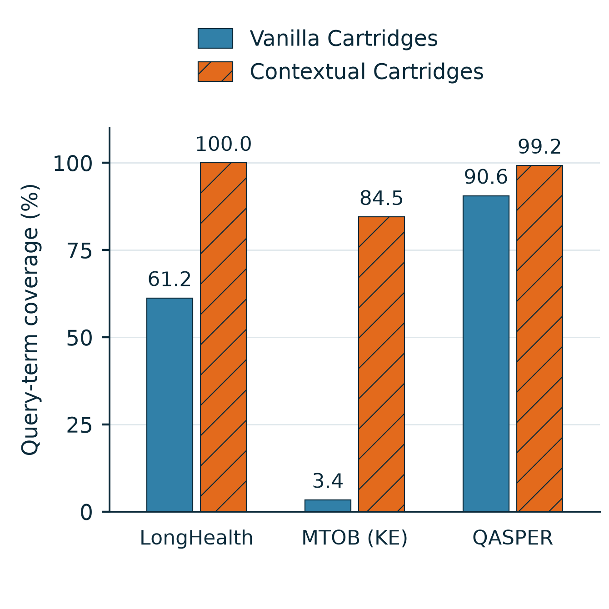

# Query-term coverage of synthetic questions

[PDF](synthetic_dilution_coverage.pdf) · [SVG](synthetic_dilution_coverage.svg) · [CSV](table.csv) · [Records](records.jsonl.gz) · [Reproduce](reproduce.py)

One compact **85.1 × 85.1 mm** figure. The original measurements are unchanged; only the dilution-related coverage panel is shown. This is the existing 107-request cohort, **not** the newly requested 30-exercise-per-request dataset.

## Definition and formula

For text $x$, define its keyword set using Unicode case folding, regex `\w+`, a fixed stopword list, and deduplication:

$$W(x)=\operatorname{set}\big(\operatorname{regex}_{\backslash w+}(\operatorname{casefold}(x))\big)\setminus\mathcal{W}_{\mathrm{stop}}.$$

The complete stopword list is in [metric_specification.json](metric_specification.json). No stemming, synonym expansion, or model judgment is used. The real query and synthetic question are processed identically; answers and source passages do not enter this metric.

For request $r$, let $q_r$ be the real query, $s_{ri}$ its $i$-th exercise, and $N_r$ its matched exercise count. An exercise is counted as covered if it shares **at least one** retained word with the query:

$$c_{ri}=\mathbf{1}\!\left[W(s_{ri})\cap W(q_r)\ne\varnothing\right].$$

For dataset $d$ containing requests $R_d$, the plotted coverage is:

$$\boxed{\operatorname{Coverage}_d=\frac{100}{|R_d|}\sum_{r\in R_d}\frac{1}{N_r}\sum_{i=1}^{N_r}c_{ri}.}$$

The corresponding **lexical dilution proxy** is the fraction without query-word overlap:

$$\operatorname{Dilution}^{\mathrm{lex}}_d=100-\operatorname{Coverage}_d.$$

Higher coverage means lower dilution **under this lexical definition**. Each request receives equal weight; this is not a pooled percentage over all exercises. All queries in this cohort have a nonempty keyword set.

**Limitation:** sharing only a person name or a broad topic word passes the test, while a useful synonym-based paraphrase can fail. Coverage therefore does not establish semantic relevance, factual correctness, useful supervision, or downstream accuracy. In particular, Kalamang queries and English exercises can have low overlap despite relevance.

## Measured coverage

| Dataset | Requests | Exercise exposures / method | Vanilla | Contextual |
|---|---:|---:|---:|---:|
| LongHealth | 36 | 169 | 61.24% | 100.00% |
| MTOB (KE) | 36 | 164 | 3.39% | 84.49% |
| QASPER | 35 | 309 | 90.57% | 99.24% |

The 107 requests share 9 documents. Counts are exercise exposures, not unique generated text: Vanilla reuses document-level records. Within each request we compare all saved specific exercises with the same number of saved agnostic exercises. All cache sizes reuse these records and are counted once. No outcomes or coverage scores were used to choose records.

## Original-query fallback sensitivity

The primary figure retains the 22 requests whose saved specific dataset fell back to the original query (13 LongHealth, 7 MTOB, 2 QASPER). A copied query necessarily passes this metric. Removing those same requests from both methods gives:

| Dataset | Paired requests remaining | Vanilla | Contextual |
|---|---:|---:|---:|
| LongHealth | 23 | 65.42% | 100.00% |
| MTOB (KE) | 29 | 4.21% | 80.74% |
| QASPER | 33 | 90.00% | 99.20% |

## Reproduce and inspect

`python reproduce.py --verify-only` recomputes every stored record diagnostic using only the Python standard library. `python reproduce.py --output reproduced` additionally draws this single figure with Matplotlib and Pillow. The JSONL, request CSV and summary retain their original fields for audit; fragmentation is not displayed. `source_analysis.py` is the historical collection script; `reproduce.py` is the current portable plotting entry point.

No new GPU experiment or generation was used to create this figure. Historical data and earlier synthesis-time violin figures remain separate. The figure has a zero baseline, fixed percentage scale, value labels and redundant left/right position and hatching; no confidence intervals, smoothing, or significance claims.

## Software acknowledgment

Figure preparation used the scientific-visualization workflow from Kassis, T., Agarwal, V., He, Y., Patel, D., and Brueckner, A. M. (2026), *Scientific Agent Skills: A Library of Procedural Knowledge for Research Agents*, [arXiv:2609.00065](https://doi.org/10.48550/arXiv.2609.00065). This is a workflow reference, not evidence for the experiment's conclusions.
